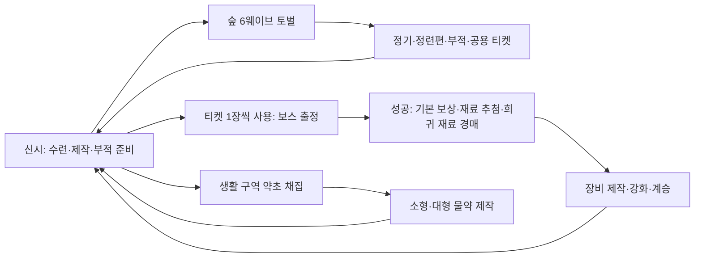

# 신시 시스템 개요

> 구현 상태(2026-10-08): 검사·마검사·궁수의 서버 전투·부적·백엔드 계약을 추가했고, 기존 직업과 함께 총 24기술·90효과를 유지한다. 아래 초기 설계의 미착수·미적용 표기보다 [세 직업 구현과 검증](05-implementation-roadmap.md#2026-10-08-세-직업-구현과-검증)을 우선한다. 신규 직업 기본 개방·실제 전투 연결·재생·다인 플레이 완료를 뜻하지 않는다.

> 기준일: 2026-10-07 · 버전: 1.1 · 설계 기준안
> 세부 규칙은 [게임 기획서](02-game-design.md), 기술 계약은 [기술설계서](03-technical-design.md)를 따른다.

직업 개편은 [캐릭터·애니메이션 개편](design/character-animation-design.md)이 기준이다. 사용자 확정은 검사·마검사·궁수(2026-10-08 세 번째 직업 확정)이며 P09 외형을 유지한다. 일반 기술 12개·부적 효과 45개(보조 30/핵심 15)의 기술·수치·특성·클립은 위임 초기안으로 미구현·미검증이다. 궁수 상세는 [궁수 설계](design/archer-design.md)를 단일 기준으로 삼는다. [기존 직업 설계 보존본](design/legacy-class-design.md)의 코드·데이터를 새 기획 적용 완료로 취급하지 않는다.

## 1. 프로젝트 정의

**신시**는 고조선 건국 신화의 초창기를 배경으로, 신시에서 준비한 토벌대가 산귀의 공세를 막고 월백의 결계에 도전하는 PC 쿼터뷰 협동 액션 RPG다. 마을에서는 성장·제작·생활·파티 준비를 하고, 전투는 1~4인 인스턴스로 진행한다.

| 항목 | 설계 |
|---|---|
| 플랫폼·입력 | Windows PC, 키보드·마우스, 클릭 이동·커서 방향 공격 |
| 전투 | 직접 기본 공격, 고정 일반 기술 4개, 무적 없는 이동 회피 |
| 직업 | 검사·마검사·궁수, 캐릭터별 고정, 파티 내 중복 허용 |
| 일반 토벌 | 6웨이브·180마리, 평균 5~6분, 무한 부활, 제한 7분(420초) 초과 시 실패 |
| 보스 | 10~15분 목표, 입장권 소모, 개인 보상과 파티 경매 |
| 성장 | 레벨·경험치 없이 정기 수련·장비·스킬 부적 |
| 미술 | 3D 스타일화, 부적·달빛·수묵 인상, 전투 가독성 우선 |
| 네트워크 | Mirror 데디케이티드 서버. 공유 마을 + 파티별 전용 전투 서버; 클라이언트는 요청과 표현 |
| 현재 상태 | Unity 6000.4.7f1·URP·Mirror 96.11.3 기반 전투·네트워크·GameDB와 ASP.NET Core·PostgreSQL 백엔드 기반은 존재. 현행 런타임은 무사/도술사/신령사 12기술·45효과이며 새 직업 코드·카탈로그·데이터 이관은 미착수. 실제 구현/실행 증거는 [로드맵](05-implementation-roadmap.md) |

## 2. 경험의 중심

| 원칙 | 플레이어 경험 | 설계에서 지킬 것 |
|---|---|---|
| 짧은 반복에 남는 성장 | 일반전 한 판으로 정기·강화 재료·부적·티켓 확보 | 일반전에 완성 장비 드롭을 추가하지 않는다 |
| 출정 전 선택의 의미 | 같은 기술도 부적으로 역할과 운용이 달라짐 | 부적 구성 변경은 신시에서만 가능 |
| 위치를 읽는 액션 | 이동·공격 예고·공격 방향이 생존을 좌우함 | 회피에 무적을 넣지 않고 예고와 실제 범위를 맞춤. 검사에게 전방 완전 방어·반격을 기본 부여하지 않음 |
| 혼자서도 가능한 협동 | 같은 직업 네 명도 출정 가능, 파티는 부담을 나눔 | 필수 탱커·힐러·특정 직업 기믹을 두지 않음 |
| 모호한 신화의 책임 | 단군의 약속과 월백의 침공을 플레이어가 판단 | 단군의 숨은 의도를 결말에서 정답으로 공개하지 않음 |

## 3. 세계관과 서사 범위

신시는 여러 인간 세대 동안 이어진 공동체이지만 인간의 나라는 아직 완성되지 않았다. 인간을 위협하는 산귀가 토벌 대상이며, 비적대 산귀는 대화·조사 조력자로 만난다.

여우 월백은 인간이 되겠다는 약속을 기다리며 신시에서 인간을 가르쳤다. 약속이 미뤄지자 산귀에게 자립을 가르치고, 이후 인정받을 땅과 힘을 확보한다며 인간 영역 침공을 정당화한다. 배후 목소리의 이간과 월백 자신의 선택·책임을 함께 남긴다. 단군이 처음부터 뜻이 없었다는 목소리의 주장은 사실로 확정하지 않는다.

월백의 첫 처치는 실제 죽음이다. 반복 보스전은 이야기 시간을 되돌리지 않는 게임플레이로 다루며, 부활·분신 설정을 새로 붙이지 않는다. 월백의 죽음 뒤에도 가르침과 산귀의 문제는 남는다.

| 구분 | 내용 |
|---|---|
| 정식 진행 | 숲 → 인간 마을 폐허 → 오래된 제단 → 월백 결계 |
| 보스 순서 | 첫 보스 철각(작업명) → 두 번째 보스 월백 |
| 결계 | 여우의 흔적으로 영구 해금, 이후 공용 티켓으로 반복 출정 |
| 체험판 | 숲 전장과 월백 이지를 먼저 시험; 정식 이야기 해금과 분리 |
| 입력 대기 | 월백 2페이즈의 실제 패턴안 |

## 4. 코어 루프

일반전 실패·중도 포기는 확보한 전리품 중 추가 정기만 50% 잃는다. 보스 기본 보상은 처치 성공 때만 지급하고, 사용한 티켓은 일반 실패 때 돌려주지 않는다. 서비스 장애 보정은 서버가 검증한 별도 경로로 처리한다.

## 5. 시스템 연결

| 시스템 | 입력 | 출력·연결 | 판정 주체 |
|---|---|---|---|
| 일반 토벌 | 준비한 빌드·물약·고정 인원 | 정기·정련편·개인 부적·개인 티켓 | 게임 서버, 지급은 백엔드 |
| 보스 | 전원 해금·티켓·물약 | 확정 기본 보상·개인 재료·파티 경매 | 게임 서버 + 백엔드 원자적 정산 |
| 부적 | 산귀 부적·정기 | 확률 등록, 중복으로 확정 강화, 기술 변형 | 신시 서버 규칙 판정 + 백엔드 원자 저장, 전투 서버 적용 |
| 장비 | 보스 재료·정련편·정기 | 6부위 제작·최대 25강·별도 계승 | 신시 서버 규칙 판정 + 백엔드 원자 저장 |
| 정기 수련 | 캐릭터 정기 | 공격·생명·방어·치명·기력 배분 | 신시 서버 규칙 판정 + 백엔드 원자 저장 |
| 생활·물약 | 계정 행동력·공용 약초 노드 | 계정 재료·물약, 출정 지참 | 마을 서버 + 백엔드 |
| 공유 마을·파티 | 접속·방 생성·초대 | 출정 인원 고정·서버 이동·재접속 | 백엔드 + 게임 서버 |
| 운영 도구 | 운영자 요청·이벤트 설정 | 지급·회수·공지·점검·기능 차단·제재·장애 복구, 경제 원장·감사 로그 | 백엔드 어드민 경로; [운영 도구](design/operations-admin.md) |
| 런처·패치 | 초대 코드·서명된 배포 파일 | 로그인·설치·업데이트·버전 차단·게임 세션 전달 | 런처 + 백엔드; [런처·패치](design/launcher-and-patch.md) |
| 이후 유저 경매장 | 거래 허용 물품·엽전 | 생활 재료·물약·거래 가능한 일반 등급 +0 장비·미등록 부적 거래 | 백엔드; 체험판 이후 |

확률 결과는 [기술설계서](03-technical-design.md) 4.1절처럼 권한 있는 서버가 정하고 API가 비용 차감과 함께 한 번 저장한다. 계정 공유는 이야기·해금·엽전·티켓·제작 재료·미등록 부적·물약·생활 행동력이다. 수련·장비·정기·정련편·등록한 부적의 성장과 구성은 캐릭터별이다. 전체 소유권·거래 조건은 02의 상세 표를 따른다.

## 6. 체험판과 후속 범위

| 범위 | 이번 외부 체험판 | 후속 |
|---|---|---|
| 직업·기술 | 검사·마검사·궁수 3직업·일반 12기술, 근접/원거리 기본 공격·회피 설계 | 세 직업 구현·저장 이관 뒤 검증; 구신령사 강림은 재사용 보류 |
| 부적 | 45효과(보조30/핵심15), 등록·Lv5 성장·3단계 조합의 위임 초기안 | 추가 효과·등급별 콘텐츠 |
| 전장 | 숲 1개·6웨이브·4종 적 역할 | 폐허·제단 |
| 보스 | 월백 이지 1종; 2페이즈 입력 통합 필요 | 철각 이지·하드, 월백 하드 |
| 성장 | 수련·6부위·강화·영웅 제작·계승·파티 경매 | 전체 등급 획득 순서 |
| 생활 | 약초 채집·소형/대형 물약 제작 | 생활 확장·유저 경매장 |
| 온라인 | 공유 신시·친구 초대·공개 방·1~4인·기존 참가자 재접속 | 규모 확장·운영 고도화 |
| 서사 | 프롤로그 약 90초·초반 안내·주요 대사 기록 | 월백 첫 조우·첫 처치 장면, 정식 이야기 해금 |
| 외부 품질 | 조작 설명·게임플레이 그래픽·정산 안전성·배포/복귀 안내 | 장기 서비스·상용화 정책 |
| 운영·배포 | 경제 원장·감사 로그. 최소 어드민과 런처의 포함 범위는 미정(사용자 결정) | 일괄 지급·이벤트·제재·쿠폰, 런처 확장·코드 서명 |

체험판에서는 희귀 6부위 +17과 계정 최초 소형·대형 물약 각 9개를 제공해 월백의 영웅 제작·계승을 시험한다. 이 지원을 정식 획득 경로로 일반화하지 않는다. 문서 작성만으로 외부 배포 가능 상태가 되는 것은 아니다.

## 7. 팀과 통합 책임

| 담당 | 사용자 지정 범위 | 통합 시 경계 |
|---|---|---|
| 진욱 | UI·성장·맵 | 화면은 서버 결과를 표시하고 성장은 요청 계약을 사용; DB 직접 수정 금지 |
| 기웅 | 보스·몬스터·프롤로그·컷신 | AI·패턴 판정은 서버 경로에서 실행; 애니메이션과 예고는 확정 이벤트 표현 |
| 민성 | 나머지 전체 | 플레이어·직업·전투 공통·네트워크·백엔드·DB·빌드·통합 |

월백 2페이즈 설계는 이 표 밖의 담당자가 제공하는 입력으로 기록되어 있으며 제공자와 수령 기한은 미정이다. 통합은 기웅이 맡는다. 공용 코드와 네트워크·서버 코드의 소유 경계는 [서버·클라이언트 협업](unity/SERVER_CLIENT_WORKFLOW.md)을 따른다. 담당별 브랜치를 사용하며, 통합 씬을 동시에 편집하지 않는다. 상세 작업은 [구현 로드맵](05-implementation-roadmap.md)에 안정적인 작업 ID로 관리한다.

## 8. 목표 일정과 품질 기준

사용자 조건은 3인·2주·외부 체험판이다. 2026-10-01 문서 기준 달력 목표는 2026-10-15이며 구현 가능성 검증이나 납기 보장이 아니다. 기반 코드/API/DB가 존재해도 통합·다인 실행과 궁수 구현과 새 직업 이관이 남아 범위 대비 일정 위험이 크다. 2026-10-07~08 직업 개편에 따른 공수와 목표일은 재산정하지 않았다.

먼저 전용 서버 입장 → 1개 전투 판정 → 정산 → 저장 후 재접속을 연결해 통합 위험을 확인한다. 병행 제작은 이 계약에 맞춰 진행한다. 일정이 밀리면 세 직업·협동·경매 등을 임의로 삭제하지 않고 병목과 선택지를 사용자에게 제시한다. 점검 시점·착수 순서·선택지 형식은 [구현 로드맵](05-implementation-roadmap.md) 4장을 따른다.

| 품질 축 | 목표·완료 조건 |
|---|---|
| 플레이 | 일반 5~6분, 보스 10~15분 목표를 실제 세션으로 확인 |
| 성능 | 1080p 평균 60fps·프레임 시간 P95 25ms 이하·메모리 최대 4GB 목표, 서버 틱은 별도 측정; 기준 PC 미정 |
| 경제 | 중복 요청·재접속·타임아웃에도 음수 재화·중복 지급·중복 티켓 차감 없음 |
| 협동 | 1/2/4인 전용 서버, 직업 중복, 사망·전멸·재접속 검증 |
| 체험 | 8명·20회·90분 체험 계획과 재접속 10회 검증; 실제 수행 수는 별도 기록 |
| 서사·시각 | 월백 2페이즈 통합, 조작 설명, 공격 예고와 실제 범위 일치, 사용 자산 권리 확인 |

## 9. 출처와 적용 경계

게임 내용은 사용자가 제공한 세계관·월백 1페이즈 가중치 문서·재련 단계 이미지 및 누적 결정, 그리고 적정치 설정을 위임한 후 정리한 초기 밸런스를 반영한다. 재련 이미지에서는 강화 단계만 사용하고 아이템 레벨은 도입하지 않는다. 17·18강 계승은 이미지에 없는 보간 초기안이다.

기술 방향은 이 저장소의 실제 패키지와 네트워크·코딩 문서에서 확인했다. 개인 작업 로그는 팀 문서의 필독 근거가 아니다.
