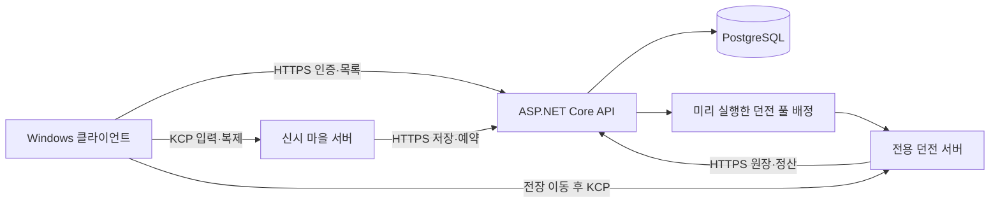

# 신시 기술 설계서

> 구현 상태(2026-10-08): 검사·마검사·궁수의 서버 전투·부적·백엔드 계약을 추가했고, 기존 직업과 함께 총 24기술·90효과를 유지한다. 세부 구현·과거 자동 시험과 남은 검증은 [세 직업 구현과 검증](05-implementation-roadmap.md#2026-10-08-세-직업-구현과-검증)을 따른다. 신규 직업 기본 개방·실제 전투 연결·재생·다인 플레이 완료를 뜻하지 않는다.

> 문서 버전 1.2 · 2026-10-11 · 현재 작업 트리 정적 대조, 기획과 실행 이력 구분.
> 게임 규칙은 [기획서](02-game-design.md), 모듈·타입·데이터 배치는 [아키텍처](04-architecture.md)를 따른다. 현재 소스와 후속 설계를 절별로 구분한다. 초기 M-A의 780/396건은 과거 기록이며 날짜·범위별 후속 결과는 [로드맵](05-implementation-roadmap.md)의 실행 증거를 따른다. 이번 문서 갱신은 정적 대조다. 서버 빌드·M2/M3·IL2CPP·실제 배포는 실행 미검증이다.

2026-10-07~08 직업 개편 계획을 반영했다. 사용자 확정은 검사·마검사·궁수 3직업이며 [캐릭터·애니메이션 개편](design/character-animation-design.md)의 12기술/45효과(보조30/핵심15)는 위임 초기안이다. 궁수 상세는 [궁수 설계](design/archer-design.md)가 단일 기준이다. 런타임은 구 직업 ID 0/1/2·12기술·45부적과 신규 ID 3/4/5·12기술·45부적을 함께 보존한다. 신령사 공명/강림은 [기존 직업 설계 보존본](design/legacy-class-design.md)의 구구현이다. 마이그레이션 0016은 직업 제약을 0~5로 넓히지만 구 진도 변환을 수행하지 않는다. 이번 문서 갱신은 코드·프로토콜·DB 실행이나 이관을 하지 않았다.

### 2026-10-11 경험치 구현과 지점 웨이브 연결 대기

현행 기획은 [전투 부록](design/combat-design.md)의 전멸 후 지점 활성화·접속한 생존자 한 명 도착 시 다음 웨이브 시작과 [레벨 기준안](design/character-level-growth.md)의 경험치/전투 중 레벨업을 포함한다. 지점 웨이브의 실제 진행기는 연결 대기다. 경험치는 SQL0017의 캐릭터 누계·초기값·세션/순번과 추가 전용 `character_experience_events`, `EXPERIENCE_GRANTED`(8) 사건으로 구현했다. 기존 정기 정산에서 재지급하지 않는다.

클라이언트가 처치·경험치·레벨·지점 도착을 최종 확정하지 않는다. 서버가 예정 출현/잔여 적 0, 지점 활성 상태와 생존 참가자의 권위 위치를 확인하고 단일 웨이브 전이를 승인해야 한다. 경험치는 서버가 자격과 source를 정하고 API가 세션→계정→캐릭터 잠금 안에서 원장·누계·순번·사건을 함께 저장한다. 큐의 유효 ACK 이후 다음 서버 틱에 누계·레벨 능력치를 반영한다. 재접속은 같은 행에서 읽은 최신 누계/순번으로 지연 ACK의 중복 합산을 막는다. 예약 시 경험치 설정을 세션에 고정하고 시작·입장 때 콘텐츠/hash를 대조한다. `CharacterLevelConfigSO`가 비용·상한·지역 지급량의 기준이고 현재 콘텐츠는 0.1.2, 성장 JSON schema는 2, Mirror 프로토콜은 5다. 비용곡선 변경은 별도 기존 진도 이관 정책이 필요하다. 새 기능의 검증 범위는 [로드맵](05-implementation-roadmap.md)에 기록한다.

## 1. 목적과 적용 범위

PC 쿼터뷰 협동 액션 RPG의 신시 공유 마을, 1~4인 일반전·보스전, 캐릭터 성장과 계정 경제를 일관된 서버 권위로 연결한다. 첫 체험판의 최종 목표는 세 직업·숲 1전장·월백 이지·생활 채집/물약 제작·성장·파티 경매다. 현재 직업 구성은 검사·마검사·궁수로 확정했으며 신규 기술·부적의 서버 규칙과 저장 계약은 구현됐다. 구 진도 이관과 실제 다인 전투 수용은 남아 있다. 유저 경매장과 1:1 거래는 체험판에 포함하며 구현됨·M2 미검증이다. 최종 두 보스×이지/하드와 다른 지역은 후속 범위다.

민성은 전투·공통·네트워크·통합, 진욱은 UI·성장·맵, 기웅은 보스·몬스터·프롤로그·컷신을 맡는다. 게임 판정이 서버에서 실행된다는 이유로 모든 판정 구현을 민성에게 넘기지 않는다. 각 파트가 규칙을 구현하고 민성이 서버 진입점·통신·저장 연결을 맡는다.

3인·2주 외부 체험판은 목표이며 구현 완료나 일정 달성을 보장하는 상태가 아니다. 월백 2페이즈는 이지 P01~P07과 하드 서버 실행·데이터가 있다. 확정 설계와의 대조·네트워크 클라이언트 표현·M-Boss는 남았으며, 하드는 표시 수신처 부재로 출정을 차단한다. 서버 구현만으로 다단계 보스 완성을 판정하지 않는다.

### 직업 개편의 적용·이관 경계(2026-10-07~08 계획)

- `KS01`~`KS04`, `MK01`~`MK04`, `AR01`~`AR04` 및 `KS01-1A` 같은 새 부적 표기는 문서용 설계 ID다. 현재 `skill_warrior_*`/`skill_sorcerer_*`/`skill_summoner_*`, `T01-*`~`T12-*`, 직업 ID 0/1/2의 의미를 문서 변경만으로 바꾸지 않는다. 신규 런타임 직업 ID는 3/4/5, 기술은 `skill_swordsman_*`/`skill_mageknight_*`/`skill_archer_*`, 부적은 T13~T24다. 구 진도와의 변환 정책은 별도 확정·검증 대상이다.
- 검사 Q/W/E/R은 넓게 베기·돌진 베기·집중 베기·연환참, 마검사는 마력검격·화염검진·봉인검격·뇌광검파, 궁수는 속사·후퇴사격·관통시위(대표)·산개사격이다. 검사·마검사 기본 공격은 근접이고 궁수는 원거리 사격이다. 궁수 상세 판정·특성·클립은 [궁수 설계](design/archer-design.md)가 단일 기준이다. 전방 방어 성공 반격, 구신령사 소환/공명/Z/X/C는 새 확정 직업에 포함하지 않는다. 애니메이션 클립과 이벤트는 표현만 담당하며 서버 시전 승인·타임라인·실제 범위를 판정 원본으로 유지한다.
- 이관 대상은 캐릭터 직업, 계정 미등록 카드, 등록 레벨·실패 보정, 기술별 선택, 회수함/미정산 보상, 열린 출정의 `loadout_snapshot`과 입장 전투구성이다. 기존 요청의 멱등 결과와 이미 열린 출정의 구콘텐츠를 보존하거나 안전하게 종료할 정책을 먼저 정한다. 기존 카드/진도를 조용히 새 효과로 해석하지 않는다.
- 현재 SQL 부적 ID 형식은 `^T[0-9]{2}-[1-3][A-Z]$`이고 T13~T24도 수용한다. 코드 카탈로그는 구·신규 합계 24기술/90효과이며 백엔드 성장 콘텐츠에도 신규 45효과가 들어 있다. 문서 ID와 런타임 ID 대응, 클라/서버/SO/백엔드 목록 일치와 구 진도 이관은 구분해 검증한다. 신규 직업의 등록·생성·드롭은 직업별 코드·데이터 이관 게이트 통과 전에 활성화하지 않는다. 수량이 구구현과 같아도 ID와 효과 의미의 일치를 검증해야 한다.
- 클라이언트·게임 서버·API의 콘텐츠 버전/`contentHash`를 맞추고 불일치 접속을 거절한다. 해시 일치는 데이터 이관 완료의 증거가 아니며, 복원·롤백·멱등 재시도·M2/M3 결과를 [로드맵의 직업 이관 게이트](05-implementation-roadmap.md#직업-개편-구현이관-검증-게이트2026-10-07)로 따로 수용한다.

### 기준의 출처

| 구분 | 의미 |
|---|---|
| 사용자·팀 확정 | 기획서의 게임 규칙, Unity/Mirror, 데디케이티드 서버, 공유 마을, ASP.NET Core/PostgreSQL, 로컬→AWS 방향 |
| 위임 초기 설계 | 아래 구체 API·상태·재시도·토큰·틱·데이터 계약. 구현·부하 시험에서 조정할 수 있음 |
| 구현 확인 | 파일·패키지가 실제 존재함. 실행 검증 완료를 뜻하지 않음 |
| 외부 입력 대기 | 월백 2페이즈, 배포 계정/주소·실제 시험 장비·자산·가용 시간 |

## 2. 실제 기반과 도입할 기술

2026-10-11 코드·설정 정적 대조 기준이다. `00.Common/Contracts`의 엔진 비의존 DTO, `01.Network`의 Mirror 연결·클라이언트 인증, `02.Combat`의 상태·규칙·표현, `98.Servers`의 서버 인증·백엔드 게이트웨이·던전 세션·전투 처리·마을 서버(`05.Town`: 파티·성장·생활·경매장·1:1 거래 중계)가 구현되어 있다. 백엔드는 `Backend/src/{Shinshi.Api,Shinshi.Contracts,Shinshi.Data}`, 테스트는 `Backend/tests/Shinshi.Backend.Tests`이며 SQL 마이그레이션 0001~0017가 있다(0014 공지 분류, 0015 유저 경매장·1:1 거래, 0016 직업 ID 0~5 제약, 0017 캐릭터 경험치). `deploy/`의 API 컨테이너·systemd 파일, `Assets/Editor/Build/ShinshiBuild.cs`의 빌드 진입점, `tools/`의 M2 실행 보조는 존재하지만 서버 빌드·배포 실행은 미검증이다. AI·보스·성장·생활·경매 등 후속 파트 전체를 구현 완료로 확대하지 않는다.

| 항목 | 현재/계획 | 기준·선택 이유 |
|---|---|---|
| Unity | 설치 6000.4.7f1 | `ProjectSettings/ProjectVersion.txt`. 이번 설계에서 업그레이드하지 않음 |
| URP | 설치 17.4.0 | `Packages/manifest.json`, 3D 스타일화·효과 가독성 |
| 입력 | 구 Input Manager 사용, Active Input Handling = Both | 2026-10-01 사용자 결정. 팀 입력 코드는 `UnityEngine.Input`만 쓴다. Input System 1.19.0 패키지는 설치된 채로 두며 팀 코드에서 참조하지 않는다 |
| Mirror/KCP | 설치 96.11.3 / 동봉 UDP KCP | `Assets/Mirror/version.txt`, `Transports/KCP/`. 프로젝트 연결·인증·서버 처리와 Network 프리팹이 존재한다. 체험판은 동봉 `Transports/Encryption/`을 적용하지 않음(2026-10-01 결정). 실제 다인 연결은 미검증 |
| Cinemachine / Navigation | 설치 3.1.7 / 2.0.12 | 카메라·NavMesh 기반 경로의 기존 도구 사용 |
| Unity Test Framework | 설치 1.6.0 | EditMode 규칙 검사, PlayMode 연결·수명 검사. 테스트 어셈블리 구성은 [아키텍처 2장](04-architecture.md#2-폴더와-소유) |
| DOTween / Dialogue System / TMP | 로컬 설치 확인 | 표현·대화·텍스트에 기존 도구 사용. 서버 판정은 연출 완료 콜백에 의존하지 않음. DOTween·Dialogue System은 유료 에셋이라 `.gitignore`로 Git에서 제외되어 새 클론·빌드 머신에는 별도 설치가 필요하다. TMP 필수 리소스는 `Assets/Plugins/TextMesh Pro/` |
| Timeline / Localization / Visual Scripting | 설치 1.8.12 / 1.5.13 / 1.9.11 | `Packages/manifest.json`에 있으나 사용 계약은 미정(15장). 서버 판정에 사용하지 않음 |
| MCP for Unity | 설치, Git `#main` | 에디터 전용 작업 도구. `packages-lock.json`의 해시로 고정되며 런타임·서버 코드에서 참조하지 않음 |
| API | ASP.NET Core / .NET 10 구현됨 | `Backend/Directory.Build.props`의 `net10.0`, 외부 프로세스 |
| DB | PostgreSQL 18 / Npgsql + Dapper 구현됨 | `Shinshi.Data.csproj`: Npgsql 10.0.3, Dapper 2.1.86. SQL 마이그레이션·경제 트랜잭션·유일 제약 |
| 로컬 DB 운영 | Docker Compose 구현됨 | `Backend/docker-compose.yml`, 실행 방법은 [Backend README](../Backend/README.md). 통합 테스트는 실제 DB 연결 설정이 있을 때만 실행 |
| AWS | EC2 Linux 게임/API + RDS DB, 도입 예정 | 초기 단순 구성 후 실측에 따라 확장 |

API 패키지는 프로젝트 파일에서 버전을 고정한다. .NET 10은 외부 API 런타임 선택이며 Unity 런타임을 .NET 10으로 바꾼다는 뜻이 아니다. Unity와 API는 버전 있는 JSON DTO로 통신하고 `Shinshi.Contracts.csproj`가 `Assets/01.Scripts/00.Common/Contracts/**/*.cs` 원본을 Compile Include/Link로 공유한다. 직렬화 계약은 `DataContract`/`DataMember`와 Newtonsoft.Json이며 Unity 패키지는 `com.unity.nuget.newtonsoft-json` 3.2.1, Backend 패키지는 Newtonsoft.Json 13.0.4다. 버전이 같은 것으로 가정하지 않고 DTO 계약 테스트로 확인한다. 2026-10-01 지원 정책 확인: [.NET 지원 정책](https://dotnet.microsoft.com/en-us/platform/support/policy), [PostgreSQL 버전 정책](https://www.postgresql.org/support/versioning/). 설치 자산의 배포 조건은 [에셋 대장](licenses/ASSET_REGISTRY.md)이 기준이다.

## 3. 실행 구성과 용량

- 마을 목표 10~100명, 공간 기반 관심 영역. 일반전·보스전은 1~4인 파티마다 별도 프로세스다.
- 한 Unity 서버 빌드가 실행 인자로 `town` 또는 `dungeon` 역할을 고른다. 클라이언트와 같은 프로젝트에서 빌드하며 플레이어 호스트는 제공하지 않는다.
- 생활 구역은 마을 서버가 관리하는 별도 공간/영역 ID, 영역당 8명으로 시작한다. 8명 제한은 신시 전체 정원과 다르다. 영역별 약초 노드·관심 영역을 분리한다.
- 100명이 전부 4인 파티면 동시 던전 25개, 전부 솔로면 100개가 필요하다. **25개는 무조건적인 최대 요구량이 아니다.** 초기 풀 수 `DUNGEON_POOL_SIZE`는 측정한 프로세스 메모리·CPU와 호스팅 자원으로 정한다.
- 현재 예약 API는 풀 부족 시 `NO_CAPACITY`로 거절하며 티켓·물약을 예약하거나 소비하지 않는다. 영속 대기열은 구현하지 않았다. 유휴 던전은 `registered_at, instance_id` 순서와 `SKIP LOCKED`로 고른다. 출정 순서 대기열은 후속 계획이며 실제 API 동작으로 표시하지 않는다.
- 동일 계정은 활성 캐릭터/게임 세션 하나만 허용한다. 살아 있는 계정 접속 임대가 있으면 새 연결을 `ALREADY_CONNECTED`로 거절하고 “이미 접속 중인 계정”으로 안내한다(2026-10-01 결정). 진행 중 출정은 동일 참가자의 재접속 경로로 처리한다.
- 던전 프로세스는 출정 하나를 맡고 정산·예약 해제 뒤 `Draining`으로 전환해 종료한다. systemd가 새 `bootId`로 재기동하며 끝난 프로세스를 같은 boot로 `Idle`에 되돌려 재배정하지 않는다. [운영 설명](../deploy/gameserver/README.md)의 파일은 구현됨·실행 미검증이다.
- Redis·다중 마을 채널·GameLift는 초기 필수 구성에 넣지 않는다. API가 마을 목록을 반환하는 계약은 유지해 이후 확장할 수 있게 한다.

## 4. 권위와 통신

### 4.1 권위 경계

| 대상 | 결정 주체 | 클라이언트 역할 |
|---|---|---|
| 이동·충돌·피격·스킬 자원·쿨다운·사망 | 게임 서버 | 입력 전송, 소유 캐릭터 예측, 결과 재조정 |
| AI 타깃·가중 선택·예고·발동·제어 | 게임 서버 | 서버 좌표·방향·시각으로 예고/연출 |
| 티켓·부적·재료 드롭과 전리품 자격 | 게임 서버 | 확정/저장 대기 표시 |
| 경제 잔액·재고·중복 처리·예약·지급 | API/DB 트랜잭션 | 요청과 확정 영수증 표시 |
| 강화·등록 확률 규칙·성공 결과 | 권한 있는 신시 서버의 규칙 서비스 | 비용·확률·결과 표시 |
| 마을/전장 배정·세션 토큰 | API | 주소로 접속, 승인 실패 표시 |
| 카메라·음향·UI·보간·VFX | 클라이언트 | 로컬 표현. 피해·보상 판단 금지 |

DB를 직접 쓰는 것은 API뿐이다. 게임 서버도 API를 거친다. API는 호출한 서버의 역할·세션 임대·대상 소유권·데이터 버전·경제 조건을 검증하고 결과를 저장한다. 전투 AI·공격 명중을 API에서 재판정하지 않는다. 클라이언트가 성공 여부·보상 수량을 임의 제출하는 저장 API는 만들지 않는다.

### 4.2 입력과 복제 계약

현재 `Constants.Network`는 서버 틱·Mirror 전송 30Hz, 소유 입력 전송 최대 30Hz, 플레이어 복제 15Hz, 적·마을 원격 캐릭터 복제 10Hz를 지정한다. 플레이어 복제 15Hz 또는 30Hz의 최종 선택은 지연·대역폭 측정 뒤 결정한다(기획 초안은 20Hz). 계약값은 `Constants`에서 관리하며 밸런스 수치와 섞지 않는다. 설정 존재를 실제 주기·성능 검증으로 해석하지 않는다.

설치된 Mirror 96.11.3에서 헤드리스 서버는 `NetworkManager.sendRate`를 `Application.targetFrameRate`로도 쓰고(`ConfigureHeadlessFrameRate`), `NetworkTransform` 계열은 전역 전송 간격의 정수배(`sendIntervalMultiplier`)로만 주기를 늘린다. `sendRate` 30이면 NetworkTransform 복제는 30/15/10Hz처럼 나뉘므로 플레이어 20Hz는 그대로 구현되지 않는다. 15Hz 또는 30Hz를 지연·대역폭 측정으로 고르고 결과를 이 절에 반영한다.

현재 Mirror 입력 공통 헤더는 `PlayerInputHeader`의 `protocolVersion(int), sessionEpoch(int), participantId(int), sequence(uint), estimatedServerTime(double)`이며 `PlayerInputSerializer`가 이 순서로 직렬화한다. `sessionEpoch`와 참가자 번호는 서버가 발급한 전투용 번호이며 API의 UUID `sessionId`·`participantId`와 구분한다. `estimatedServerTime`은 Mirror `NetworkTime` 기준 초이며 API의 UTC Unix 밀리초와 다르다. 순번은 연결이 바뀌어도 동일 출정 참가자의 마지막 승인 이후로 이어진다. 입력은 이동 목적지·조준 좌표/방향·기술 ID처럼 의도를 보내며 최종 위치·피해·잔액을 보내지 않는다. 입력 제한 값은 `Constants`에서 관리하고, 서버 입력 창구의 순번·시각·전송량 검증을 적용한다.

서버 검증 순서:

1. 인증 연결과 참가자 소유권, 세션/프로토콜, 단조 순번과 중복을 확인한다.
2. 요청 시각을 서버 허용 창으로 제한한다. 초기 입력 과거 허용 150ms·미래 허용 50ms이며 보상/경매 종료 시각에는 적용하지 않는다.
3. 현재 단계·생존·거리·가시 경로·기력·쿨다운·행동 제한을 검증한다.
4. 수락한 입력만 자원 차감과 행동 상태 전이를 함께 커밋한다.
5. 마지막 처리 순번·권위 상태·거절 사유를 전송한다. 거절에는 자원·물약·쿨다운을 소모하지 않는다.

이동 예측은 입력 반응을 위한 표현이며 서버가 최종 위치를 결정한다. `NetworkTransformReliable`은 원격 개체 보간에 사용하고 **동기화 방향은 ServerToClient를 명시**한다. 소유 캐릭터는 별도 예측 계층이 순번 이후 입력을 재적용한다. 두 계층이 동시에 Transform을 쓰지 않도록 역할별 적용을 끈다. 비서버 Rigidbody는 kinematic, interpolation None이다. 물리 루트 대신 시각 자식만 회전하며 필요한 방향은 별도 복제한다.

### 4.3 상태·이벤트 선택

- HP·기력·공명·생사·세션 단계·부활 잔여 횟수는 지속 복제 상태로 전달한다.
- 인벤토리 전체를 매 프레임 보내지 않는다. 소유자 전용 스냅샷+revision·변경분만 전달한다. 타인에게 정기·티켓·경제 상세를 브로드캐스트하지 않는다.
- 패턴 예고는 `patternInstanceId, patternId, origin, direction, targets, telegraphAt, resolveAt, shapeVersion`으로 보낸다. 늦은 접속에는 현재 활성 예고 스냅샷을 포함한다.
- 일회 결과에는 `eventId`를 붙여 중복 RPC로 연출을 두 번 재생하지 않는다. 이벤트만으로 영구 상태를 유지하지 않는다.
- C# 이벤트/버스는 한 프로세스 안에서만 동작한다. 서버 사실을 원격 UI에 알릴 때 반드시 Mirror 복제/RPC를 거친다.
- Mirror 정적 연결 이벤트에 구독하지 않고 프로젝트 NetworkManager 파생 콜백을 통해 프로젝트 이벤트를 발행한다.

## 5. 공개 요청과 결과 계약

아래 표는 게임 요청의 계약이며 구현 범위는 모듈마다 다르다. 현재 HTTP 진입점은 다음 표의 “구현됨” 행을 따른다. 미구현 기능의 UI는 개발용 표시 상태로 제작하되 정상 버튼에서 가짜 성공을 확정하지 않는다.

| 요청 | 필수 인자 | 승인 시 결과 | 주요 거절 |
|---|---|---|---|
| 이동/공격/기술/강림 | 입력 헤더, 목적지/조준, 기술 ID | 처리 순번·행동/자원 상태 | Dead, WrongPhase, Cooldown, InsufficientEnergy, InvalidTarget |
| `RequestPotionUse` | 입력 헤더, 물약 정의/지참 슬롯 | 사용 영수증·잔량·횟수·HP·공용 만료시각 | FullHealth, Disabled, PotionLimit, PendingCommit |
| `RequestRevive` | 입력 헤더 | 위치·HP·공용 횟수 | TooEarly, NoSafePoint, NoRevives, SessionTerminal |
| `RequestReady` | 방 revision, 장비/부적/물약 준비 revision | 참가자 준비 상태 | Locked, MissingUnlock, InsufficientTicket, StaleRevision |
| `RequestDeparture` | 방 ID/revision, operationId | 예약/전장 배정/시작 | NotLeader, NotAllReady, `NO_CAPACITY`, ReservationConflict |
| 수련/제작/강화/등록/계승 | operationId, 캐릭터 revision, 대상 ID·예상 비용 버전 | 원자적 경제 영수증·새 revision | WrongLocation, InventoryFull, InsufficientItem, BoundItem, InvalidInheritance |
| `RequestGatherStart/Cancel` | 노드 ID, nodeRevision, operationId | 선점·완료 예정 시각/해제 | OutOfRange, Occupied, InsufficientAction |
| `RequestAuctionBid` | auctionId, revision, 정수 금액, operationId | 최고가·예약금·종료시각 | NotEligible, Closed, BidTooLow, InsufficientCurrency |
| `RequestAbandon` | sessionId, operationId | 개인 실패 정산·귀환 | AlreadySettled, SessionMismatch |

경제 작업 응답 공통은 `operationId, status, reasonCode, committedRevision, serverTimeUnixMs, receiptId`다. `status`는 `Pending`(수락, 미확정)·`Committed`(영속 확정)·`Rejected`(효과 없음, reasonCode 필수) 셋이며 C# 타입은 `EOperationStatus`로 둔다. `Pending`은 성공이 아니다. `operationId`는 요청을 처음 만든 쪽이 UUID로 생성한다. 플레이어 요청은 클라이언트, 드롭·정산처럼 서버가 시작한 작업은 게임 서버다. API는 `(actor_id, operation_id)`로 유일 처리하고 다른 행위자의 ID 조회를 거절한다. 게임 서버는 클라이언트가 보낸 ID를 그대로 전달하되 actor는 인증된 연결에서 정한다. UI는 현재 스냅샷을 먼저 받고 이벤트를 구독하며, 캐릭터 교체·재접속 시 이전 구독을 해제한다. 동일 operationId로 조회/재시도하면 최초 확정 결과를 받는다. 같은 ID에 다른 요청 본문이면 `IdempotencyConflict`다.

### 현재 HTTP 엔드포인트

경로의 원본은 [ApiRoutes](../Assets/01.Scripts/00.Common/Contracts/ApiRoutes.cs), [GameServerRoutes](../Assets/01.Scripts/00.Common/Contracts/Sessions/GameServerRoutes.cs), [JoinApiRoutes](../Assets/01.Scripts/00.Common/Contracts/Join/JoinApiRoutes.cs)다. 아래는 `Backend/src/Shinshi.Api`의 Controller와 대조한 구현됨 경로다. 운영 도메인·TLS와 실제 Unity 서버 통합 실행은 미검증이다. 모든 Bearer 자격은 `Authorization: Bearer {token}`으로 싣는다.

| 경로 | 인증·호출자 | 현재 목적 |
|---|---|---|
| `POST /v1/auth/exchange` | 초대 코드 또는 갱신 토큰(본문), 접근 Bearer 불필요 | 초대 교환 또는 갱신 토큰 회전. 초대 교환은 `build` 필수, **갱신 토큰 회전은 `build`가 선택**이다(없으면 점검만 검사, 있으면 빌드 호환 검사). 게임 서버 입장은 빌드를 검사하는 게임 세션 토큰만 받으므로 빌드 없이 받은 접근 토큰으로는 입장할 수 없다 |
| `POST /v1/auth/logout` | 공개(Bearer 없음), 본문 `{ refreshToken }` | 갱신 토큰으로 묶음과 하위 게임 세션을 폐기한다. 만료·폐기된 토큰이어도 진짜 토큰이면 폐기하고, 못 찾아도 204(멱등, 존재 여부 비노출). 태그가 틀린 토큰은 인증 실패 한도에 센다. 이미 붙은 접속 임대는 끊지 않는다 |
| `GET /v1/service-state` | 공개, Bearer 불필요 | 점검·공지(`notice`, 노출 중 공지 목록 `notices`)·차단 기능·허용 buildId. 런타임 DB 연결이 있으면 `service_state`·`service_notices`(5초 캐시), 없으면 설정 값. DB readiness를 보장하지 않음 |
| `GET /v1/inbox`, `POST /v1/inbox/claim` | 플레이어 접근 Bearer | 운영자 지급과 게임 보상 회수·시장 반환의 통합 우편 목록(곧 만료되는 순서 최대 100개)·수령. 수령은 operationId 원자 작업(원장 `InboxClaim`). 기능 키 `inbox_claim`이 꺼지면 저장된 결과가 없는 요청은 `FEATURE_DISABLED(1100)`. 계정별 1분 수령 30회·목록 60회 초과는 429 `RATE_LIMITED` |
| `/admin/v1/*` | 어드민 접근 Bearer(게임·서버 토큰은 401), 허용 네트워크 밖 404 | 운영자 로그인·역할, 계정 조회·강제 종료, 초대, 지급·조정, 서비스 상태·공지, 로그 조회, 세션 복구. 경로·역할 표는 [Backend README](../Backend/README.md) 0008 절 |
| `GET`·`POST /v1/characters`, `GET /v1/characters/name-availability`, `POST /v1/characters/{characterId}/delete` | 플레이어 접근 Bearer | 캐릭터 목록·이름 확인·생성(초기 지급 1회 포함)·소프트 삭제. 거절 코드는 [Backend README](../Backend/README.md) 0010 절 |
| `POST /v1/auth/game-session`, `/refresh`, `/revoke` | 발급은 플레이어 접근 Bearer, 갱신·폐기는 게임 하위 세션 토큰 | 런처→게임 하위 세션 발급·회전·폐기. 게임은 만료 5분 전에 회전한다(`GameSessionRefresher`) |
| `GET /v1/accounts/me/progress` | 플레이어 접근 Bearer | 계정 진행·해금 조회 |
| `/v1/town/characters/{characterId}/...`(성장 조회, 부적 등록·강화·조합·분해, 수련·재분배, 장비 제작·계승·강화·착용·해제·잠금·분해), `POST /v1/town/accounts/{accountId}/progress/intro` | 마을 서버 임대 Bearer + 인스턴스 헤더 | 마을 서버가 중계하는 성장 원자 작업과 신시 안내 완료 기록. 확률은 마을 서버가 뽑은 roll을 받는다. 경로·규칙은 [Backend README](../Backend/README.md) 0011 절 |
| `POST /v1/town/life/snapshot`, `/gathers`, `/potion-crafts` | 마을 서버 임대 Bearer + 인스턴스 헤더 | 행동력·재고 조회, 채집 완료, 물약 제작. [Backend README](../Backend/README.md) 0013 절 |
| `POST /v1/game-sessions/readiness` | 마을 서버 임대 Bearer + 인스턴스 헤더 | 출정 준비 확인(읽기 전용, 작업 행·원장 없음) |
| `POST /v1/town/market/search`, `/v1/town/market/listings/query`, `POST /v1/town/characters/{characterId}/market/listings`, `/purchases`, `/listings/{listingId}/cancel`, `/ack`, `GET .../market/mine`, `.../market/history` | 마을 서버 임대 Bearer + 인스턴스 헤더 | 유저 경매장 검색·품목별 등록 조회(읽기, 작업 행 없음), 등록·구매·취소·확인(쓰기는 operationId 원자 작업). 기능 키 `market`(취소·조회는 차단 중에도 허용). 경로 원본은 `Contracts/Market/MarketRoutes.cs`, 템플릿은 `Shinshi.Api/Market/MarketRouteTemplates.cs` |
| `POST /v1/town/trades/prepare`, `/v1/town/trades/{executionId}/commit`, `/resolve` | 마을 서버 임대 Bearer + 인스턴스 헤더 | 1:1 거래의 제안 동결·확정·결과 불명 확정. 기능 키 `trade`. 경로 원본은 `Contracts/Trade/`, 템플릿은 `Shinshi.Api/Trade/TradeRouteTemplates.cs` |
| `POST /v1/town/join-ticket` | 플레이어 접근 Bearer | 소유 캐릭터를 검증하고 API가 고른 살아 있는 마을의 60초 일회 토큰 발급 |
| `POST /v1/game-sessions/{sessionId}/rejoin-ticket` | 플레이어 접근 Bearer | Running 출정의 Active 참가자 복귀 토큰. 게임 서버가 120초 재접속 유예를 별도 검증 |
| `POST /v1/server-instances/lease` | 서비스 자격 Bearer + `X-Shinshi-Instance-Id` | instanceId·역할·bootId에 묶인 서버 임대 발급/갱신. 임대 없이 부르는 유일한 서버 경로 |
| `POST /v1/server-instances/register` | 서버 임대 Bearer + 인스턴스 헤더 | 같은 bootId의 역할·주소·포트·빌드·콘텐츠 등록 |
| `POST /v1/server-instances/{instanceId}/heartbeat`, `/drain` | 서버 임대 Bearer + 인스턴스 헤더 | 5초 생존 신호·배정 중지, 계정 임대 연장 |
| `POST /v1/server-instances/{instanceId}/account-leases/{leaseId}/release` | 소유 서버 임대 Bearer + 인스턴스 헤더 | 연결 종료 시 계정 접속 임대 해제. 본문 없음, 이미 해제/이관되면 204 |
| `POST /v1/game-servers/join-tokens/exchange` | 대상 서버 임대 Bearer + 인스턴스 헤더 | 마을/던전 일회 입장 토큰 한 번 교환. 응답 유실 시 같은 토큰 재교환 불가 |
| `POST /v1/game-sessions/reservations` | 마을 서버 임대 Bearer + 인스턴스 헤더 | 풀 배정·전원 티켓/물약 원자 예약. 풀 부족은 `NO_CAPACITY` |
| `POST /v1/game-sessions/{sessionId}/cancel`, `/join-tickets` | 예약한 마을 서버 임대 Bearer + 인스턴스 헤더 | 시작 전 전체 취소·참가자별 입장 토큰 발급 |
| `POST /v1/game-sessions/{sessionId}/lease-transfer` | 배정 던전 서버 임대 Bearer + 인스턴스 헤더 | 참가자 계정 접속 임대를 마을에서 던전으로 이관 |
| `POST /v1/game-sessions/{sessionId}/start` | 배정 던전 서버 임대 Bearer + 인스턴스 헤더 | 전원 준비·임대 이관 검증 후 Reserved→Running, 티켓 소비 |
| `POST /v1/game-sessions/{sessionId}/events` | 배정 던전 서버 임대 Bearer + 인스턴스 헤더 | 순번 있는 전리품·물약·기본/추가 정기 적립·SessionEnded 저장 |
| `POST /v1/game-sessions/{sessionId}/checkpoints` | 배정 던전 서버 임대 Bearer + 인스턴스 헤더 | 별도 경로의 진단용 체크포인트. 저장/동일 중복은 204, 경제 이벤트와 분리 |
| `POST /v1/game-sessions/{sessionId}/settlement` | 배정 던전 서버 임대 Bearer + 인스턴스 헤더 | 저장한 종료 정산안을 동일 operationId로 원자 적용. 보스 성공은 `Closed` 대신 `Auction`으로 두고 서버·참가자·접속 임대를 유지한다 |
| `POST /v1/game-sessions/{sessionId}/auctions` | 배정 던전 서버(같은 boot) 임대 Bearer + 인스턴스 헤더 | `Auction` 출정의 파티 경매 품목 개시. 자격 집합 동결, 자격 1명이면 단독 모드. 현재 처치당 1품목 |
| `POST /v1/game-sessions/{sessionId}/auctions/{auctionId}/bids` | 배정 던전 서버(같은 boot) | 접속 자격자 입찰 전달. 행위자는 참가자 계정, 최고가 엽전 예약·이전 예약 해제, `expectedBidSeq` 직렬화 |
| `POST /v1/game-sessions/{sessionId}/auctions/{auctionId}/close` | 배정 던전 서버(같은 boot) | 종료 시각·접속 집합을 먼저 저장(Closing)한 뒤 그 값으로 낙찰·분배·소각 또는 유찰 |
| `POST /v1/game-sessions/{sessionId}/auctions/finish` | 배정 던전 서버(같은 boot) | 열린 품목이 없을 때 출정 `Closed`, 참가자 정산 완료, 접속 임대 해제, 서버 Draining |

서버 임대의 instanceId·역할·bootId와 경로/본문/인스턴스 헤더를 대조한다. 일반 로그인 토큰으로 서버 경로를 호출할 수 없다. [AuthRoutes](../Assets/01.Scripts/00.Common/Contracts/Auth/AuthRoutes.cs)의 `/v1/auth/join/consume`는 상수만 존재하며 Backend 공유 컴파일에서 제외되어 현재 HTTP 경로가 아니다.

### 후속 HTTP 계약

| 경로/기능 | 현재 상태 |
|---|---|
| `GET /v1/towns`, `GET /v1/parties` | 목록 경로 초안, Controller 미구현. 현재 마을 선택은 `/v1/town/join-ticket`이 수행 |
| `GET /v1/operations/{operationId}` | 경로 상수·작업 저장소 존재, HTTP 조회 Controller 미구현 |
| 파티 경매 개시/입찰/마감/finish·복구 | API·Unity 서버 연결 구현됨·DB 테스트 통과·실제 서버 실행 미검증(9장) |
| 어드민 P1 이후 기능 | P0 `/admin/v1`은 위 표대로 구현됨(U25). 조건부 일괄 지급·2인 승인, 이벤트, 제재, 해금 조정, RecoveryPending 상태 세션 처리는 미구현. 경매 복구 목록(`GET /admin/v1/auctions`)은 구현됨 |

## 6. 출정 예약과 전장 전환

분산 네트워크 전체를 하나의 DB 트랜잭션으로 잠그지 않는다. API의 예약·시작·취소 상태와 보상 원장을 이용하는 보상 가능한 절차로 만든다.

1. 전원 준비·해금·한 계정 한 세션을 확인하고 풀을 배정한다. 한 파티의 참여자 집합과 시작 인원을 고정한다.
2. API가 계정 ID 순서로 잠금을 잡아 **전원의 보스 티켓 1장과 각 지참 물약을 한 트랜잭션으로 예약**한다. 일반전 티켓 예약은 없다. 하나라도 부족하면 전부 예약하지 않는다.
3. `reservationId`에 서버·참가자·캐릭터/준비 revision·contentVersion을 묶는다. 일회용 접속 토큰은 60초, 로딩 준비 제한은 120초로 제안한다. 토큰 발급은 참가자별이고 한 번만 교환한다.
4. 마을의 캐릭터를 전장 이행 상태로 두고 던전 연결/스폰 준비를 확인한다. 한 명이라도 실패하면 시작하지 않고 예약 해제·마을 복귀한다.
5. 배정된 서버가 전원 준비 증거로 `/start`를 요청한다. API는 `Reserved→Running`와 **전원 티켓 소비**, 물약 예약의 출정 귀속을 한 번 커밋한다. 던전은 성공 영수증을 받은 뒤 전투 시계를 시작한다.
6. 응답이 유실되면 새 ID로 재소비하지 않고 동일 시작 작업을 조회한다. Running 상태라면 원래 출정을 재개하거나 확인된 장애 취소 경로로 보상한다.

예약 행은 `expires_at`(초기안: 준비 제한 120초 + 여유 30초)을 가진다. `/start`가 오지 않은 채 만료되면 API가 예약 전체를 한 번 해제한다. 마을·던전 프로세스가 예약 뒤 소실돼도 티켓·물약이 묶이지 않게 하기 위해서다. `/start`와 만료 해제가 경합하면 `Reserved` 상태 조건부 갱신으로 둘 중 하나만 성공하고, 진 쪽은 확정된 상태를 조회해 따른다.

60초 토큰 만료와 120초 준비 제한은 별개다. 아직 교환하지 않은 토큰이 만료되면 인증 세션·예약 상태·참가자 소유를 다시 검증해 같은 예약에 새 토큰을 발급하고 이전 토큰을 폐기한다. 이미 교환한 토큰은 재사용하지 않는다. Running 이후 복귀는 120초 재접속 자격을 검증한 별도 일회용 복귀 토큰을 발급한다.

예약된 물약은 계정 재고의 총량과 사용 가능량을 구분한다. 전투 시작만으로 전부 소비하지 않는다. 실제 사용만 소비하고 정산 때 미사용 예약을 반환한다. 지참량은 가용 재고 안에서 선택하며 보스는 두 종류 합산 **사용 9회**, 일반전은 지참량만큼 사용한다.

## 7. 영속성과 경제 원자성

### 7.1 데이터·정합성 원칙

- 정수 재화·수량은 64비트 정수, 음수 금지 CHECK 제약. 비율의 반올림/올림/버림은 기획에 명시한 시점에서 한 번 수행한다.
- 캐릭터/계정 revision을 요청의 기대값과 비교한다. 충돌하면 전체 작업을 거절하고 최신 상태를 다시 제공한다.
- `operationId`와 정규화 요청 해시를 유일하게 저장한다. 트랜잭션 결과·영수증·outbox를 함께 커밋한다. 재시도는 새 확률을 굴리지 않는다.
- 항목·참가자에 잠금이 여럿이면 계정→캐릭터→아이템 ID의 고정 순서로 취득한다. 짧은 트랜잭션만 사용하고 게임 입력을 DB 잠금 안에서 기다리지 않는다.
- 전달은 최소 한 번 일어날 수 있다. **유일 키·소비 원장으로 경제 효과를 한 번만 적용**한다. RPC 전송 자체가 정확히 한 번이라고 가정하지 않는다.
- `protocolVersion`, `contentVersion/hash`, `saveSchemaVersion`을 분리한다. 서버·클라이언트 콘텐츠 불일치 시 출정을 거절하고 갱신을 안내한다. 마이그레이션 버전은 API 배포가 관리한다.
- 랜덤 결과는 서버가 정한 시도 ID와 함께 커밋한다. API에 결과가 저장된 뒤 UI 확정 연출을 보낸다. 타임아웃 재시도에서 드롭·강화·등록을 다시 추첨하지 않는다.
- 시각의 판정 주체를 나눈다. 전투 타이머·부활·경매 마감은 해당 게임 서버 시계가 정하고 이벤트에 기록한다. 토큰·예약 만료, 행동력 회복, 회수함 만료는 DB 시각(UTC)을 쓴다. 서버 호스트는 시간 동기화를 켠 상태를 전제로 하고, 클라이언트 시각은 어떤 만료 판정에도 쓰지 않는다.
- `operations` 기록은 체험판 기간 동안 삭제하지 않는다. 보존 기간을 줄이려면 클라이언트·서버의 최대 재시도·조회 기간보다 길게 잡는다.

### 7.2 주요 원자 작업

| 작업 | 한 번에 확정하는 데이터 |
|---|---|
| 수련/재분배 | 정기 차감, 5항목 단계, 총량/항목 상한, revision |
| 제작 | 레시피 재료 소모, 새 장비/물약 생성, 결과 공간, revision |
| 장비 강화 | 캐릭터 정기/정련편 소모, 단계 성공 또는 유지, 해당 캐릭터·부위·현재 단계 보정 갱신 |
| 계승 | 같은 부위·같은 캐릭터·등급 조건·+0 대상 검증, 정기 차감, 원본 삭제, 대상 단계 적용 |
| 신규 부적 등록 | 동일 효과 카드+정기 소모, 성공 시 Lv1 생성 또는 효과별 실패 보정 증가 |
| 부적 확정 강화 | 같은 효과 중복 카드+정기 소모, 효과 Lv 증가(최대 5) |
| 채집 | 유효 선점 소비, 행동력 2 차감, 약초 2 지급, 노드 재생시각·완료 ID |
| 물약 사용 | 출정 예약분 1 소비·사용 횟수·공용 쿨다운/회복 이벤트를 확정 영수증으로 기록 |
| 경매 낙찰 | 최고 예약금 소비, 재료 지급, 자격자의 분배금 지급, 나머지 소각, 종료 상태 |
| 정산 | 추가 정기 지급률, 보호 전리품, 미사용 물약 반환, 참가자/세션 종료·영수증 |
| 경매장 등록 | 거래 가능 판정, 계정 활성 등록 10건 이하, 수량형 재고 차감 또는 장비 보관 표시, 등록 행(만료 DB 시각 +24시간), 원장 `MarketEscrow` |
| 경매장 구매 | 등록 행 잠금 후 만료·가격·수량 재확인, 구매자 엽전 차감(`MarketPurchase`)·판매자 입금(`MarketProceeds`)·구매자 지급(`MarketReceive`) 또는 장비 소유 이전, 거래 기록 |
| 경매장 취소·만료 | 미판매 수량 반환(원장 `MarketReturn`, 상한 초과분은 회수함) 또는 장비 보관 해제, 종료 상태. 만료는 유지 작업이 행마다 별도 트랜잭션·`SKIP LOCKED`로 처리 |
| 1:1 거래 prepare | 형식·거래 가능 검사 뒤 동결 제안 `Prepared` 행 저장(경제 효과 없음) |
| 1:1 거래 commit | 두 계정의 보유량·엽전·받는 쪽 공간 재확인, 품목·엽전 상호 이동(`TradeGive`/`TradeReceive`), 장비 소유 이전·이력, `Committed`. 준비 후 120초가 지나면 거절 |
| 1:1 거래 resolve·정리 | 작업 결과가 있으면 그 결과로 종결, 없고 만료됐으면 `Abandoned`(경제 효과 없음) |

경매장·거래 잠금 순서: 등록 행 → 계정(두 계정은 정렬해 한 번에) → 지갑 → 캐릭터 → 수량형 아이템 → 장비 행(`item_id` 정렬) → 원장. 같은 등록에 대한 구매·취소·만료는 등록 행 잠금이 직렬화하고, 만료 판정은 잠금을 얻은 뒤 `clock_timestamp()`로 한다.

채집의 행동력 2 예약은 API 예약 행이 아니라 마을 서버 메모리의 계정별 선점 기록으로 둔다(위임 초기안). 행동력의 소비처가 채집뿐이고 계정 활성 세션이 하나이므로 쓰는 쪽이 하나다. 시작 때 마을 서버는 최근 계정 스냅샷으로 가용량을 확인하고 계정당 선점 1개를 강제한다. 완료 호출에서 API가 행 잠금 안에서 회복을 반영하고 가용 2 이상을 다시 검증해 차감·지급한다. 부족하면 `InsufficientAction`으로 거절하고 노드를 해제한다. 마을 프로세스가 소실되면 선점과 예약도 함께 사라지며 차감은 일어나지 않는다.

성장 결과 공간이 없으면 비용을 소모하지 않는다. 후속 인벤토리 설계는 이미 획득을 확정한 드롭/낙찰을 보상 회수함에 넣고 원래 시각부터 30일을 유지하며 수령 가능한 수량만 원자 이동하는 방식이다. 현재 정산·경매 지급은 보관 상한을 넘는 아이템 수량만 0012 `reward_inbox_lines`(30일, 부분 수령)로 보내고 나머지는 account_items 스택에 지급한다. 보관 상한이 정해지지 않은 정기·엽전은 회수함 대상이 아니다. 정산 API는 허용 ID·귀속·수량/줄 수 상한을 계속 검증한다. 릴리즈 `MailBoxBinder`·`MailBoxViewRules`는 같은 우편함 API의 운영 지급·출정/경매 회수·시장 반환을 출처별로 표시한다(정적 연결 확인·실제 부분 수령 미검증).

계승은 제작과 별도다. 원본 +17부터 한 등급 위로만 `17→10,18→11,19→12,20→13,21→14,22→15,23→16,24→18,25→20`, 같은 등급은 원본 단계 유지다. 원본은 계승 성공 때 소모하고 실패 보정을 결과 단계로 복사하지 않는다. 장비 강화 보정 키에는 장비 ID나 등급을 넣지 않는다.

### 7.3 전리품·물약과 장애

전리품은 `(sessionId, sourceEventId, recipientId, rewardIndex)`가 유일하다. 일반전 모든 몬스터의 개인별 판정 결과는 생성 즉시 저장 큐에 넣되 UI에는 내구 저장 전까지 저장 중으로 표시한다. 현재 정산 DTO `SettlementGrant`는 `essence`, `refineShards`, `tickets`, `currency`, `items`, `talismans`를 구분한다. 정기·정련편은 캐릭터, 티켓·엽전은 계정 지갑, 아이템·미등록 부적은 계정 귀속(`Account`)이며 지갑 자산을 아이템 줄로 우회 지급하지 않는다. 완료 웨이브 기본 보상, 카드·티켓·정련편은 확보 목록에 보존한다. 추가 정기는 출정 원장에 쌓고 성공 100%, 실패/포기 50%로 최종 정산한다. 정산 전에 소비 가능한 잔액에 더했다가 실패 때 빼는 방식은 사용하지 않는다.

물약은 회복 적용 전 사용 이벤트를 API에 확정하는 초기 방식을 채택한다. 응답까지 추가 물약 요청을 잠그고 저장 지연을 표시한다. 승인 응답 시 동일 전투·행동 가능 상태를 재확인해 한 번 회복을 적용한다. 그 전에 사망·종료로 적용할 수 없으면 해당 미적용 사용을 취소하는 보상 작업으로 재고/횟수를 복원한다. 적용/취소 중 하나만 유일하게 종결한다. 재접속 중 미확인 상태는 서버 기록을 먼저 조회한다. 10초 쿨다운은 실제 회복 적용 시각 기준이다. API 왕복 지연으로 회복 체감이 목표를 벗어나면 영속 명령 큐 구조를 측정 후 개선하되 미저장 소비를 정상 완료로 표시하지 않는다.

전투 상태 체크포인트는 30초마다 저장한다. `DungeonSessionHost`가 백엔드를 쓰는 진행 중 출정에서 30초(`Constants.Network.CHECKPOINT_INTERVAL_SECONDS`)마다 명단·진행 값과 전투 런타임이 준 참가자 체력·자원, 보스 체력 비율·페이즈를 이진으로 묶어 `/checkpoints`에 보낸다. 앞 요청이 응답을 기다리는 중이면 그 주기는 건너뛰고 재시도하지 않으며, 저장 상한을 넘는 상태는 보내지 않고 경고만 남긴다. 실제 서버 빌드·DB에서 주기 저장을 돌려 본 검증은 아직 없다. 체크포인트는 경제 원장의 대체물이 아니다. 체험판 초기안은 프로세스 생존 시 인메모리 권위 상태로 재접속하고, 프로세스 소실 시 오래된 체크포인트만으로 보스를 되살려 이어가지 않는다. 완전 복구 검증 전에는 **확인된 서비스 장애 취소**로 처리한다. 장애 취소는 소모 티켓·실제로 사용한 물약을 같은 보상 ID로 한 번 복구하며, 이미 확정된 전리품을 재추첨/재지급하지 않는다. 개인 연결 종료·의도적 포기는 장애 환급 사유가 아니다.

서비스 장애 취소는 완료 웨이브 기본 정기 적립분과 정산 전 추가 정기 적립분을 모두 100% 지급한다(2026-10-08 사용자 결정, 2026-10-01의 추가 정기 50% 정책 대체). API는 `session_participants.base_essence_accrued`와 `essence_accrued`를 구분하고 장애 취소 트랜잭션에서 서버 원장으로 확인된 미정산분만 한 번 적용한다. 일반 종료의 정산안은 게임 서버가 계산하며 장애 취소는 저장된 출정 원장을 API가 보상 처리한다. 현재 구현은 이 결정을 따른다. `PostgresSettlementRepository`의 서비스 장애 취소는 100%, `SettlementRules`의 `ServiceCancelled`는 추가 정기 100%, `SessionConfig.asset`의 `_serviceCancelExtraEssence`는 `FullGrant`(2)다. 일반 실패·포기·유예 만료·전멸의 추가 정기 50% 보존 규칙은 유지한다. 관련 회귀 테스트는 실제 PostgreSQL 18 격리 컨테이너에서 Settlement·AdminSessionRecovery·AdminSessionForceClose 134/134(skip 0)로 통과했다(2026-10-10 실제 검증). 실제 서버 소실에서 장애 취소가 일어나는 실행(M2/M3)은 검증하지 않았다.

**운영 강제 종료 경계.** 이미 종료되어 정산 실패로 격리된 `Settling`의 `ForceClose`는 진행 중 서버 소실로 취소하는 `ServiceCancel`과 구분한다. 두 경로는 `CompensateCancelledSessionAsync`를 공유하되 추가 정기 지급률을 인자로 받는다. 현재 `ServiceCancel`은 100%(`SERVICE_CANCEL_ESSENCE_PERCENT`), `ForceClose`는 기본 정기 전액에 추가 정기 50% 내림(`FORCE_CLOSE_ESSENCE_PERCENT`)으로 분리되어 있다. 2026-10-08의 100% 결정을 `ForceClose`에 자동 확대하지 않았다. 원래 전투 결과의 지급률을 보존할지, 정산 오류도 100% 보상할지는 기획 미정(사용자 결정 대기)이며 결정 전에는 `ForceClose`의 50%를 현행으로 유지한다.

**종료·정산 장애 계약.** 일반 종료의 정산 규칙은 던전 서버의 `SettlementRules`가 계산하고 API는 저장된 정산안을 검증·적용한다. 종료 정산안이 없는 확인된 서비스 장애 취소는 위에 정한 원장 기반 보상 규칙을 API가 수행한다. 이를 위해 순서를 고정한다.

1. 던전 서버는 종료 판정 즉시 종료 원인과 참가자별 정산안(보호 전리품, 추가 정기 지급률 적용 결과, 미사용 물약 반환)을 `SessionEnded` 이벤트로 `/events`에 저장한다. 개별 포기·유예 만료는 Unity의 `ParticipantSettled` 내부 이벤트로 자격을 닫는다. 현재 API에는 별도 ParticipantSettled 종류/개인 정산 경로가 없어 참가자별 종료 원인을 세션 종료 정산안에 담아 최종 적용한다. 개인 귀환 직후 별도 영수증 확정은 후속 통합 계약이다.
2. 저장 영수증을 받은 뒤 같은 operationId로 `/settlement`를 호출한다. API는 저장된 이벤트의 정산안만 적용한다.
3. 종료 이벤트 저장 뒤 프로세스가 소실되면 API 복구 작업이 같은 정산안과 operationId로 정산을 끝낸다.
4. 종료 이벤트 저장 전 소실은 전투 결과를 확정할 수 없으므로 임대 확인(10장) 뒤 확인된 서비스 장애 취소로 처리한다.
5. 종료 이벤트가 저장되면 참가자 귀환을 허용한다. 결과 화면은 정산 영수증을 받기 전까지 저장 중으로 표시한다.

## 8. 재접속·생사·정산 순서

연결 종료 시각은 서버가 연결 해제를 감지한 시각이다. KCP 기본 `Timeout`은 10000ms라 네트워크 단절은 최대 약 10초 늦게 감지될 수 있으며, 이 시간은 120초에 포함하지 않는다. 연결 종료부터 120초 동안 캐릭터는 서버에 남아 피격된다. 수동 입력은 중단하고 타이머·예정 공격·피격·사망은 계속 처리한다. 동일 계정/참가자·출정 토큰으로 복귀하면 기존 HP·기력·공명·스킬/물약 만료시각·지참량·사망시각을 제공한다. netId가 바뀌어도 영구 participantId로 연결한다. 복귀 시 무료 회복·부활·쿨다운 초기화는 없다.

초기 한 틱 처리 순서는 입력 수집→예정 공격/피해·사망→전투 종료 판정→살아 있는 세션의 부활 승인→복제다. 일반전 420초 도달과 마지막 적 처치가 같은 틱이면 성공을 먼저 판정한다(2026-10-01 결정). 보스 전체 실행 시험은 마지막 M-Boss에서 수행한다(2026-10-01 결정). 생산 보스의 성공/종료 연결은 후속 보스 통합 작업이다. 같은 틱의 마지막 생존자 사망과 부활은 전멸이 우선한다. 최종 보스 사망과 전원 사망이 완전히 같은 시각이면 초기 기준으로 전멸 실패를 우선하며 실제 전투 피드백을 확인한다.

| 상황 | 처리 |
|---|---|
| 일반전 사망 | 5초 후 F로 서버 기록 사망 위치 그대로 자가 부활, 무제한·HP 50%·무적 없음. 안전 지점 선택/위험 대기 없이 시간과 적 상태 유지. `ReviveLocationRules`와 서버 사망 좌표 분기 구현됨(2026-10-09), 실제 일반전 미검증 |
| 협동 보스 사망 | 10초 후 자가 부활, 공용 3회·HP 30%. 실제 복귀 성공 때만 차감 |
| 협동 보스 전원 사망 | 잔여 횟수와 무관하게 즉시 실패 |
| 솔로 보스 사망 | 즉시 실패 |
| 협동 보스 안전 복귀 지점 없음 | 0.25초마다 재평가, 횟수 소모 안 함. 일반전 사망 위치 부활에는 적용하지 않음 |
| 120초 만료/명시 포기 | 개인 실패 정산, 이후 보상 자격 제거·재합류 금지 |
| 일부 이탈 | 시작 인원 스케일 유지. 남은 파티 계속 진행 |
| 전원 포기/유예 만료 | 세션 마감·개별 정산 |

처치/웨이브 완료 시점에 원래 참가자이며 접속 중 또는 120초 유예 내인 사람에게 개인 보상을 판정한다. 사망 자체는 보상 자격을 없애지 않는다. 보스 기본 보상은 **처치 성공 때만** 생성한다. 이탈 정산 완료자에게 이후 처치 보상을 추가하지 않는다.

## 9. 파티 경매

보스 기본 보상·개인 재료 저장을 먼저 완료해 기본 엽전을 사용할 수 있게 한 뒤 확률 출현 희귀 재료의 경매를 연다. 경매는 생존 여부와 관계없이 원래 참가자를 대상으로 한다.

- 품목 시작 때 접속한 원래 참가자 ID 집합을 동결한다. 중간 복귀자는 다음 품목부터 입찰할 수 있다.
- 접속 중 자격자만 새 입찰. 최고 입찰금은 계정 잔액에서 예약하고 이전 최고가 예약은 새 입찰 승인과 함께 해제한다.
- 최저 100, 최소 증액 10, 기본 30초, 남은 10초 미만의 유효 입찰이면 10초로 연장하되 품목 시작+120초를 넘지 않는다. 클라이언트 시각은 마감 판정 근거가 아니다.
- 한 경매의 단조 입찰 순번과 DB 행 잠금으로 동시 입찰을 직렬화한다. 새 최고가·예약 후 사용 가능 잔액으로 다시 검증한다.
- 최고 입찰자가 연결 종료해도 입찰은 유지한다. 종료 시 예약금을 소비하고 재료를 계정 보관 또는 회수함에 지급한다.
- 분배 집합은 **품목 시작 자격 집합 ∩ 종료 순간 접속 집합 − 낙찰자**다. 접속 상태는 서버가 확정한 종료 이벤트에 기록하고 재시도 때 다시 계산하지 않는다.
- 낙찰금/분배 인원을 버림해 동일 지급, 나머지 소각. 대상 0명이면 전액 소각. 수수료 0%다. **품목 개시 때 자격자가 한 명인 경우** 최저가 구매·전액 소각 모드로 연다. 여러 명으로 열린 품목은 접속자가 한 명으로 줄어도 모드를 바꾸지 않으며, 이미 접수한 최고 입찰과 예약금을 최저가 100으로 덮지 않는다.
- 아무도 입찰하지 않으면 유찰·재료 소멸. 기본/개인 보상은 유지한다.

**API 구현 현황(2026-10-02)**: `PostgresPartyAuctionRepository`와 `AuctionsController`, 마이그레이션 0009(`auctions`, `auction_bids`, `account_wallets.currency_reserved`, `game_sessions.auction_ends_at`)가 있다. 보스 성공 정산 뒤 출정은 `Auction` 상태에서 경매를 마치고 `finish`로 닫힌다. 경매 단계 기한은 180초이고 품목 개시는 품목 상한 120초를 다 쓸 수 있는 정산 뒤 60초 안에만 받는다. 기한+60초를 넘기거나 배정 boot가 60초 무증거이면 유지 작업이 종료 기록 있는 품목은 그 값으로 정산, 없는 품목은 예약을 풀어 취소한 뒤 출정을 닫는다(API 시작·DB 장애 직후 보류는 기존 복구와 같다). Unity 던전 쪽은 `PartyAuctionDirector`(98.Servers/01.Network/Session/Auction)가 정산 확정 직후 희귀 재료 출현을 한 번 판정해 품목을 열고, `SessionConfigSO`의 30초 기본·10초 연장·120초 상한으로 마감하며, 접속은 실제 Mirror 연결로 판단하고, 마감 뒤 `finish`가 확정돼야 출정 프로세스가 내려간다. 입찰은 `AuctionBidMessage`, 상태는 `AuctionStateMessage`·`AuctionBidResultMessage`(01.Network/Auction)로 오가며 클라이언트는 `PartyAuctionClient`를 구독한다(구현됨·EditMode 검증·실제 서버 실행 미검증). 경매 마감 전 끊긴 참가자의 재입장은 구현됐다(구현됨·실행 미검증). 클라이언트 경매 화면(UI 담당)은 아직 없다.

**연출·경매 연결 변경안(2026-10-08, 미구현)**: 첫 처치 시청 대상과 연출 대기 여부를 서버가 보스 성공 정산과 함께 확정·저장한다. 개인 보상은 즉시 정산하되 경매 품목 개시만 연출 종료까지 보류한다. 연출이 없으면 정산 확정 시각, 있으면 준비 최대 30초+재생 60초가 끝난 서버 시각을 경매 기준 시각으로 저장하며 정산 확정+90초를 넘길 수 없다. API 품목 개시 창 60초·경매 단계 기한 180초는 이 기준 시각부터 계산하고 품목 30초/연장10초/최대120초는 유지한다. 기준 시각은 배정 서버의 검증된 상태 전이로 한 번만 확정하고 클라이언트 요청·재접속·재시도로 연장하지 않는다. 준비가 일찍 끝나면 실제 공통 재생 종료 시각(재생 시작+60초)으로 한 번 확정하며, 확정 전 서버 소실은 저장한 최대 종료 시각을 사용하고 새 90초를 부여하지 않는다. 유지 작업도 연출 대기와 기존 boot 증거·장애 복구를 함께 구분해야 하며, 기존 정산 후 60초 개시 제한으로 정상 연출 대기를 취소하면 안 된다. 기존 API·Director·DB 상태 계약에 대한 변경 요구이며 아직 구현·장애 검증된 계약은 아니다.

경매 서버가 소실된 경우 API는 저장된 유효 입찰과 **영속 저장된 종료 이벤트의 접속 집합**으로 종료를 재개한다. 마지막 heartbeat의 과거 접속 상태를 종료 순간 상태로 대신 쓰지 않는다. 종료 이벤트가 없어 자격을 확정할 수 없다면 해당 경매를 `RecoveryPending`으로 두고 예약금 해제/품목 취소를 한 번 수행하며, 확인할 수 없는 분배금을 임의 발행하지 않는다. 이 경매 장애는 이미 성공한 보스 전투의 티켓 환급 사유로 확장하지 않는다.

유저 경매장은 정가 시장이며 같은 엽전 잔액을 쓴다. 체험판에 포함한다(2026-10-08 팀장 결정, 구현됨·실행 미검증). 마이그레이션 `0015_user_market_trade`의 `market_listings`(등록·잔여 수량·상태)·`market_trades`(추가 전용 거래 기록)와 장비 보관 표시(`escrow_kind/escrow_ref`)로, 등록 때 실물을 판매 보관하고 구매 때 구매자 차감·재고 감소·구매자 지급·판매자 즉시 입금·수수료(구매 한 건 총액 5% 올림)를 한 API 트랜잭션으로 처리한다. 만료·취소 반환 중 수량형 상한 초과분은 회수함 출처 `MarketReturn`으로 보낸다. 제작 물약은 초기 지원 물약과 재고가 한 행에 합쳐져 이번에는 거래 불가다(후속). 거래 규칙은 [체험판 경험 기본안 6장](design/experience-service.md)이 기준이다.

1:1 거래의 세션(요청·편집·잠금·카운트다운·수락)은 마을 서버 메모리(`TownTradeDirector`)가 권위이고, 이동은 API가 두 단계로 확정한다. prepare가 동결한 제안을 `player_trade_executions`에 `Prepared`로 저장하고(경제 효과 없음, 한 계정에 `Prepared` 하나), commit이 보유량·거래 가능·엽전·받는 쪽 공간을 다시 확인해 한 트랜잭션으로 이동한다. 결과 불명이나 마을 서버 재시작은 resolve와 30초 간격 방치 정리가 확정한다(최악 종결 지연 약 150초). 양쪽이 같은 자산·엽전을 주고받으면 원장 키가 겹치므로 방향별 `entryScope`(`a2b`/`b2a`)를 쓰고 0 금액 줄은 만들지 않는다.

## 10. 보안·배포·관측

체험판 인증은 사전 발급 초대 계정으로 시작하는 위임 초기안이다. 공급자/계정 발급 운영은 실제 배포 단계에서 연결한다. 로그인 토큰·전장 일회용 토큰·게임 서버 서비스 자격을 분리하고 토큰·비밀번호를 로그/클라이언트 빌드에 넣지 않는다. 서버 간 통신은 HTTPS와 역할별 자격 검증을 사용한다. DB 포트는 게임 클라이언트에 공개하지 않는다.

KCP 기본 전송은 암호화하지 않는다. 전장 일회용 토큰은 60초·한 번 교환·참가자와 배정 인스턴스에 결합해 가로채도 재사용 범위를 제한한다. Mirror 동봉 `Encryption` 트랜스포트는 체험판에 적용하지 않는다(2026-10-01 결정). 토큰 교환은 Mirror `NetworkAuthenticator` 파생 컴포넌트에서 처리하고, 인증 전 연결에는 플레이어를 스폰하지 않는다.

저장소에는 비밀값을 두지 않는다. `.gitignore`가 `.env`·`*.env`·`*.pem`·`*.key` 등을 제외하고 `.env.example`만 공유한다. DB 연결 문자열, 서비스 자격, 토큰 서명 키는 API·서버 프로세스에만 주입하며 클라이언트 빌드와 Unity 에셋·SO에 넣지 않는다. 운영 비밀값 저장소와 API의 도메인·TLS 인증서 방식은 미정이다(15장).

배포 설정은 `SERVER_ROLE`, `GAME_PORT`, `BACKEND_BASE_URL`, `CONTENT_VERSION`, `INSTANCE_ID`, `DUNGEON_POOL_SIZE` 등 외부 설정으로 주입한다. 정확한 변수명은 구현 계약에서 고정한다. 비밀값은 별도 시크릿 설정으로 공급한다. KCP 수신은 UDP 포트를 열고 API HTTPS와 구분한다. EC2 유형/개수·RDS 사양은 실측 전 확정하지 않는다.

서버 heartbeat는 5초 주기다. 15초 부재는 신규 배정과 시작·이벤트 효과의 생존 판정에서 제외하는 기준이며 Running 출정의 장애 취소 기준은 60초다. 전체 인스턴스가 무응답이면 API 쪽 단절로 보고 Running 장애 취소를 보류한다. API 시작·DB 연결 장애 뒤 30초 동안도 소실 복구를 보류한다. 임대 인증은 heartbeat와 분리하며 같은 boot의 정상 heartbeat는 Offline 확정 전까지 회복할 수 있다. 정산안이 있는 Settling은 15초 생존 판정 또는 종료 저장 뒤 60초 지연으로 동일 정산안을 복구한다. 계정 접속 임대는 15초이고 heartbeat/drain이 함께 연장한다. 만료된 임대는 되살리지 않으며 정산·예약 해제·장애 취소는 대상 임대를 해제한다. 살아 있는 임대와 충돌하는 새 연결은 “이미 접속 중인 계정”으로 거절하고 던전 참가자는 기존 출정 복귀 경로를 안내한다. 종료 배포는 신규 배정 중지→진행 세션 종료 대기→정산 outbox 비우기→종료 순서다. 경제 미확정 작업이 있으면 강제 정상 종료로 표시하지 않는다.

로그 공통 키는 `buildId, contentVersion, instanceId, sessionId, participantId, operationId, eventId, reasonCode`다. 개인정보 대신 내부 ID를 쓰고 토큰을 제외한다. 관측 항목은 서버 틱 시간·활성 적/연결 수·대역폭·프로세스 메모리·API p50/p95/p99·저장 큐/재시도·예약/정산 불일치·드롭/강화 결과 분포다.

API 타임아웃은 초기 3초, 동일 ID로 1/2/4초 후 재시도한다. 미확정 경제 작업은 결과 조회 뒤 재시도하며 무한 새 요청을 만들지 않는다. 장기 저장 장애는 해당 성장/제작/입찰 UI를 잠그고 이유를 표시한다. 백엔드 일시 장애는 `BACKEND_UNAVAILABLE(810)`로 구분한다. 생존 판정만 일시 실패한 `/start`·`/events`는 효과와 operations 결과를 롤백하고 503, `Retry-After: 5`로 응답하므로 같은 operationId를 재시도한다. 게임 서버의 미저장 이벤트가 누적되면 새 출정을 받지 않으며 진행 세션은 저장 복구 또는 확인된 장애 취소로 마감한다.

### 경제 원장과 운영 도구

재화·수량형 아이템의 모든 증감은 상태 변경과 **같은 트랜잭션**에서 `economy_ledger`에 한 행씩 남긴다. 장비 인스턴스는 `item_history`에 생성부터 소멸까지 남긴다. 행에는 사유(`EEconomyReason`), 출처 종류·ID, `operationId`, 행위자 종류(`Player`/`Server`/`Admin`/`System`)를 적는다. 원장을 거치지 않고 잔액을 바꾸는 API 코드 경로는 두지 않는다. 계정·자산별 원장 합계와 현재 잔액의 일일 대사·ERROR 알림은 운영 목표다. 현재 `EconomyLedgerReconciler`와 `EconomyReconciliationService`의 일일 대사·ERROR 로그는 구현·등록돼 있다(운영 실행 미검증). 같은 DB 소비자용 `PostgresOutboxDispatcher`는 구현·DI 등록만 있으며 운영 `ProcessBatchAsync` 호출부·소비 callback·외부 전송은 확인되지 않았다. outbox 소비 상태를 실제 정산 커밋 성공과 구분한다.

운영자 지급·회수·조정·이벤트·점검·기능 차단·제재·장애 복구는 어드민 경로(`/admin/v1`)의 원자 작업으로만 한다. 2026-10-01 API·CLI 범위에 2026-10-07 운영 웹(`Shinshi.Admin.Web`, Blazor Interactive Server)을 추가했다. 웹은 어드민 API만 호출하며 DB에 직접 접근하지 않는다. CLI도 API를 호출하고 DB에 직접 접속하지 않는다(ADR02). P0 운영 모듈은 마이그레이션 0008과 `Backend/src/Shinshi.Api/Admin/`로 구현됐다(U25, 백엔드 자동 테스트 통과·운영 실행 미검증). 모든 어드민 쓰기는 `operationId`·사유가 필수이고 `IdempotentOperationExecutor`로 실행하며 추가 전용 `admin_audit_log`에 효과와 같은 트랜잭션으로 남긴다. 업무 거절은 감사 행도 롤백하므로 감사 로그에는 커밋된 변경만 남는다. 계정 상세와 원장·아이템 이력·세션 이벤트·작업 조회는 사유를 받아 읽기 전에 감사한다. 예외로 수동 정산 재시도·장애 취소는 의도 감사 행을 먼저 커밋하고, 기존 정산·장애 취소 경로가 서버 actor로 확정한 뒤, 어드민 작업과 감사를 따로 확정한다. 격리된 Settling 세션의 강제 종료(`ForceClose`)는 운영자 작업 한 트랜잭션에서 장애 취소 보상으로 닫는다. API 시작·DB 단절 뒤 30초 동안은 자동 복구와 같이 수동 장애 취소·강제 종료도 보류한다(503). 운영자 지급은 `reward_inbox` 우편으로 넣고 플레이어가 `POST /v1/inbox/claim`으로 받는다. 점검·기능 차단·허용 빌드·공지는 DB `service_state`·`service_notices`로 옮겼고 기능 차단은 `ServiceFeatureGate`로 진입점에서 `FEATURE_DISABLED`로 거절한다(현재 출정·우편·성장·생활·입찰·시장·거래 진입점에 연결). 명령줄 도구는 `Backend/src/Shinshi.AdminCli`다. 게임 규칙을 바꾸는 이벤트 배율은 세션 시작 때 고정한다(이벤트는 P1). 기능·권한·로그 보존의 상세는 [운영 도구·로그 설계](design/operations-admin.md)다.

### 런처와 패치

정식 배포의 로그인·설치·업데이트·실행은 전용 런처가 맡는다. 런처는 갱신 토큰만 DPAPI로 보관하고, 게임에는 짧은 수명의 게임 세션을 Named Pipe로 한 번 전달한다. 토큰을 실행 인자·로그에 넣지 않는다. 게임 파일은 서명한 매니페스트와 파일별 SHA-256으로 검증하고, 새 버전 폴더를 완성한 뒤 활성 포인터만 바꾼다. 아래 버전 호환 때문에 게시 순서는 서버 드레인 → 허용 `buildId` 등록 → 채널 갱신 → 이전 빌드 허용 해제다. 체험판에 런처를 넣을 범위는 미정이다. 상세는 [런처·패치 설계](design/launcher-and-patch.md)다.

### 버전 호환

| 경계 | 규칙 | 불일치 처리 |
|---|---|---|
| 클라이언트↔게임 서버 | Mirror 직렬화는 같은 코드로 만든 빌드를 전제하므로 `protocolVersion`과 `contentHash`가 **완전히 같아야** 한다. 서로 다른 빌드 간 호환은 제공하지 않는다 | `/auth/exchange`와 `NetworkAuthenticator` 두 곳에서 거절, 갱신 안내 |
| 게임 서버↔API | 경로 버전 `/v1`. v1 안에서는 필드 추가만 허용하고 삭제·의미 변경·enum 값 재배열은 `/v2`로 낸다. 진행 세션이 남은 동안 API는 이전 게임 서버 빌드의 v1 요청을 계속 받는다 | 알 수 없는 필수 필드는 `Rejected`, 새 서버 빌드는 드레인 뒤 교체 |
| API↔DB | 마이그레이션은 앞으로만 적용하고 API 배포 전에 실행한다. 배포 중 이전 API도 동작하도록 컬럼 추가→코드 전환→정리의 순서로 나눈다 | 마이그레이션 실패 시 API 배포 중단 |
| 저장 데이터 | `saveSchemaVersion`을 행 또는 계정 단위로 기록한다. 체험판은 이전 테스트 계정 형식과의 호환을 보장하지 않으며, 초기화가 필요하면 참가 안내에 사전 표시한다([생활·서비스](design/experience-service.md)) | 초기화 공지 없이 형식을 바꾸지 않음 |

`buildId`는 빌드마다 유일하게 만들고 로그·거절 응답에 포함한다. `ProjectSettings`의 `bundleVersion`(현재 0.1.1)은 표시용이며 호환 판정에 쓰지 않는다. `ProjectSettings.asset`의 스크립팅 정의에는 아직 Dedicated Server(`Server`) 대상 항목이 없다. 서버 빌드 프로필을 만들 때 Standalone의 `MIRROR`·`TMP_PRESENT` 등 필요한 정의를 맞추고 실제 Linux 서버 빌드로 확인한다.

## 11. 검증과 배포 조건

| 수준 | 필수 확인 |
|---|---|
| 문서/정적 | 기획 추적·ID·상한·확률/계승·권위/소유·실제와 예정 구분·상대 링크 |
| EditMode | 수련 비용/상한, 강화 보정 키, 계승 전 행, 부적 중복/레벨, 보상 자격, 경매 분배/올림, 상태 전이 |
| API/DB 통합 | 원장 합계=잔액 대사, 감사 로그 수정·삭제 거절, 운영자 지급 재실행 1회 적용, 같은 ID 반복·다른 본문, 동시 잔액 소비, 전원 예약 일부 실패, 예약 만료와 `/start` 경합, 종료 이벤트 저장 전·후 프로세스 종료, outbox 재전송, 회수함 중복 수령, 버전 불일치 거절 |
| 전용 서버+2~4인 | 출정·전멸 우선·공용 부활·동일 직업·소환물·공용 채집·개인 드롭·경매 자격 |
| 지연/단절 | RTT 0/50/150ms, 패킷 손실 1/3%, 120초 전후 복귀, API 응답 유실·DB 장애·프로세스 종료 |
| 성능 | 새 검사/마검사/궁수 동일·혼합4인/적24체/부적 VFX 중첩 10분과 P09 외형 부하, 마을10→50→100명·솔로/4인 혼합 풀 부하. 기존 4인 신령사/동료8체는 구구현 회귀 부하로 분리하며 궁수4인의 최대 속사·산개 중첩도 포함 |
| 외부 체험 | 안내→일반전→성장→생활→월백→경매/제작, 90분 연속·의도 재접속 10회, 중복 지급/음수 재고 0 |

클라이언트 목표는 1080p 평균 60fps, 프레임 p95 25ms 이하, 메모리 최대 4GB이며 실제 시험 PC를 기록한다. 서버 30Hz의 틱 예산과 프로세스 메모리를 별도 측정한다. 렌더링 목표를 서버 처리량 근거로 쓰지 않는다. [검증 플레이북](ai/03_VERIFICATION_PLAYBOOK.md)과 [멀티플레이 절차](ai/04_MULTIPLAYER_TEST_PROTOCOL.md)에 따라 호스트 모드만 확인한 기능은 완료로 보고하지 않는다.

현재 소스·SO·HTTP 경로·SQL·어셈블리를 정적으로 대조했다. 사용자 제공 실행 근거는 [로드맵](05-implementation-roadmap.md) 8장의 실행 증거 표를 따르며 이번 갱신에서 재실행한 결과는 아니다. Linux Dedicated Server/Windows 클라이언트 빌드·IL2CPP·M2/M3·지연/손실·부하·실제 배포는 실행 미검증이다. 월백 2페이즈의 설계 대조·표현 연결, 실제 배포 환경과 자산, 세 사람의 가용 시간을 확인해 구현 일정과 외부 배포 가능성을 다시 확인한다.

## 12. 기준 문서

- [네트워크 권위와 서버 운영](unity/NETWORK_AUTHORITY.md)
- [서버·클라이언트 협업](unity/SERVER_CLIENT_WORKFLOW.md)
- [코딩 컨벤션](coding-convention.md)
- [밸런스 데이터 작업](unity/BALANCE_DATA_WORKFLOW.md)
- [Unity 엔지니어링 패턴](unity/UNITY_ENGINEERING_PATTERNS.md)
- [디자인 패턴 선택 규칙](unity/DESIGN_PATTERNS.md)
- [문서 분류와 현재성](DOCUMENTATION_POLICY.md)

## 13. 초기 개발 환경과 표현 시스템

기존 Unity 프로젝트를 그대로 연다. 새 Unity 템플릿으로 다시 만들거나 패키지를 일괄 업그레이드하지 않는다. 설치 버전은 [첫 실행 안내](unity/UNITY_START_HERE.md)와 프로젝트 파일을 따른다. Unity 버전의 공식 릴리스 근거는 [6000.4.7f1 릴리스](https://unity.com/releases/editor/whats-new/6000.4.7f1)다.

| 순서 | 현재 기반·남은 준비 | 확인할 결과 |
|---|---|---|
| 1 | Windows용 Editor와 Linux Dedicated Server 빌드 모듈 확인 | 같은 프로젝트로 클라이언트·헤드리스 서버 생성 가능 |
| 2 | GameDB·Bootstrap·`ShinshiBuild` 진입점 존재, SO 설정 잔여와 실제 빌드 확인 | `town`/`dungeon` 역할과 콘텐츠 버전 보고 |
| 3 | `Backend/` .NET 10 API·PostgreSQL 18 Compose·SQL 0001~0017 존재 | 건강 검사·DB 연결·유일 키·롤백 검증 |
| 4 | 개발용 서버 URL/포트/자격을 환경 설정에 주입 | 코드·문서·클라이언트에 실제 비밀값 없음 |
| 5 | 마을 프로세스1·던전 프로세스1·클라이언트2부터 실행 | 로그인→입장→권위 이동→정산→재접속 |
| 6 | 승인된 AWS 환경에 같은 서버 빌드 배포 | 외부 PC 접속·버전 거절·로그 추적·종료/복구 |

이 순서는 남은 통합·배포 검증 계획이다. 현재 사용할 Backend 실행 명령은 [Backend README](../Backend/README.md), 배포 파일/환경은 [deploy README](../deploy/README.md), 실제 빌드·M2 준비는 [로드맵](05-implementation-roadmap.md)을 따른다. 파일 존재를 빌드·배포 통과로 해석하지 않는다. MCP for Unity는 선택적 에디터 작업 도구이며 게임 실행 의존성이 아니다. 다만 현재 `Packages/manifest.json`에 Git 의존성으로 들어 있어 프로젝트를 여는 모든 팀원에게 설치된다. 유지·제거·버전 고정 방식은 미정이다(15장).

아래 표현·관측 항목은 적용 목표다. 서버/API의 전 구간 JSON 로깅·지표 수집, UI·음향·진단 통합은 파일 또는 일부 구현의 존재만으로 완료라 하지 않는다.

- **UI:** uGUI·TextMeshPro를 기본으로 삼는다. HUD는 스냅샷/변경 이벤트를 표시하고 패널별 로딩·오류·재시도 상태를 가진다. 동일 기능에 UI Toolkit을 혼합하지 않는다. 실제 설치 API와 입력 차단은 구현 시 확인한다.
- **자산 로딩:** Bootstrap의 필수 GameDB 루트만 Resources로 로드한다. 숲·월백·마을은 씬 단위 비동기 로드와 직렬화 참조를 사용한다. 첫 전투 전에 해당 씬의 공격 예고/VFX를 준비하고, 초기에는 원격 Addressables 카탈로그를 도입하지 않는다.
- **음향:** Unity AudioMixer에 Master/Music/SFX/UI 그룹을 둔다. 위험 예고음은 소환물·반복 공격음에 묻히지 않게 우선하며, 볼륨/흔들림/글자/키 재지정은 로컬 설정으로 저장한다. 설정 파일은 재화·캐릭터 진도 저장에 사용하지 않는다.
- **오류:** 예상되는 거절은 reasonCode 결과로 처리한다. 네트워크/I/O 예외는 경계에서 잡아 재시도 또는 차단 상태로 전환하고, 필수 GameDB 누락은 시작 실패로 처리한다. 예: 잔액 부족은 안내, DB 타임아웃은 저장 대기, 잘못된 콘텐츠 버전은 입장 차단이다.
- **로그:** 서버/API는 구조화 JSON, Unity 개발 클라이언트는 콘솔을 사용한다. INFO에는 입장·정산·버전, WARN에는 재시도/거절 급증, ERROR에는 복구 불가·불변식 위반을 기록한다. 매 틱 입력 전문은 기본 기록하지 않는다.
- **진단:** 개발 빌드에서만 tick·보스 문맥 가중치·히트박스·operation 상태를 표시한다. 재화 지급·스킬 무제한 명령은 외부 체험판에서 제거하며 UI를 숨기는 것만으로 서버 권한을 해제하지 않는다. 개발 패널·서버 판단 기록기의 제안 구조는 [도입 기능 계획](unity/FEATURE_ADOPTION_PLAN.md)에 있다.

## 14. 주요 선택과 대안

이미 확정된 기술 방향은 유지했다. 새로 세분화한 선택은 구현을 시작할 초기 기준이며 실제 문제와 측정 결과가 생기면 이유를 남겨 바꾼다.

| ID | 선택 | 비교한 대안·이유 | 상태 |
|---|---|---|---|
| ADR01 | 전용 서버 + 공유 마을/파티별 프로세스 | 플레이어 호스트는 접속 종료·영구 경제의 신뢰 경계를 달리하므로 기존 확정 방향 유지 | 기존 결정 |
| ADR02 | API만 PostgreSQL 쓰기 | 게임 서버별 직접 DB 접근보다 예약·지급·수정 정책을 한곳에서 검증 | 기존 결정 |
| ADR03 | 상태 머신·일반 C# 규칙·GameObject 표현 | 초기 4인/활성 적24 규모에서 ECS·범용 행동 트리 프레임워크 추가 비용을 피함. 보스의 새 패턴 선택 단계에만 직접 만든 경량 BT(Sequence, Selector, Leaf 3종, 외부 프레임워크 없음)를 쓴다(사용자 확정 2026-10-01) | 위임 초기안 |
| ADR04 | 세션/경제 원장 + operationId + outbox | 전체 이벤트 소싱보다 저장 구조를 단순화하면서 재전송·중복 정산을 통제 | 위임 초기안 |
| ADR05 | 씬 로딩·기존 uGUI/TMP·AudioMixer | 원격 자산 서비스/새 UI·오디오 미들웨어보다 기존 설치와 2주 범위에 맞춤 | 위임 초기안 |
| ADR06 | 프로세스 생존 재접속, 소실 시 검증된 장애 취소 | 전체 물리/AI 상태의 장애 복원은 추가 검증이 필요; 오래된 체크포인트 재개로 경제 상태를 되돌리지 않음 | 위임 초기안 |
| ADR07 | 물약 사용의 영속 확인 후 적용 | 로컬 선소모·나중 저장보다 중복/장애 처리가 명확하나 API 지연 비용이 있어 회복 체감 검증이 필수 | 위임 초기안·성능 검증 대상 |
| ADR08 | 역할별 클래스(규칙·상태·서버·표현) + `Shinshi.Server` 어셈블리로 클라이언트 빌드에서 서버 코드 제거 | partial 분할은 협업 경계만 주고 빌드 제거·규칙 단독 테스트가 안 됨. 데디케이티드 서버에서는 서버 규칙이 클라에 실릴 이유가 없음 | 사용자 확정 2026-10-01 |

2026-10-02 사용자 결정으로 공개 회원가입과 아이디·비밀번호 로그인을 도입했다. 규칙은 [계정·홈페이지](design/account-and-website.md)가 기준이며, 아래 초대 코드 문단은 운영자 복구 경로와 기존 계정에만 적용한다. 초대 계정 방식의 첫 구현은 운영자가 발급한 일회용 고엔트로피 초대 코드를 HTTPS로 교환하는 구조로 제한한다. 코드는 계정에 연결하고 DB에는 원문 대신 해시·만료·사용 여부를 저장하며, 교환·소비를 원자 처리한다. 클라이언트가 임의 accountId를 제출해 로그인하는 경로는 개발 외부에 노출하지 않는다. 초대 코드는 24시간, 접근 토큰은 15분, 회전되는 갱신 토큰은 24시간을 초기값으로 두고 폐기된 토큰은 재사용하지 못하게 한다. 토큰은 OS 보호 저장소를 사용하며 PlayerPrefs에 저장하지 않는다. 기기 변경/유실은 운영자가 같은 계정에 새 초대를 발급하고 기존 세션을 폐기한다. 소셜 로그인은 범위에 넣지 않는다. 플레이어 로그인(아이디·비밀번호)과 갱신 토큰 보관은 런처가 맡고 게임은 파이프로 받은 게임 세션을 쓴다([런처·패치](design/launcher-and-patch.md) 3장). 런처 도입 전·후 모두 게임의 인증 입력은 한 곳으로 모은다.

## 15. 확정 결정과 미정 항목

### 15.1 2026-10-01 확정 결정

본문에 반영한 결정이다. 구현 여부와 실행 검증은 별도이며 설정 잔여가 결정 자체를 미정으로 되돌리지 않는다.

| 항목 | 결정·적용 경계 |
|---|---|
| 동시 접속 | 새 연결 거절, “이미 접속 중인 계정”. 계정 접속 임대15초·heartbeat 연장 |
| 서비스 장애 취소 | 2026-10-08 정책: 기본·추가 정기 적립분 전액. 구현됨(Backend 장애 취소 100%, `SettlementRules` `ServiceCancelled` 100%, `SessionConfig` `FullGrant`). 회귀 테스트는 실제 PostgreSQL 18 격리 컨테이너 134/134(2026-10-10). 실제 서버 소실 실행(M2/M3) 미검증. `ForceClose` 추가 50%는 현행 유지·기획 미정 |
| 일반전 종료 경합 | 420초와 마지막 처치 같은 틱은 성공 우선 |
| 보스 시험 순서 | 보스 전체 실행 시험은 마지막 M-Boss에서 수행. 생산 보스의 성공/종료 연결은 별도 구현 잔여 |
| 체험판 운영 도구 | 어드민 API·CLI·운영 웹(`Shinshi.Admin.Web`, 2026-10-07 추가). P0 API·운영자 역할·감사 구현됨(U25), 명령줄 도구 `Backend/src/Shinshi.AdminCli`. 운영 실행 미검증 |
| DB·DTO·인증 | PostgreSQL/Npgsql+Dapper/SQL 마이그레이션, Unity Contracts 원본 링크, `Authorization: Bearer` |
| 손실 시험 | 1%·3%를 별도 시험 조건으로 사용. 실제 시험은 미실행 |
| KCP 암호화 | 체험판 미적용, 60초 일회 토큰·배정 인스턴스/참가자 결합 |
| 백엔드 장애 | `BACKEND_UNAVAILABLE(810)`로 표시, 확정 결과가 없는 작업은 같은 ID로 재시도 |
| 정산 자산 | 아이템·미등록 부적은 계정 귀속. 정기·정련편·티켓·엽전과 부적 전용 DTO 칸 구분 |
| 던전 프로세스 수명 | 출정1개 후 Draining·종료, systemd 새 bootId 재기동. 실제 Linux 수명 검증 미실행 |

### 15.2 남은 결정

| 항목 | 선택지 | 결정 담당 | 필요 시점 |
|---|---|---|---|
| AWS 계정·리전·EC2 유형·개수·RDS 사양 | 헤드리스 메모리·100명 부하 실측 뒤 결정 | 민성 | U19 |
| API 도메인·TLS 인증서 | 관리형 인증서+로드밸런서 / 인스턴스에 직접 설치 | 민성 | U19 |
| 운영 비밀값 공급 | 관리형 비밀 저장소 / 매개변수 저장소 / 권한을 제한한 인스턴스 환경 파일 | 민성 | U02·U19 |
| DB 백업·복구 목표 | 자동 백업 보존 기간·수동 스냅샷 시점, 허용 데이터 손실 시간 | 민성 | 외부 체험 전 |
| 정산 안전 상한·콘텐츠 허용 목록 | `SettlementSanityLimits`의 임시 출정/아이템/지갑/일일 상한과 허용 ID 규칙을 실제 보상 최대치로 확정 | 사용자(기획)·민성 | 외부 체험 전 |
| MCP for Unity 패키지 | 유지(특정 커밋 고정) / 유지(`#main`) / manifest에서 제거하고 개인 설치 | 민성 | 다음 패키지 변경 때 |
| Timeline·Localization·Visual Scripting 사용 | 컷신·다국어에 사용 / 미사용 시 제거 검토 | 기웅·진욱, 패키지 변경은 민성 | U18 |
| 어드민 앞단 접근 제한 | P0는 API의 허용 IP·CIDR 목록(`Admin:AllowedNetworks`)으로 구현. VPN·사설망·관리형 인증 프록시를 더할지([운영 도구](design/operations-admin.md) 8장) | 민성 | U19 |
| 체험판 런처 범위·배포 저장소·코드 서명 | [런처·패치](design/launcher-and-patch.md) 9장 | 사용자·민성 | U26 전 |
