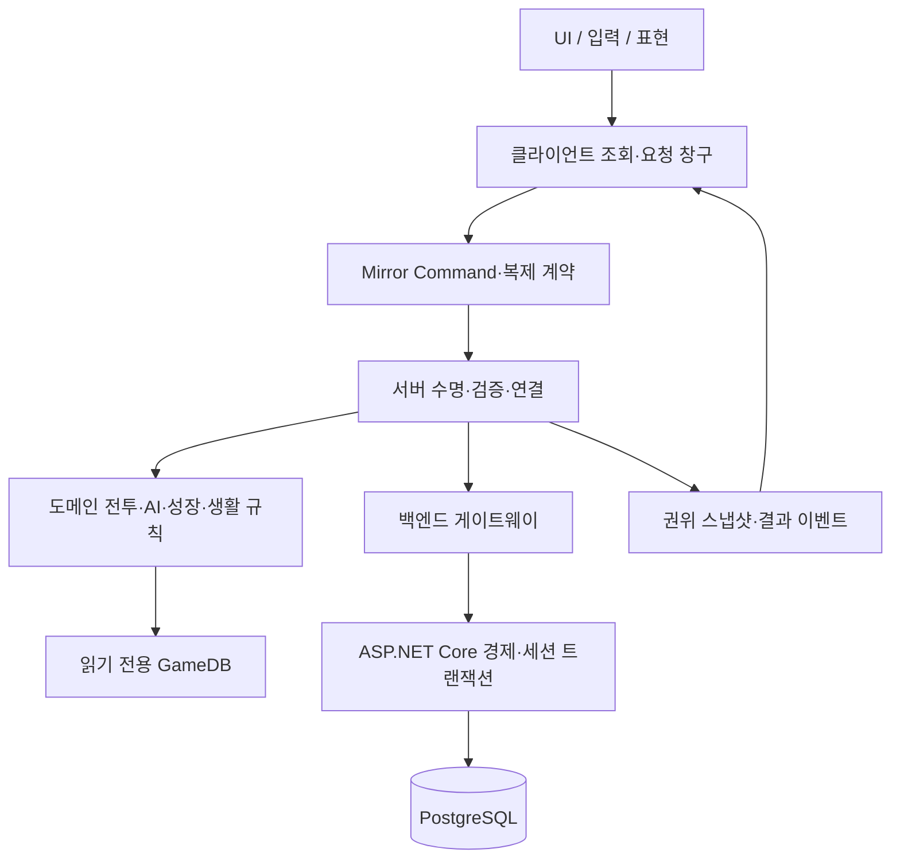
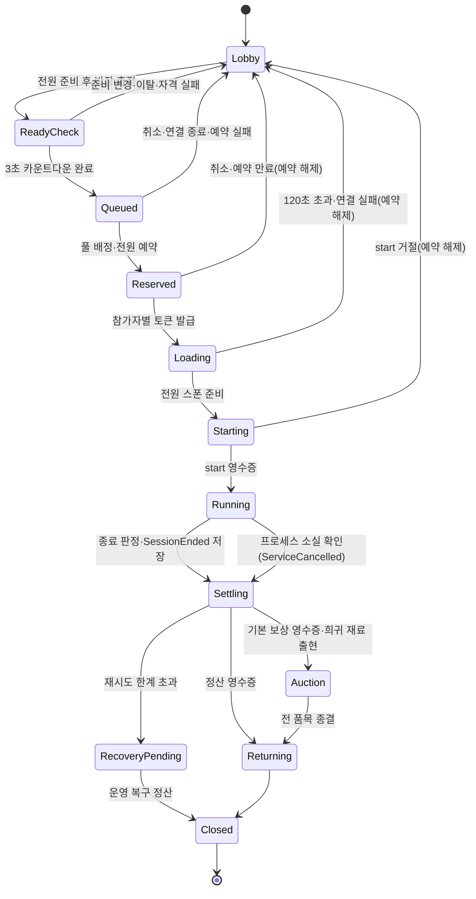

# 신시 소프트웨어 아키텍처

> 문서 버전 1.0 · 2026-10-01 · 구현 예정 구조.
> [기획서](02-game-design.md)의 규칙을 [기술 설계](03-technical-design.md)의 서버 권위·저장 계약으로 구현하기 위한 모듈 지도다. 아래 클래스·SO·API·DB는 설계 이름이며 기존 구현이라고 주장하지 않는다.

## 1. 현재 상태와 구조 원칙

Unity 6000.4.7f1, URP·Mirror 96.11.3과 외부 도구는 설치되어 있다. `Assets/01.Scripts/`의 도메인 폴더·meta와 일부 환경 아트가 있고, `00.Common/`에 `Constants`, enum, GameDB 골격이 있으나 게임플레이 C#은 없다. `Assets/09.Data/`에는 GameDB 루트와 `PlayerConfig`, `SessionConfig` 에셋만 있고 `Assets/Tests/`는 빈 폴더이며 백엔드·DB 프로젝트는 미생성이다. `98.Servers/`·`99.Dev/`는 `.gitkeep`만 있다. 팀 코드용 asmdef는 아직 없어 현재 C#은 기본 `Assembly-CSharp`에 들어간다(asmdef는 `Assets/Mirror/`와 `99.ThirdParty/`에만 있음). U01에서 아래 2장의 어셈블리 구성을 만든다. 기존 `Assets/Editor/ScriptTemplateNamespaceProcessor.cs`는 코드 템플릿 보조이며 게임 기능이 아니다.

게임의 규칙, 네트워크 연결, 화면 표현, 영구 저장을 구분한다. 규칙은 해당 파트가 작성하고 서버 경로에서 실행한다. 클라이언트는 공개 Request/조회 계약만 사용하며 서버 전용 어셈블리(`Shinshi.Server`)의 타입을 참조하지 않는다. 과도한 빈 인터페이스나 상태 클래스는 먼저 만들지 않고 실제 교체 지점·중복·협업 경계가 있을 때 도입한다.



이 그림은 실행 책임이다. 어셈블리는 `Shinshi.Runtime`(규칙·상태·표현·UI·요청 창구)과 `Shinshi.Server`(서버 수명·검증·AI·정산·백엔드 게이트웨이) 두 개로 나누고, 서버 쪽은 클라이언트 빌드에서 빠진다. 규칙 중 클라가 알아야 하는 계산만 `Shinshi.Runtime`에 둔다. 기준은 [코딩 컨벤션](coding-convention.md) 0장·9장.

## 2. 폴더와 소유

현재 규정된 최상위 구조를 사용한다. 아래 새 기능 하위 폴더는 계획이며 파일 생성 시 실제 목록과 소유를 갱신한다.

```text
Assets/
  00.Scenes/                    기존 씬 폴더
  01.Scripts/
    00.Common/                  Shinshi.Common, 공용 계약·자료형·GameDB·Constants·로컬 풀
      Data/                     Shinshi.Data, SO 정의
      Events/ Interfaces/ Types/ Utility/ Pooling/ Constants/ Sound/
    01.Network/                 Shinshi.Network, 세션·로비·연결·게이트웨이
      Session/ Lobby/
    02.Combat/                  Shinshi.Combat, 플레이어·피해·기술·소환
      Player/ Damage/ Skill/
    03.AI/                      Shinshi.AI, 산귀·월백·출현
      Enemy/ Boss/ Spawn/
    04.Systems/                 Shinshi.Systems, 진행·경제·생활 규칙
      Wave/ Outpost/ Reward/ BossTicket/ Essence/ Talisman/
      Equipment/ Inventory/ Growth/ FoxTrace/ Interaction/
      Life/ Crafting/ Auction/  폴더만 생성(.gitkeep)
    05.Art/                     Shinshi.Art, 카메라·예고·VFX·환경
    06.UI/                      Shinshi.UI, Combat/Hub/Lobby/Systems
    98.Servers/                 Shinshi.Server, 서버 전용 클래스. 도메인 경로를 비춤. 민성(AI·웨이브는 기웅)
      {NN.원래도메인}/{기능}/    원래 경로를 그대로 비춤
    99.Dev/                     테스트 지원·진단, 배포에서 분리
  09.Data/                      GameDB 에셋, 현재 루트와 플레이어·세션 설정 SO
    Resources/GameDB.asset      GameDatabaseSO 루트
    Combat/ AI/ Growth/ Reward/ Life/ Session/ Presentation/
  Tests/EditMode/ PlayMode/     폴더만 있음, 테스트 미작성
  Editor/                       기존 에디터 도구
  ScriptTemplates/              기존 팀 스크립트 템플릿
  Mirror/                       기존 Mirror 96.11.3, 기본 위치 유지
  Plugins/TextMesh Pro/         기존 TMP 필수 리소스
  Settings/                     기존 URP 설정 에셋
  99.ThirdParty/                기존 외부 자산, 공급자 구조 보존. 유료 패키지는 Git 제외
```

| 영역 | 규칙/표현 작성 | 서버 통신·수명 연결 |
|---|---|---|
| 공통·네트워크·플레이어 전투 | 민성 | 민성 |
| UI·성장·인벤토리·제작·생활 화면·맵 | 진욱, 세부 생활/경매 규칙 구현은 담당 배분 때 진욱/민성 확인 | 민성 |
| 몬스터·보스·프롤로그·컷신 | 기웅 | 민성 |
| 공용 GameDB 루트·계약 | 민성, 각 SO 내용은 해당 파트 | 민성 |

개체 하나는 규칙(`{기능}/Rules/`, 서버·클라 공용 계산), 상태(`{기능}/Net/{이름}State.cs`, `NetworkBehaviour`), 서버(`98.Servers/{NN}.{도메인}/{기능}/`, 서버 전용), 표현(`{기능}/View/`)으로 나눈다. 상태는 동기화 필드·Command·Rpc만 갖고 판정을 두지 않는다. Command는 상태가 가진 처리기 인터페이스로 넘기고, 서버 처리기가 호출자·소유권·상태·revision·중복을 검증한 뒤 규칙을 호출한다. 서버 객체는 프리팹에 붙이지 않고 `ServerBootstrap`이 상태의 `OnStartServer` 알림을 받아 만든다. 층별 규칙과 코드 예시는 [코딩 컨벤션](coding-convention.md) 9장, 담당은 [서버·클라이언트 협업](unity/SERVER_CLIENT_WORKFLOW.md)이 기준이다. 모듈 표(4장)의 타입은 이 층 중 하나에 속한다.

**어셈블리와 테스트 구성(2026-10-01 확정).** `Assets/01.Scripts/`에 `Shinshi.Runtime`, `98.Servers/`에 `Shinshi.Server`(define 제약 `UNITY_SERVER || UNITY_EDITOR`), `99.Dev/`에 `Shinshi.Dev`를 둔다. `Tests/EditMode`·`Tests/PlayMode` asmdef는 `Shinshi.Runtime`과 `Shinshi.Server`를 참조하므로 규칙·서버 클래스를 `NetworkBehaviour` 없이 시험한다. 이전에 비교한 (A) 전체 단일 어셈블리, (B) 순수 규칙만 분리 안은 partial 구조를 전제로 했으므로 폐기한다. 전체 표는 [코딩 컨벤션](coding-convention.md) 0장이다.

백엔드 저장소 내 배치는 위임 초기안으로 `Backend/Shinshi.Api/`, `Backend/Shinshi.Api.Tests/`, `Backend/Shinshi.Admin/`(어드민 화면, [운영 도구](design/operations-admin.md)), `Backend/deploy/`를 제안한다. 런처는 `Launcher/`(런처·패치·게시 도구와 테스트, [런처·패치](design/launcher-and-patch.md) 2장)에 둔다. 현재 존재하지 않으며 Unity Assets 밖의 별도 .NET 프로젝트다. 실제 생성 시 빌드·의존성·비밀값 제외 규칙을 함께 설정한다.

## 3. 씬과 부트스트랩

| 씬 작업명 | 역할 | 서버 역할 |
|---|---|---|
| `Bootstrap` | 버전·GameDB·설정 로드, 서비스 바인딩, 인증/연결 진입 | 서버/클라이언트 공통 진입 |
| `Login` | 초대 계정 접속·캐릭터 선택 | 클라이언트 표현 |
| `ShinshiTown` | 공유 마을·서비스 NPC·방 목록·생활 구역 | town |
| `ForestWave` | 숲 6웨이브, 1~4인 | dungeon |
| `WolbaekEasy` | 월백 이지 전투/파티 경매 | dungeon |
| `DevCombat` / `DevGrowth` | 담당 파트의 반복 시험 | 개발 전용 |

현재 이 씬들이 존재하는 것은 아니다. 기존 확인된 씬은 `Assets/00.Scenes/SampleScene.unity`다. 팀 씬은 Unity 에디터에서 만들고 GUID·meta를 보존한다.

부트 순서는 외부 설정 읽기→GameDB 단일 초기화→필수 참조/콘텐츠 해시 검증→역할별 서비스 바인딩→Mirror 시작→해당 씬 준비→API readiness 보고다. `GameDBBootstrap`만 BeforeSceneLoad에서 Resources 루트를 로드해 초기화한다. Awake는 같은 멱등 경로를 호출하며 소비자는 Start/OnStartServer/OnStartClient 이후 읽는다. 필수 데이터가 없으면 기본값으로 전투를 열지 않는다.

서버에서는 카메라·UI·오디오·연출이 비활성/부재여도 규칙이 동작해야 한다. `NetworkClient.localPlayer`, `Camera.main`, 애니메이션 이벤트를 서버 판정의 전제로 삼지 않는다. 마을↔던전은 프로세스 간 연결 전환이며 방장 승계는 관리 권한만 바꾸고 서버를 플레이어로 옮기지 않는다.

## 4. 모듈과 제안 타입

| 모듈 | 제안 타입 | 책임·입출력 |
|---|---|---|
| 연결 | `ShinshiNetworkManager`, `SessionBinding`, `JoinTokenAuthenticator` | Mirror 콜백, 역할·토큰·참가자 연결, 재접속. 인증기는 Mirror `NetworkAuthenticator` 파생이며 버전·토큰 검증 전 플레이어를 스폰하지 않음 |
| 백엔드 연결 | `BackendGateway`, `OperationTracker`, `ServerLeaseClient` | 인증된 HTTPS, 동일 ID 재시도/조회, 서버 임대 |
| 런처 연결 | `LauncherSessionReceiver`, `BuildIdentity` | 파이프로 게임 세션 1회 수신·PID 확인·갱신, `build-identity.json` 읽기. 게임 안 초대 코드 로그인과 같은 인증 입력 창구로 합류 |
| 서비스 상태 | `ServiceStateClient` | 점검·기능 차단·공지·이벤트 스냅샷 조회. 세션 시작 때 이벤트 고정 |
| 전투 입력 | `PlayerInputReader`, `PlayerRequestFacade`, `PlayerPrediction` | 구 Input Manager 입력 의도→요청, 소유 예측/재조정 |
| 플레이어 상태 | `PlayerActor`, `CharacterStats`, `PlayerLifeRules` | HP/자원·생사, 복제 상태와 규칙 연결 |
| 스킬 | `SkillController`, `SkillResolver`, `TalismanModifierResolver` | 12기술·3단 부적 조합→실행 명세 |
| 피해 | `DamageResolver`, `HitLedger`, `GuardWindow` | 서버 피해/중복 적중 차단·반격 판정 |
| 신령 | `SummonController`, `SummonTargetRules`, `ResonanceRules` | 2동료 시간제 유지, 타깃/공명·3강림 |
| 적 AI | `EnemyController`, `EnemyDecisionRules`, `SpawnDirector` | 생존 타깃·제어·이동·공격, 활성 24상한 |
| 보스 | `BossBrain`, `BossCombat`, `BossSelectionTree`, `BossPatternSelector`, `IBossPattern` (서버 뼈대, 구현됨·EditMode만 검증), `WolbaekController`(개체 연결, 미구현) | 상위 FSM→전투(페이즈·공격 FSM, 선택 BT)→가중 선택→패턴 실행. 6패턴·복제·제어 연결은 미구현, 2페이즈는 입력 대기. 계약은 [서버·클라이언트 협업 8장](unity/SERVER_CLIENT_WORKFLOW.md#8-보스-서버-경계) |
| 일반전 | `WaveSession`, `WaveSchedule`, `ParticipantRoster` | 6웨이브·180마리·420초·고정 시작 인원 |
| 보스 세션 | `BossSession`, `ReviveBudget`, `ResultEligibility` | 솔로/협동 사망·공용3회·처치 자격 |
| 전리품 | `LootRoller`, `SessionRewardLedger`, `SettlementRules` | 개인 독립 추첨·보호/추가 정기·정산안 |
| 성장 | `TrainingRules`, `EquipmentRules`, `TalismanRules` | 비용/상한/보정/계승·결과 미리보기 |
| 인벤토리 | `InventorySnapshot`, `ItemInstance`, `RewardInbox` | 소유·스택/공간·귀속·30일 회수함 |
| 생활 | `GatherNode`, `GatheringRules`, `ActionEnergyRules`, `CraftingRules` | 선점/취소/완료, 오프라인 회복·제작 |
| 파티 경매 | `PartyAuctionSession`, `BidRules`, `AuctionSettlement` | 자격 집합·입찰 순번·예약금·분배 |
| 진행 | `AccountProgress`, `StoryProgressRules` | 지역/흔적/첫 처치·체험판 진행 분리 |
| UI | `LocalPlayerView`, `HubPanels`, `CombatHud`, `AuctionView` | 현재 스냅샷·늦은 구독·재바인딩·거절/저장 대기 |
| 표현 | `TelegraphPresenter`, `CombatFxPresenter`, `LocalFxPool` | 권위 좌표/시각의 표시, 로컬 풀 |

타입 수는 필수 고정 목록이 아니다. 동일 역할이 단순하면 합치고, 교체/협업 경계가 생기면 나눈다. 네트워크 개체를 로컬 VFX 풀에 넣지 않는다. 네트워크 풀링은 Mirror 스폰 핸들러·netId/수명 초기화 검증이 필요한 별도 작업이다.

## 5. 핵심 상태와 전이

### 5.1 출정

`Lobby → ReadyCheck → Queued → Reserved → Loading → Starting → Running → Settling → Auction(보스 성공·희귀 재료 출현) → Returning → Closed`



| 상태 | 소유·기록 위치 | 소실 시 |
|---|---|---|
| Lobby·ReadyCheck | 마을 서버 메모리의 방 | 방이 사라짐. 경제 영향 없음 |
| Queued | API 배정 대기열(위임 초기안) | 티켓 미소비. 마을 소실 시 대기열에서 제거 |
| Reserved·Loading·Starting | API `reservations`·`game_sessions` | 예약 만료 시 API가 해제([기술 설계 6장](03-technical-design.md#6-출정-예약과-전장-전환)) |
| Running | 던전 서버 메모리 + API `session_events` | 종료 이벤트 없으면 확인된 장애 취소 |
| Settling·RecoveryPending | API | 저장된 정산안으로 API가 재개 |
| Auction | 던전 서버 진행 + API 입찰·예약 | 5.4의 경매 장애 규칙 |
| Returning·Closed | 클라이언트 전환·마을 서버 / API | 귀환 실패는 재로그인으로 마을 복귀 |

- ReadyCheck는 방장의 출정 요청 뒤 해금·티켓·물약 자격을 다시 확인하고 3초 카운트다운을 보여 주는 구간이다(카운트다운 위치는 위임 초기안). 이 동안 준비 변경·이탈이 생기면 Lobby로 돌아간다.
- Ready 변경/일행 이탈: 시작 전 상태에서는 준비 해제 또는 예약 취소 후 Lobby.
- Starting은 티켓 소비 확정 응답을 기다리는 상태이며 전투 타이머를 시작하지 않는다.
- Running 참가자 집합은 고정, 신규 참가 불가. 이탈은 참가자 상태만 바꾸고 시작 인원 스케일을 바꾸지 않는다.
- 종료 원인은 `ESessionEndReason`의 Success/Timeout/AllDead/Abandon/DisconnectExpired/ServiceCancelled로 기록한다. Success 아닌데 보스 기본 보상을 생성하지 않는다. 프로세스 소실 경로의 Settling은 API가 수행한다.
- Settling은 멱등 영수증 확정 전까지 유지하고 저장 실패를 Closed로 숨기지 않는다. `SessionEnded` 저장 뒤에는 세션이 Settling이어도 참가자 개인의 귀환을 허용하고(경매가 열리면 경매 종결 뒤) 결과 화면은 정산 영수증 전까지 저장 중으로 표시한다([기술 설계 7.3](03-technical-design.md#73-전리품물약과-장애)).

### 5.2 참가자

연결 상태 `Connected / ReconnectGrace / Departed`와 생사 `Alive / Dead / ReviveWaiting / Spectating`는 별도 축이다. 끊겨도 Alive일 수 있고 피격·사망한다. Dead여도 Connected 또는 ReconnectGrace이면 보스 성공 개인 보상을 받을 수 있다. ReconnectGrace는 종료시각을 가지며 만료 뒤 원래 세션 복귀를 허용하지 않는다.

| 전이 | 조건 |
|---|---|
| Connected → ReconnectGrace | 서버가 연결 해제를 감지. `grace_until` = 감지 시각 + 120초 |
| ReconnectGrace → Connected | 같은 참가자의 복귀 토큰을 인증기가 승인 |
| ReconnectGrace → Departed | 유예 만료. `ParticipantSettled`(DisconnectExpired) 저장 |
| Connected → Departed | 명시 포기. `ParticipantSettled`(Abandon) 저장 |
| Dead → ReviveWaiting | 부활 대기 시간(일반 5초, 협동 보스 10초) 경과 뒤 `RequestRevive` 수락. 안전 위치를 0.25초마다 찾는 중이며 미접속 중에는 요청이 없으므로 일어나지 않음 |
| ReviveWaiting → Alive | 안전 위치 확인·(보스) 공용 횟수 차감 승인 |
| Dead → Spectating | 협동 보스에서 공용 부활 3회를 모두 쓴 뒤 사망. 전투 종료까지 관전 |

Departed 캐릭터는 전장에서 제거하고 보스 타깃·주변 인원 계산에서 뺀다(위임 초기안). ReconnectGrace 캐릭터는 남아 있으므로 타깃·인원 계산에 포함한다. Departed는 되돌리지 않는다.

일반전은 Dead→5초대기→안전위치 확인→HP50% Alive를 반복한다. 협동 보스는 Dead→10초대기→전투 계속/공용횟수/안전위치 검증→HP30% Alive다. 전멸 판정이 같은 틱 부활보다 우선하며 솔로는 Dead가 즉시 실패로 이어진다. 기력/공명/물약/쿨다운을 생사 전환과 함께 초기화하지 않는다.

### 5.3 스킬/보스

기술은 `Idle → Targeting(선택형) → Validating → Windup → Active → Recovery → Idle`이다. Targeting 취소는 비용이 없다. 서버가 승인한 시점에 명세의 자원/쿨다운을 적용한다. 입력 큐 0.15초/1개와 취소 가능한 구간은 기획 데이터로 정한다.

월백은 `SelectTarget → ReadContext → SelectPattern → Telegraph → Execute → Recover → SelectTarget`이다. 매 선택 시 생존 플레이어 한 명을 무작위로 고르고 거리·방향을 계산한다. 근처 5m의 플레이어/전투 봇만 세고 소환물은 제외한다. 0명은 1명 열, 3명 이상은 3명 열을 쓴다. 가중치는 Base×거리×방향×인원×최근 패턴이며 최대값 고정 선택을 하지 않는다. 1페이즈 원본 6패턴과 배율은 기획 표를 보존한다.

보스 서버 구조는 `상위 FSM → Combat → PhaseState / AttackState FSM → Combat BT → 상황별 가중치 선택 → 패턴 실행`이다. 위 `SelectTarget → ReadContext → SelectPattern`은 공격 FSM이 `Ready`이고 페이즈가 `Active`일 때만 BT가 한 번에 평가하는 단계이고, 공격 FSM은 `Ready → Telegraph → Execute → Recover → Ready`를 서버 시각으로 진행한다. 상위 FSM이 중단 이유(사망, 전투 종료, 페이즈 전환, 직접 제어)를 정하고 취소를 지시한다. 현재 패턴은 자신의 실행과 예약 타격을 정리하고, 지속 장판과 투사체는 별도 수명 관리자가 이유별로 정리한다. 예고, 실행, 회복 중에도 사망, 페이즈 전환, 직접 제어 검사는 계속하며, 같은 틱의 우선순위는 사망·전투 종료 → 페이즈 전환 → 허용된 직접 제어 → 일반 공격 진행·새 선택이다. 이미 적용된 피해는 되돌리지 않는다. 체력 0과 사망 확정은 구분하며 최종 발악 도입은 미정이다. 오프닝과 강제 후속 공격도 미정이라 구현하지 않았고 일반 가중 선택 앞에 선택 규칙을 끼울 자리만 있다.

생명 50% 도달 즉시 `PhaseTransitionPending`을 설정하고 1페이즈의 새 패턴 선택을 막는다. 전투 부록의 전환 취소 규칙에 따라 진행 중인 1페이즈 공격·잔여 장판·투사체와 예정 피해를 종료한 뒤 2페이즈 실행기에 인계한다. 2페이즈 데이터·실행기를 받기 전 공개 배포 빌드에서 미완성 전환을 정상 완주로 꾸미지 않는다. 별도 시험 빌드는 1페이즈 종료 지점을 명확하게 표시한다. 2페이즈 자체의 전환 연출·공격 규칙은 담당자의 입력을 따른다.

### 5.4 채집/경매

채집 노드는 `Available → Claimed → Completing → Depleted → Available`이다. `Claimed → Available`(이동·취소·구역 이탈, 연결 종료 5초, 시작 10초 미완료)과 `Completing → Available`(API 거절)도 있다. 시작에 마을 서버가 계정별 선점으로 행동력 2를 예약하고(계정당 선점 1개), 3초 경과 시 Completing으로 바꿔 API가 약초2/차감/재생시각을 함께 확정한다. 10초 해제 규칙은 Claimed에만 적용한다. Completing은 API 결과(응답 유실 시 동일 operationId 조회)로만 끝내며, 결과 전에 노드를 풀어 두 번 지급하지 않는다. Depleted는 완료 후60초이며 노드 상태는 영역 ID별로 분리한다. 예약 방식은 [기술 설계 7.2](03-technical-design.md#72-주요-원자-작업)를 따른다.

경매 품목은 `Pending → Open → Closing → Settling → Sold/Unsold`다. 종료 이벤트 저장 전 서버가 소실되면 `Open·Closing → RecoveryPending → Cancelled`로 간다. Open 시 자격자 집합을 동결하고, Closing에서 서버가 확정한 종료 시각·연결자 집합을 종료 이벤트로 영속 저장한 뒤 Settling으로 넘어간다. 최고 입찰자 단절은 기존 예약을 해제하지 않는다. Settling 재시도와 서버 소실 뒤 API 재개는 저장된 자격·최고가·연결자 집합을 그대로 사용한다. 종료 이벤트가 없어 자격을 확정할 수 없으면 RecoveryPending에서 예약금 해제·품목 취소를 한 번 수행해 Cancelled로 끝내고 새 품목으로 복제하지 않는다.

## 6. GameDB와 런타임 명세

SO는 읽기 전용 설계도이며 개별 상태·랜덤 결과·저장 진도는 별도 구조체/레코드다. 모든 정의에 안정적 `definitionId`, 스키마 버전, 표시 키를 둔다. 이름 변경을 ID 변경으로 취급하지 않는다. ID 중복·누락·효과 범위·불가능한 참조는 빌드 전 검증한다.

| SO 제안 | 주요 데이터 | 책임 파트 |
|---|---|---|
| `GameDatabaseSO` | 모든 카탈로그 참조·contentVersion | 민성 |
| `PlayerConfigSO` | 이동/회피·기력회복·기본능력·기본공격 | 민성 |
| `SkillCatalogSO` | 기술12·강림3 ID, 비용/CD/타임라인/형태 | 민성 |
| `TalismanCatalogSO` | 45효과 ID·직업/기술/선택단계·변형/수치/레벨 | 민성(등록·강화 비용과 확률은 `GrowthConfigSO`) |
| `EnemyCatalogSO` | 4일반적 역할·HP/공격·제어/예고 | 기웅 |
| `BossPatternCatalogSO` | 월백6패턴·문맥배율·형태·회복/방어/제어창 | 기웅 |
| `WaveConfigSO` | 6웨이브 배치·180개 source ID·활성상한·시간 | 기웅, 세션 연결 민성 |
| `EquipmentCatalogSO` | 6부위·4등급·기본수치·제작/강화·계승표 | 진욱 |
| `GrowthConfigSO` | 수련5항목·비용·상한·부적 등록/강화 비용과 보정 | 진욱 |
| `RewardCatalogSO` | 재화·재료 아이템, 개인드롭·웨이브기본·추가정기·보스보상·희귀확률 | 진욱(정산 규칙 수치는 `SessionConfigSO`, 민성) |
| `LifeConfigSO` | 약초·행동력·선점/재생·소형/대형 레시피 | 진욱 |
| `SessionConfigSO` | 스케일·부활·복귀/입장/경매 게임 규칙 | 민성 |
| `ProgressionCatalogSO` | 지역·보스·흔적·최초지원·체험판 플래그 | 기웅 |
| `CameraConfigSO` | 카메라 거리·각도 등 로컬 시점 값 (`09.Data/Combat/`) | 민성 |
| `PresentationConfigSO` | 음향·색·로컬 전용 연출 참조 | 담당 아트/UI |

2026-10-01 사용자 결정으로 공동 소유였던 SO를 한 파트씩으로 나눴다(부적 효과 정의는 민성, 등록·강화 수치는 진욱의 `GrowthConfigSO`, 보상·생활은 진욱, 진행은 기웅). SO 구조 변경은 [밸런스 작업](unity/BALANCE_DATA_WORKFLOW.md) 절차를 따른다. 기술 표를 실제로 도입할 때 [코딩 컨벤션](coding-convention.md)의 SO 대상 표와 연결한다.

기술 실행 시 원본 기술→핵심 변형→형태에 맞는 보조 효과→효과 레벨 보너스→최종 표시/판정 명세 순으로 컴파일한다. 대표 기술 3종의 2×2×2조합을 검사한다. Lv1~5 배율1/1.15/1.30/1.45/1.60은 부적이 더하는 보너스에만 적용하며 원본 기술 전체를 반복 배수하지 않는다.

이 명세를 서버 판정과 클라이언트 예고가 같은 ID/hash로 사용한다. 소환 동료 한 공격 동작의 다중 적중은 공명을 한 번만 주므로 `castInstanceId / actionInstanceId / hitTargetId`를 구분한다. 전투용 HitLedger는 수명 종료 때 비우고 보상 원장의 영구 ID와 혼용하지 않는다.

## 7. 영구 데이터 초안

아래는 PostgreSQL 논리 스키마다. 마이그레이션·인덱스·실제 SQL은 API 구현 작업에서 작성한다. 모든 시간은 UTC 서버 시각으로 저장하고 UI만 현지화한다.

| 테이블 작업명 | 핵심 키·필드 | 불변 조건 |
|---|---|---|
| `accounts` | account_id, created_at, revision | 계정당 활성 플레이 세션1(`account_leases`로 강제) |
| `account_leases` | account_id(유일), lease_id, instance_id, role, expires_at | 계정당 1행. 인스턴스 소실 확정 시 API가 해제 |
| `auth_invites` | invite_id, account_id, code_hash, expires_at, used_at | 원문 미저장·교환과 소비를 한 트랜잭션으로 |
| `auth_refresh_tokens` | token_id, account_id, token_hash, expires_at, revoked_at | 원문 미저장·회전 시 이전 토큰 폐기·폐기 토큰 재사용 거절 |
| `server_instances` | instance_id, role, address, port, build_id, content_version, state, heartbeat_at | 풀 배정 대상. heartbeat 15초 부재 시 신규 배정 중지 |
| `characters` | character_id, account_id, class_id, essence, shards, revision | 직업 고정·정기/정련편 캐릭터별 |
| `account_wallets` | account_id, currency, tickets, action_value, action_anchor, revision | 공유 잔액, 사용 가능=총량−예약량 |
| `account_items` | account_id, definition_id, binding_kind, quantity | 약초/보스재료/물약/미등록 부적, 동일 ID/귀속별 스택 |
| `equipment_instances` | item_id, character_id, definition_id, grade, slot, enhancement, bound, locked, origin | 강화0~25·소유·잠금/착용·지원품 표식 |
| `training` | character_id, stat_id, stage | 5행·항목≤40·합계≤100 |
| `enhancement_pity` | character_id, slot, current_stage, fail_count | **아이템 ID·등급을 키에 넣지 않음** |
| `talisman_progress` | character_id, effect_id, learned_level, registration_fail_count | 배우기 전 실패 보정, 배운 뒤Lv1~5 |
| `talisman_loadout` | character_id, skill_id, selection_tier, effect_id | 단계당1개·소유/직업/기술 일치 |
| `account_progress` | account_id, progress_id, value, completed_at | 영구 해금·흔적·첫 처치, 체험판 namespace 분리 |
| `initial_grants` | account_id/character_id, grant_id, receipt_id | 삭제/재생성·재접속 중복 지원 차단 |
| `game_sessions` | session_id, mode, map_id, state, starting_count, content_version, server_lease, started_at, result | 시작 후 참여자/스케일 고정 |
| `session_participants` | session_id, participant_id, character_id, connection_state, grace_until, death_at, settled_at | 이탈 정산 뒤 보상 제외 |
| `reservations` | reservation_id, owner, session_id, item/currency, quantity, state, expires_at | 시작 전 전체취소·소비/반환 한 번 |
| `session_events` | session_id, event_seq, event_id, event_kind, payload, committed_at | event_id 유일·순번 누락 검출 |
| `session_rewards` | session_id, source_event_id, recipient_id, reward_index, payload, state | 추첨/확보 한 번·추가정기 미지급 보관 |
| `session_checkpoints` | session_id, checkpoint_seq, last_event_seq, state_blob, schema_version | 30초 주기. 체험판에서는 진단·향후 복구 검증용이며 재접속은 프로세스 메모리, 프로세스 소실은 장애 취소를 쓴다. 경제 원장 대체 금지 |
| `auctions` | auction_id, session_id, item, status, opened_at, deadline, eligible_ids, closing_connected_ids, revision | 동결 자격·종료 순번 |
| `auction_bids` | auction_id, bid_seq, bidder_id, amount, reservation_id, operation_id | 최고가 예약·입찰 철회 금지 |
| `operations` | operation_id, actor_id, request_hash, status, receipt, committed_at | `(actor_id, operation_id)` 유일. 동일 ID·동일 본문만 재실행 허용, 체험판 기간 삭제 안 함 |
| `reward_inbox` | reward_id, owner, source_kind, source_id, payload, original_awarded_at, expires_at, remaining | 회수함은 원래 획득+30일, 운영자 우편은 지급별 기한·부분 수령 원자성 |
| `economy_ledger` | ledger_id, occurred_at, account_id, character_id, asset_kind, asset_id, delta, balance_after, reason, source_type, source_id, operation_id, actor_kind, actor_id | 상태 변경과 같은 트랜잭션·추가 전용·자산별 합계=잔액 |
| `item_history` | item_id, seq, event, before, after, owner_id, operation_id, occurred_at | 장비 인스턴스의 생성~소멸 추적·추가 전용 |
| `admin_users` | admin_id, role, mfa_enabled, disabled_at | 게임 계정과 분리·2단계 인증 필수 |
| `admin_audit_log` | audit_id, at, admin_id, role, action, target_type, target_id, before, after, reason, approval_id | 추가 전용(API DB 계정에 UPDATE·DELETE 권한 없음) |
| `admin_grants` | grant_id, target_spec, rewards, reason, expires_at, state, created_by, approved_by | `(grant_id, account_id)` 유일 지급·미수령분 취소 |
| `live_events` | event_id, kind, target, value, starts_at, ends_at, state | 배율 상한·시작 뒤 종료 앞당기기만 허용 |
| `service_state` | key(maintenance·feature 이름·notice), value, updated_by, updated_at | 점검·기능 차단·공지. 변경은 감사 로그 |
| `allowed_builds` | build_id, channel, protocol_version, content_hash, allowed_from, allowed_until | 런처·API·인증기가 같은 목록으로 판정 |
| `sanctions` | sanction_id, account_id, kind, starts_at, ends_at, reason, evidence_ref, created_by | 기간 중 로그인·출정 거절 |
| `auth_game_sessions` | game_session_id, parent_token_id, account_id, expires_at, revoked_at | 런처 세션의 하위·부모 폐기 시 함께 폐기 |
| `outbox` | event_id, aggregate_id, payload, delivered_at, retries | 같은 트랜잭션 결과 통지·중복 소비 방지 |

생활 노드의 실시간 선점은 마을 서버가 소유하고 완료의 nodeInstanceId/claimId·재생시각을 이벤트로 남긴다. 행동력은 계정 행 잠금 안에서 `경과한 5분 구간 수`를 계산해 상한100까지 반영한 뒤 예약/소모한다. 상한에 머문 초과 시간은 적립하지 않는다. 회복 앵커를 클라이언트 시계나 캐릭터 변경으로 초기화하지 않는다.

동시 게임 접속은 계정 세션 임대의 유일 제약으로 제한한다. 계정 삭제/재생성 정책과 실제 인증 공급자의 안정 ID 연결은 배포 전 검증한다. 백업 복원·마이그레이션은 스키마 버전·경제 원장까지 함께 복구해야 하며 클라이언트 로컬 파일을 생산 잔액 복원 근거로 쓰지 않는다.

## 8. 모듈 의존과 통합 계약

| 소비자 | 사용할 계약 | 금지되는 결합 |
|---|---|---|
| UI | `LocalPlayerView` 스냅샷·결과 이벤트·Request | Inventory/Player의 서버 private 상태 직접 수정 |
| 보스 AI | 읽기 전용 타깃 목록·패턴 명세·피해 적용 창구 | Camera/UI/애니메이션 종료에서 판정 |
| 성장 화면 | 규칙 미리보기+서버 승인 영수증 | 비용만 로컬 차감 후 성공 가정 |
| 피해/소환 | 상태 조회·유효 타깃 인터페이스·명세 | 다른 파트 구체 컨트롤러와 순환 참조 |
| 세션 | 참가자 목록·생사/전리품 이벤트·원장 | 장비 UI의 표시값으로 실제 스케일 계산 |
| API | 서버 인증·경제 DTO·스키마 | Unity GameObject/MonoBehaviour 타입 공유 |

내 캐릭터의 이산 변화는 인스턴스 이벤트, 연속 게이지는 조회, 주인 없는 세계 사실은 로컬 이벤트 버스로 전달한다. 서버 버스는 원격 전달이 아니다. 늦은 구독·재바인딩·OnDisable/OnStopServer 해제 책임을 타입별로 정한다. Null Object는 누락 가능한 표현에만 쓰며 필수 GameDB·저장 서비스를 조용히 성공시키는 대체물로 쓰지 않는다.

백엔드와 Unity의 공통 DTO는 엔진 비의존 스키마로 관리한다. 런타임 DLL을 무조건 공유하지 않고 Unity 지원 직렬화와 .NET API 직렬화의 필드·enum 숫자·정수범위·날짜를 계약 테스트한다. enum은 `E` 접두사와 명시값, 기존 값 재배열 금지다.

## 9. 기획 추적과 구현 순서

| 기획 요구 | 담당 모듈/데이터 | 최소 검증 |
|---|---|---|
| 마을10~100/전장1~4, 시작 뒤 합류 금지 | SessionBinding/ParticipantRoster/API 배정 | 마을 부하·준비 자격·신규 토큰 거절 |
| 6웨이브/180마리/420초/활성24 | WaveSession/WaveConfigSO/SpawnDirector | 지연 스폰 누락0·시간 초과·무한 부활 |
| 직업3/일반기술12/부적45 | SkillResolver/TalismanCatalogSO | 대표 조합·자원·형태/판정 일치 |
| 무적 없는 회피/전방 반격 | PlayerLifeRules/GuardWindow/DamageResolver | 경계/예고·RTT0/50/150ms |
| 시간제 동료2/공명/강림3 | SummonController/ResonanceRules | 중복 적중 공명1회·사망 소환 해제 |
| 월백 가중6패턴/2페이즈 연결 | Selector/Executor/BossPatternCatalogSO | 문맥표·최근 패널티·전환 미입력 차단 |
| 개인 드롭/티켓 매 몬스터 | LootRoller/SessionRewardLedger | source ID별 개인 판정·재시도 동일 결과 |
| 전원 티켓1/물약 지참 | reservations/Start operation | 일부 부족이면 전원 무소비·응답 유실 |
| 실패 추가정기50%만 손실 | SettlementRules/session_rewards | 보호품 유지·보스 실패 기본보상0 |
| 보스10초/공용3/전멸 즉시 | ReviveBudget/PlayerLifeRules | 동시 부활·마지막 사망 우선 |
| 재접속120초/피격 유지 | SessionBinding/ParticipantRoster(프로세스 메모리 상태) | 경계 시각·유예 후 자격 제외·감지 지연 기록 |
| 서버 소실·정산 장애 | SessionEnded 이벤트/API 복구 작업/reservations 만료 | 종료 이벤트 저장 전·후 종료, 예약 만료와 start 경합 |
| 장비 제작/25강/계승 | EquipmentRules/pity/EquipmentCatalogSO | 표9행·원본 소모·보정 공유·공간/잔액 |
| 수련5종100/40·카드등록/효과Lv5 | TrainingRules/TalismanRules | 비용59500·확률보정·확정강화 |
| 공용채집/행동력/물약 | GatheringRules/ActionEnergyRules | 선점/취소·미접속 회복·중복 완료 |
| 보스희귀 경매/분배 | PartyAuctionSession/API 예약 | 시작/종료 자격·단절 낙찰·솔로소각 |
| 이야기·지역 영구 공유 | AccountProgress | 첫 처치·흔적·반복 보상·체험판 분리 |
| 후속 유저 경매장 | 별도 Market 모듈, 미구현 | 현재 체험판에서 제공하지 않음 |

구현 순서는 ① 버전/GameDB/전용 서버 부트 ② 이동·기본공격·요청 결과 ③ 세션 예약/영속 원장 ④ 세 직업·일반전/개인 드롭 ⑤ 성장/생활·물약 ⑥ 월백/공용 부활/파티 경매 ⑦ UX·컷신·장애/부하·외부 배포 검증으로 잡는다. 이 순서는 모듈 의존 관계를 보인 것이며, 실제 착수 순서·담당·점검일은 [구현 로드맵](05-implementation-roadmap.md)이 기준이다(로드맵은 저장 경로와 전투 경로를 병행한다). 파트별 표현 작업은 샘플 스냅샷으로 병행하되 생산 서버 상태를 가짜로 확정하지 않는다. 월백 2페이즈·자산·배포 환경은 별도 입력 의존이며 이를 이유로 사용자가 정한 체험판 범위를 자동 축소하지 않는다.

## 10. 설계 검증 경계

문서 단계에서는 이름·책임·상태·권위·영속성·기획 대응을 검토한다. 도입할 클래스 존재, API 실행, DB 원자성, Linux 빌드, 네트워크 지연, 성능을 문서만으로 검증 완료라 하지 않는다. 구현 후 실제 소스·SO·테스트가 생기면 이 표의 제안 이름을 실제 경로와 연결하고 [디자인 패턴 지도](unity/DESIGN_PATTERNS.md)의 적용 위치를 갱신한다.
