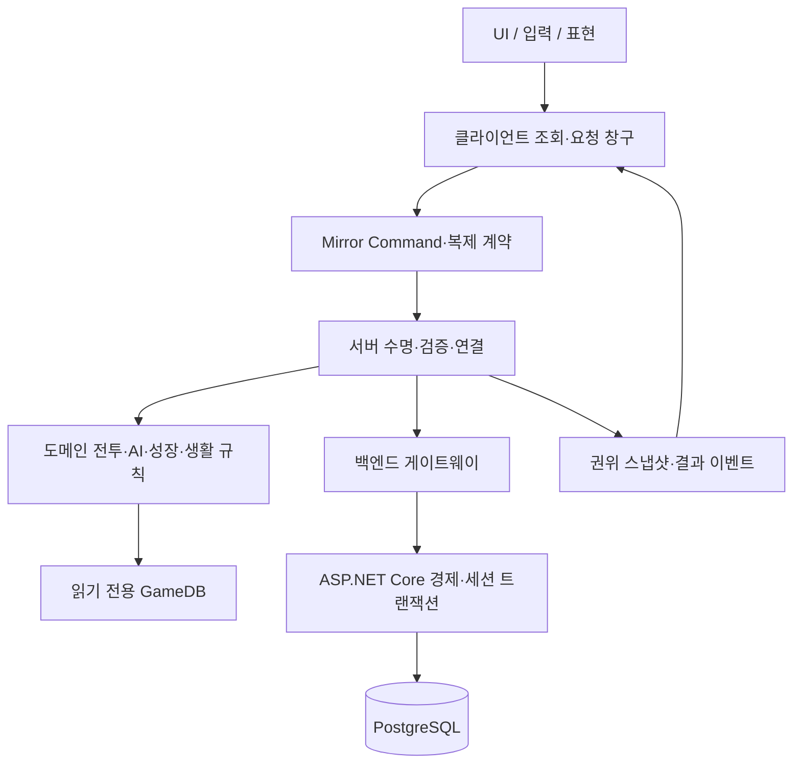
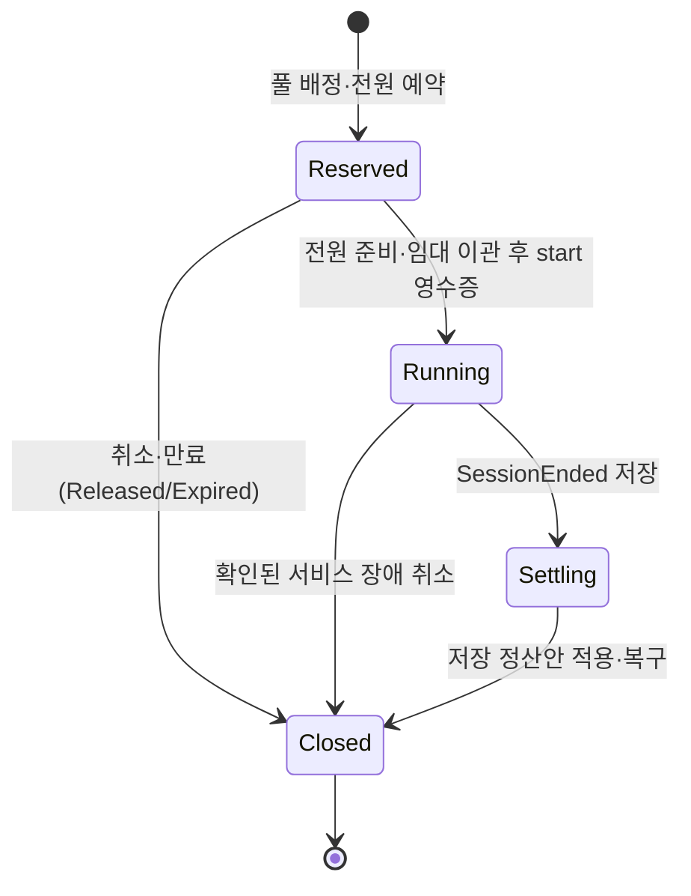

# 신시 소프트웨어 아키텍처

> 구현 상태(2026-10-08): 검사·마검사·궁수의 서버 전투·부적·백엔드 계약을 추가했고, 기존 직업과 함께 총 24기술·90효과를 유지한다. 아래 초기 설계의 미착수·미적용 표기보다 [세 직업 구현과 검증](05-implementation-roadmap.md#2026-10-08-세-직업-구현과-검증)을 우선한다. 신규 직업 기본 개방·실제 전투 연결·재생·다인 플레이 완료를 뜻하지 않는다.

> 문서 버전 1.1 · 2026-10-02 · M-A 구현과 후속 구조 구분.
> [기획서](02-game-design.md)의 규칙을 [기술 설계](03-technical-design.md)의 서버 권위·저장 계약으로 구현하기 위한 모듈 지도다. 실제 소스·어셈블리·마이그레이션과 미구현 설계 이름을 구분한다. 사용자 제공 검증은 Unity EditMode 780개, PostgreSQL 18 Docker 환경 Backend 396개 통과다. 이번 갱신은 정적 대조이며 서버 빌드·M2/M3·IL2CPP·배포는 실행 미검증이다.

2026-10-08 사용자 확정 직업은 [캐릭터·애니메이션 개편](design/character-animation-design.md)의 검사·마검사·궁수다. 일반 기술 12개·부적45효과(보조30/핵심15)의 기술·수치·특성·클립은 위임 초기안이며 미구현·미검증이다. 궁수 상세는 [궁수 설계](design/archer-design.md)가 단일 기준이다. 현재 모듈/카탈로그의 무사·도술사·신령사 12기술·45효과와 공명/강림 구현은 [기존 직업 설계 보존본](design/legacy-class-design.md)에 대응하며, 아래 존재·검증 기록은 신규 기획 이관 완료를 뜻하지 않는다.

## 1. 현재 상태와 구조 원칙

Unity 6000.4.7f1, URP·Mirror 96.11.3과 외부 도구가 설치되어 있다. 공통 계약·GameDB 카탈로그, Mirror 연결/인증, 이동·기본공격·스킬·소환의 규칙/상태/표현, 서버 처리와 던전 세션·정산 연결 코드가 존재한다. `Assets/09.Data/`에는 GameDB 루트와 플레이어·세션·기술·부적·적·보스·웨이브·장비·성장·보상·생활·진행·외형 카탈로그 에셋이 있다. `Assets/Tests/EditMode`에 테스트가 있으며 PlayMode 어셈블리도 구성되어 있다. `Backend/src`의 API·Data·Contracts와 `Backend/tests/Shinshi.Backend.Tests`, SQL 마이그레이션 0001~0015(0008 운영 어드민, 0009 파티 경매, 0010 계정 자격·캐릭터 이름, 0014 공지 분류, 0015 유저 경매장·1:1 거래), `deploy/`·`tools/`가 존재한다. 실제 어셈블리는 아래 2장과 같다. 이 파일 존재 사실은 각 파트의 게임플레이 통합·서버 빌드·배포 완료를 뜻하지 않는다.

게임의 규칙, 네트워크 연결, 화면 표현, 영구 저장을 구분한다. 규칙은 해당 파트가 작성하고 서버 경로에서 실행한다. 클라이언트는 공개 Request/조회 계약만 사용하며 서버 전용 어셈블리(`Shinshi.Server`)의 타입을 참조하지 않는다. 과도한 빈 인터페이스나 상태 클래스는 먼저 만들지 않고 실제 교체 지점·중복·협업 경계가 있을 때 도입한다.



이 그림은 실행 책임이다. 어셈블리는 `Shinshi.Contracts`(엔진 비의존 공유 DTO), `Shinshi.Runtime`(규칙·상태·표현·UI·요청 창구), `Shinshi.Server`(서버 수명·검증·정산·백엔드 게이트웨이), `Shinshi.Dev`와 테스트 어셈블리로 나뉜다. `Shinshi.Server`는 define 제약으로 클라이언트 빌드에서 제외하도록 구성되어 있으나 실제 빌드 제거 검증은 미실행이다. 규칙 중 클라가 알아야 하는 계산만 `Shinshi.Runtime`에 둔다. 기준은 [코딩 컨벤션](coding-convention.md) 0장·9장.

## 2. 폴더와 소유

현재 규정된 최상위 구조를 사용한다. 아래는 도메인 배치이며 하위 폴더가 있다고 해당 기능이 구현된 것은 아니다. 네임스페이스(Shinshi.Common 등)와 실제 어셈블리(Shinshi.Runtime 등)를 혼동하지 않는다.

```text
Assets/
  00.Scenes/                    기존 씬 폴더
  01.Scripts/
    00.Common/                  Shinshi.Common, 공용 계약·자료형·GameDB·Constants·로컬 풀
      Contracts/                Shinshi.Contracts, 엔진 비의존 DTO 원본
      Data/                     Shinshi.Data 네임스페이스, SO 정의
      Events/ Interfaces/ Types/ Utility/ Pooling/ Constants/ Sound/
    01.Network/                 Shinshi.Network, 세션·로비·연결·게이트웨이
      Session/ Lobby/
    02.Combat/                  Shinshi.Combat, 플레이어·피해·기술·소환
      Player/ Damage/ Skill/
    03.AI/                      Shinshi.AI, 산귀·월백·출현
      Enemy/ Boss/ Spawn/
    04.Systems/                 Shinshi.Systems, 진행·경제·생활 규칙
      Wave/ Outpost/ Reward/ BossTicket/ Essence/ Talisman/
      Equipment/ Inventory/ Growth/ FoxTrace/ Interaction/
      Life/ Crafting/ Auction/  폴더만 생성(.gitkeep)
    05.Art/                     Shinshi.Art, 카메라·예고·VFX·환경
    06.UI/                      Shinshi.UI, Combat/Hub/Hud/Lobby/Systems
    98.Servers/                 Shinshi.Server, 서버 전용 클래스. 도메인 경로를 비춤. 민성(AI·웨이브는 기웅)
      {NN.원래도메인}/{기능}/    원래 경로를 그대로 비춤
    99.Dev/                     테스트 지원·진단, 현재 define 제한 없음
  09.Data/                      GameDB 루트와 도메인별 카탈로그·설정 SO 에셋
    Resources/GameDB.asset      GameDatabaseSO 루트
    Combat/ AI/ Growth/ Reward/ Life/ Session/ Presentation/
  Tests/EditMode/ PlayMode/     테스트 asmdef 존재, EditMode 테스트 작성됨
  Editor/                       기존 에디터 도구
  ScriptTemplates/              기존 팀 스크립트 템플릿
  Mirror/                       기존 Mirror 96.11.3, 기본 위치 유지
  Plugins/TextMesh Pro/         기존 TMP 필수 리소스
  Settings/                     기존 URP 설정 에셋
  99.ThirdParty/                기존 외부 자산, 공급자 구조 보존. 유료 패키지는 Git 제외
```

| 영역 | 규칙/표현 작성 | 서버 통신·수명 연결 |
|---|---|---|
| 공통·네트워크·플레이어 전투 | 민성 | 민성 |
| UI·성장·인벤토리·제작·생활 화면·맵 | 진욱, 세부 생활/경매 규칙 구현은 담당 배분 때 진욱/민성 확인 | 민성 |
| 몬스터·보스·프롤로그·컷신 | 기웅 | 민성 |
| 공용 GameDB 루트·계약 | 민성, 각 SO 내용은 해당 파트 | 민성 |

개체 하나는 규칙(`{기능}/Rules/`, 서버·클라 공용 계산), 상태(`{기능}/Net/{이름}State.cs`, `NetworkBehaviour`), 서버(`98.Servers/{NN}.{도메인}/{기능}/`, 서버 전용), 표현(`{기능}/View/`)으로 나눈다. 상태는 동기화 필드·Command·Rpc만 갖고 판정을 두지 않는다. Command는 상태가 가진 처리기 인터페이스로 넘기고, 서버 처리기가 호출자·소유권·상태·revision·중복을 검증한 뒤 규칙을 호출한다. 서버 객체는 프리팹에 붙이지 않고 `ServerBootstrap`이 상태의 `OnStartServer` 알림을 받아 만든다. 층별 규칙과 코드 예시는 [코딩 컨벤션](coding-convention.md) 9장, 담당은 [서버·클라이언트 협업](unity/SERVER_CLIENT_WORKFLOW.md)이 기준이다. 모듈 표(4장)의 타입은 이 층 중 하나에 속한다.

**실제 어셈블리와 테스트 구성(2026-10-02 작업 트리).** 도메인별 `Shinshi.Combat`·`Shinshi.AI` 등은 네임스페이스이며 별도 asmdef가 아니다. 기준은 [코딩 컨벤션](coding-convention.md) 0장이다.

| asmdef 경로 | 어셈블리·참조 | 현재 제약 |
|---|---|---|
| `Assets/01.Scripts/Shinshi.Runtime.asmdef` | `Shinshi.Runtime` → Contracts, Mirror/Components/Transports, kcp2k, Cinemachine, Navigation, TMP, DOTween, Dialogue System, MeshBakerCore | 플랫폼·define 제한 없음. 유료 패키지 참조는 빌드 머신 별도 설치 필요 |
| `00.Common/Contracts/Shinshi.Contracts.asmdef` | `Shinshi.Contracts`, 프로젝트 어셈블리 참조 없음 | `noEngineReferences=true`, 엔진 비의존 공유 계약 |
| `98.Servers/Shinshi.Server.asmdef` | `Shinshi.Server` → Runtime, Contracts, Mirror, Mirror.Transports, kcp2k | `UNITY_SERVER \|\| UNITY_EDITOR \|\| SHINSHI_DEV_TEST`(시험 빌드 `windows-devtest`만 정의) |
| `99.Dev/Shinshi.Dev.asmdef` | `Shinshi.Dev` → Runtime | 현재 플랫폼·define 제한 없음. 배포에서 자동 제외된다고 가정하지 않음 |
| `Assets/Tests/EditMode/Shinshi.Tests.EditMode.asmdef` | Runtime, Server, Contracts, Mirror, Unity Test Runner, NUnit | Editor 한정, `UNITY_INCLUDE_TESTS`, autoReferenced=false |
| `Assets/Tests/PlayMode/Shinshi.Tests.PlayMode.asmdef` | Runtime, Server, Contracts, Mirror, Unity Test Runner, NUnit | 플랫폼 제한 없음, `UNITY_INCLUDE_TESTS`, autoReferenced=false. 실제 PlayMode/빌드 검증 미실행 |

백엔드는 `Backend/src/{Shinshi.Api,Shinshi.Data,Shinshi.Contracts}`와 `Backend/tests/Shinshi.Backend.Tests`의 .NET 10 프로젝트다. `Shinshi.Contracts.csproj`는 Unity Contracts 원본 C#을 Compile Include/Link로 공유하며 Newtonsoft.Json을 사용한다. `Contracts/Auth`의 기존 Consume 경로/DTO 세 파일은 공유 컴파일에서 제외되어 현재 접속 교환은 `Contracts/Join`을 사용한다. DB 접근은 Npgsql + Dapper, 마이그레이션은 `Shinshi.Data/Migrations/*.sql`이다. 실행은 [Backend README](../Backend/README.md), API 컨테이너·게임 서버 유닛은 [deploy README](../deploy/README.md)를 따른다. 어드민은 체험판 API·CLI만 제공한다는 결정이다. P0 운영 모듈은 `Shinshi.Api/Admin/`(어드민 API), `Shinshi.Data/Admin/`, `Shinshi.Contracts/Admin/`(어드민 전용 DTO, Unity 공유 계약 아님), 플레이어 우편함 `Shinshi.Api/Inbox/`·`Shinshi.Data/Inbox/`와 마이그레이션 0008로 구현됐고(U25, 운영 실행 미검증) 명령줄 도구는 `Backend/src/Shinshi.AdminCli`다. `Launcher/`는 아직 생성하지 않았다.

## 3. 씬과 부트스트랩

| 씬 작업명 | 역할 | 서버 역할 |
|---|---|---|
| `Bootstrap` | 버전·GameDB·설정 로드, 서비스 바인딩, 인증/연결 진입 | 서버/클라이언트 공통 진입 |
| `Login` | 초대 계정 접속·캐릭터 선택 | 클라이언트 표현 |
| `ShinshiTown` | 공유 마을·서비스 NPC·방 목록·생활 구역 | town |
| `ForestWave` | 숲 6웨이브, 1~4인 | dungeon |
| `WolbaekEasy` | 월백 이지 전투/파티 경매 | dungeon |
| `DevCombat` / `DevGrowth` | 담당 파트의 반복 시험 | 개발 전용 |

실제 `Assets/00.Scenes/Bootstrap.unity`와 기존 `SampleScene.unity`가 존재한다. 나머지 표의 씬은 작업명이며 현재 씬 파일로 가정하지 않는다. Bootstrap·Network 프리팹의 파일 존재와 서버 빌드/다인 접속 검증은 구분한다. 팀 씬은 Unity 에디터에서 만들고 GUID·meta를 보존한다.

부트 순서는 외부 설정 읽기→GameDB 단일 초기화→필수 참조/콘텐츠 해시 검증→역할별 서비스 바인딩→Mirror 시작→해당 씬 준비→API readiness 보고다. `GameDBBootstrap`만 BeforeSceneLoad에서 Resources 루트를 로드해 초기화한다. Awake는 같은 멱등 경로를 호출하며 소비자는 Start/OnStartServer/OnStartClient 이후 읽는다. 필수 데이터가 없으면 기본값으로 전투를 열지 않는다.

서버에서는 카메라·UI·오디오·연출이 비활성/부재여도 규칙이 동작해야 한다. `NetworkClient.localPlayer`, `Camera.main`, 애니메이션 이벤트를 서버 판정의 전제로 삼지 않는다. 마을↔던전은 프로세스 간 연결 전환이며 방장 승계는 관리 권한만 바꾸고 서버를 플레이어로 옮기지 않는다.

## 4. 모듈과 실제 타입

| 현재 구현 영역 | 실제 타입·위치 | 연결 범위·후속 작업 |
|---|---|---|
| 연결/인증 | `01.Network/ShinshiNetworkManager`, `ShinshiClientAuthenticator`; 서버 `ShinshiServerAuthenticator`, `SessionBinding`, `ApiJoinTokenVerifier` | Mirror 연결·버전/토큰·참가자 소유 확인. 실제 다인 접속은 미검증 |
| 서버/API 연결 | `98.Servers/01.Network/Backend/BackendGateway`, `HttpClientBackendTransport`, `ServerPresence`, `AccountLeaseReleaser` | 임대·풀 등록·heartbeat·동일 ID 재시도·계정 임대 해제 |
| 프로세스 수명 | `ServerProcessDriver`, `ServerShutdownController`, `UnityServerProcessControl` | 한 출정 뒤 Draining·연결 정리·종료, systemd 새 bootId. Linux 실행 미검증 |
| 플레이어 입력/상태 | `02.Combat/Player/Net/PlayerInputState`, `PlayerCombatState`; View의 `PlayerInputReader`, `PlayerPrediction`, `PlayerMovePredictor`; `02.Combat/Skill/Rules/SkillInputRules`, `Skill/View/SkillRangeIndicatorView`; `Player/View/LocalPlayerView`(`ILocalPlayerView` 구현), `LocalPlayerHudBinder`, `Player/Rules/LocalPlayerHudRules` | 구 Input Manager·입력 순번·소유 예측/재조정·기술 키 해석과 지점 지정(확정 전 상태는 소유 클라이언트에만 있음). `LocalPlayerHudBinder`는 프리팹에 붙고 소유 플레이어일 때만 `LocalPlayerView`에 묶여 씬의 `HudPlayerStatusView`·`HudSkillSlotView`를 채운다(없으면 아무 일도 하지 않음) |
| 플레이어 서버 | `98.Servers/02.Combat/Player/PlayerServer`, `PlayerInputGate`, `MoveRequestThrottle`, `ReconnectVault`, `ReviveBudget` | 이동·기본공격·회피·생사·120초 보존·공용 부활 규칙/처리 |
| 피해 | `98.Servers/02.Combat/Damage/DamageResolver`, `HitLedger`, `CombatTargetRegistry`; 공용 `DamageRules` | 서버 피해·중복 적중·표적·가시성 검사 |
| 스킬/동료 | `98.Servers/02.Combat/Skill/SkillServer`, `CompanionServer`, `ResonanceLedger`, `CompanionSpawnTracker`, `CompanionNetworkSpawner`; `CompanionCombatState`, `Skill/View/CompanionView`, `02.Prefab/Network/NetCompanion/PF_NetCompanion` | 실행·동료·공명 기반과 동료 네트워크 개체(서버 소유 스폰·풀, 임시 표현). 보스 주변 인원은 소환물 제외. 부적 modifier의 실제 파트 연결, 최종 동료 표현, M2 후속 |
| 보스 | `BossBrain`, `BossCombat`, `BossSelectionTree`, `BossPatternSelector`, `IBossPattern` (서버 뼈대, 구현됨·EditMode만 검증), `BossServer`(서버 몸체), `BossState`(복제 상태, 구현됨·EditMode만 검증) | 상위 FSM→전투(페이즈·공격 FSM, 선택 BT)→가중 선택→패턴 실행. 1페이즈 6패턴·지속물·이동·사건 복제·늦은 접속 복원은 구현됨(전용 서버 미검증), 클라이언트 표현 연결부는 미구현, 2페이즈는 입력 대기. 계약은 [서버·클라이언트 협업 8장](unity/SERVER_CLIENT_WORKFLOW.md#8-보스-서버-경계) |
| 세션/보상 | `98.Servers/01.Network/Session/DungeonSessionHost`, `DungeonSession`, `ParticipantRoster`, `LootRoller`, `SettlementLedger`, `SettlementRules` | 세션 규칙·원장·정산안 구현. 호스트의 일반전 CreateNormal/웨이브 source/참가자 효과 연결은 TODO라 6웨이브 완주로 판정하지 않음 |
| 저장 연결 | `SessionEventQueue`, `HttpBackendEventSink`, `SessionSettlement` | 순번 이벤트·SessionEnded·정산 영수증 연결. 진단 체크포인트 주기 송신 TODO |
| API/DB | `Backend/src/Shinshi.Api`, `Shinshi.Data` | 실제 HTTP는 [기술 설계 5장](03-technical-design.md#현재-http-엔드포인트), 실제 스키마는 7장 |

후속 모듈의 작업명은 `EnemyController`·`SpawnDirector`·월백 패턴 실행기(M-Boss), 성장/장비/부적 규칙, 인벤토리·RewardInbox, 생활/제작, PartyAuctionSession, 진행, UI/HUD, 런처·운영 API/CLI다. 관련 SO 카탈로그의 존재와 게임플레이 구현은 구분한다. 보스 마지막 단계 통보·경매·미정산 화면·마을 로비의 통합을 M-A 파일 존재만으로 완료라 하지 않는다.

타입 수는 필수 고정 목록이 아니다. 동일 역할이 단순하면 합치고 교체/협업 경계가 생기면 나눈다. 네트워크 개체를 로컬 VFX 풀에 넣지 않는다. 네트워크 풀링은 Mirror 스폰 핸들러·netId/수명 초기화 검증이 필요한 별도 작업이다.

## 5. 핵심 상태와 전이

### 5.1 출정

현재 API가 쓰는 `game_sessions.state`는 `Reserved → Running → Settling → Closed`이고, 보스 성공 출정은 `Settling → Auction → Closed`다(정산이 기본 보상을 지급하고 Auction으로 둔 뒤 경매 `finish` 또는 경매 복구가 닫는다). `/start` 승인 때 Running으로 바뀌며 Started라는 저장 상태는 없다. DB CHECK에는 Loading/Starting/Returning/RecoveryPending도 허용되어 있지만 현재 API가 이 상태를 쓰는 것은 아니다. 마을 로비·준비/카운트다운·화면 로딩·경매·귀환은 후속 UI/게임 흐름이며 DB 상태와 별도로 다룬다.



| 구간 | 실제 소유·기록 | 현재 처리와 후속 경계 |
|---|---|---|
| Lobby·ReadyCheck | 마을 로비/준비 구현 대상 | 해금·전원 준비·3초 카운트다운의 통합은 후속 작업 |
| 풀 부족 | 예약 API | `NO_CAPACITY`, 티켓·물약 무예약. 출정 대기열은 미구현 |
| Reserved | API `game_sessions`·`session_participants`·`reservations` | 준비 120초+여유 30초 만료. 전원 예약/취소가 원자적 |
| Running | 던전 메모리 + API 순번 `session_events` | 시작 인원·참가자 고정. 진단 체크포인트의 DB/API는 구현됐지만 Unity 30초 송신은 TODO |
| Settling | API 저장 `SessionEnded` 정산안 | 같은 operationId 재시도. 저장 뒤 60초 미정산도 유지 작업이 복구 |
| Closed | API 영수증·result | Released/Expired/Settled/ServiceCancelled. 던전은 Draining 후 종료, 새 bootId로 재기동 |
| 경매·귀환 | 후속 게임/UI 통합 | 성공 보스 경매는 5.4 설계, 기본 정산 경로 존재가 경매 구현을 뜻하지 않음 |

- Starting이라는 화면/서버 대기 구간에서는 start 영수증 전 전투 시계를 시작하지 않는다.
- Running 참가자 집합은 고정이며 신규 참가를 허용하지 않는다. 이탈해도 시작 인원 스케일을 바꾸지 않는다.
- 종료 원인은 `ESessionEndReason`의 Success/Timeout/AllDead/Abandon/DisconnectExpired/ServiceCancelled다. 보스 마지막 단계의 성공 통보는 M-Boss 통합 범위다.
- 종료 정산안 저장 뒤 귀환 허용·결과 화면 저장 중 표시·개인 이탈 정산 등 전체 UX는 [기술 설계 7.3](03-technical-design.md#73-전리품물약과-장애)의 계약이며 현재 모든 화면/파트 연결이 완료된 것은 아니다.

### 5.2 참가자

연결 상태 `Connected / ReconnectGrace / Departed`와 생사 `Alive / Dead / ReviveWaiting / Spectating`는 별도 축이다. 끊겨도 Alive일 수 있고 피격·사망한다. Dead여도 Connected 또는 ReconnectGrace이면 보스 성공 개인 보상을 받을 수 있다. ReconnectGrace는 종료시각을 가지며 만료 뒤 원래 세션 복귀를 허용하지 않는다.

| 전이 | 조건 |
|---|---|
| Connected → ReconnectGrace | 서버가 연결 해제를 감지. `grace_until` = 감지 시각 + 120초 |
| ReconnectGrace → Connected | 같은 참가자의 복귀 토큰을 인증기가 승인 |
| ReconnectGrace → Departed | 유예 만료. `ParticipantSettled`(DisconnectExpired) 저장 |
| Connected → Departed | 명시 포기. `ParticipantSettled`(Abandon) 저장 |
| Dead → ReviveWaiting | 부활 대기 시간(일반 5초, 협동 보스 10초) 경과 뒤 `RequestRevive` 수락. 안전 위치를 0.25초마다 찾는 중이며 미접속 중에는 요청이 없으므로 일어나지 않음 |
| ReviveWaiting → Alive | 안전 위치 확인·(보스) 공용 횟수 차감 승인 |
| Dead → Spectating | 협동 보스에서 공용 부활 3회를 모두 쓴 뒤 사망. 전투 종료까지 관전 |

Departed 캐릭터는 전장에서 제거하고 보스 타깃·주변 인원 계산에서 뺀다(위임 초기안). ReconnectGrace 캐릭터는 남아 있으므로 타깃·인원 계산에 포함한다. Departed는 되돌리지 않는다.

일반전은 Dead→5초대기→안전위치 확인→HP50% Alive를 반복한다. 협동 보스는 Dead→10초대기→전투 계속/공용횟수/안전위치 검증→HP30% Alive다. 전멸 판정이 같은 틱 부활보다 우선하며 솔로는 Dead가 즉시 실패로 이어진다. 기력/공명/물약/쿨다운을 생사 전환과 함께 초기화하지 않는다.

### 5.3 스킬/보스

기술은 `Idle → Targeting(선택형) → Validating → Windup → Active → Recovery → Idle`이다. Targeting 취소는 비용이 없다. 서버가 승인한 시점에 명세의 자원/쿨다운을 적용한다. 입력 큐 0.15초/1개와 취소 가능한 구간은 기획 데이터로 정한다.

월백은 `SelectTarget → ReadContext → SelectPattern → Telegraph → Execute → Recover → SelectTarget`이다. 매 선택 시 생존 플레이어 한 명을 무작위로 고르고 거리·방향을 계산한다. 근처 5m의 플레이어/전투 봇만 세고 소환물은 제외한다. 0명은 1명 열, 3명 이상은 3명 열을 쓴다. 가중치는 Base×거리×방향×인원×최근 패턴이며 최대값 고정 선택을 하지 않는다. 1페이즈 원본 6패턴과 배율은 기획 표를 보존한다.

보스 서버 구조는 `상위 FSM → Combat → PhaseState / AttackState FSM → Combat BT → 상황별 가중치 선택 → 패턴 실행`이다. 위 `SelectTarget → ReadContext → SelectPattern`은 공격 FSM이 `Ready`이고 페이즈가 `Active`일 때만 BT가 한 번에 평가하는 단계이고, 공격 FSM은 `Ready → Telegraph → Execute → Recover → Ready`를 서버 시각으로 진행한다. 상위 FSM이 중단 이유(사망, 전투 종료, 페이즈 전환, 직접 제어)를 정하고 취소를 지시한다. 현재 패턴은 자신의 실행과 예약 타격을 정리하고, 지속 장판과 투사체는 별도 수명 관리자가 이유별로 정리한다. 예고, 실행, 회복 중에도 사망, 페이즈 전환, 직접 제어 검사는 계속하며, 같은 틱의 우선순위는 사망·전투 종료 → 페이즈 전환 → 허용된 직접 제어 → 일반 공격 진행·새 선택이다. 이미 적용된 피해는 되돌리지 않는다. 최종 발악은 이번 구현에서 제외하며 체력 0이면 사망을 확정하고, 발악을 추가할 때 사망 정책을 교체할 자리만 둔다. 보스 사망과 전원 사망이 같은 시각이면 기획의 초기 기준대로 전멸 실패를 우선하되 둘 다 기록하고 플레이어 사망 상태는 유지한다. 보스가 죽으면 남은 장판과 투사체를 즉시 제거하고 예약 타격을 포함한 추가 피해를 막으며 이미 적용된 피해는 되돌리지 않는다. 보스는 등장 컷씬 전에 미리 스폰하고 상위 FSM의 등장 대기 상태에서 서버 시각으로만 전투 시작 시점을 관리한다(클라이언트 컷씬 종료 신호는 기준이 아니며, 컷씬의 시작 조건과 길이는 기획과 세션이 정한다). 고정 오프닝과 강제 후속 공격은 제외하며 일반 가중 선택 앞에 선택 규칙을 끼울 자리만 있다. 속박 등 직접 제어가 보스를 움직이는 방식은 가능성을 열어 두고 적용 사실만 알리며, 월백 2페이즈와 그로기는 미정이다. 세부 계약은 [서버·클라이언트 협업 8장](unity/SERVER_CLIENT_WORKFLOW.md#8-보스-서버-경계)에 있다.

생명 50% 도달 즉시 `PhaseTransitionPending`을 설정하고 1페이즈의 새 패턴 선택을 막는다. 전투 부록의 전환 취소 규칙에 따라 진행 중인 1페이즈 공격·잔여 장판·투사체와 예정 피해를 종료한 뒤 2페이즈 실행기에 인계한다. 2페이즈 데이터·실행기를 받기 전 공개 배포 빌드에서 미완성 전환을 정상 완주로 꾸미지 않는다. 별도 시험 빌드는 1페이즈 종료 지점을 명확하게 표시한다. 2페이즈 자체의 전환 연출·공격 규칙은 담당자의 입력을 따른다.

### 5.4 채집/경매

채집 노드는 `Available → Claimed → Completing → Depleted → Available`이다. `Claimed → Available`(이동·취소·구역 이탈, 연결 종료 5초, 시작 10초 미완료)과 `Completing → Available`(API 거절)도 있다. 시작에 마을 서버가 계정별 선점으로 행동력 2를 예약하고(계정당 선점 1개), 3초 경과 시 Completing으로 바꿔 API가 약초2/차감/재생시각을 함께 확정한다. 10초 해제 규칙은 Claimed에만 적용한다. Completing은 API 결과(응답 유실 시 동일 operationId 조회)로만 끝내며, 결과 전에 노드를 풀어 두 번 지급하지 않는다. Depleted는 완료 후60초이며 노드 상태는 영역 ID별로 분리한다. 예약 방식은 [기술 설계 7.2](03-technical-design.md#72-주요-원자-작업)를 따른다.

경매 품목은 `Pending → Open → Closing → Settling → Sold/Unsold`다. 종료 이벤트 저장 전 서버가 소실되면 `Open·Closing → RecoveryPending → Cancelled`로 간다. Open 시 자격자 집합을 동결하고, Closing에서 서버가 확정한 종료 시각·연결자 집합을 종료 이벤트로 영속 저장한 뒤 Settling으로 넘어간다. 최고 입찰자 단절은 기존 예약을 해제하지 않는다. Settling 재시도와 서버 소실 뒤 API 재개는 저장된 자격·최고가·연결자 집합을 그대로 사용한다. 종료 이벤트가 없어 자격을 확정할 수 없으면 RecoveryPending에서 예약금 해제·품목 취소를 한 번 수행해 Cancelled로 끝내고 새 품목으로 복제하지 않는다.

## 6. GameDB와 런타임 명세

SO는 읽기 전용 설계도이며 개별 상태·랜덤 결과·저장 진도는 별도 구조체/레코드다. 모든 정의에 안정적 `definitionId`, 스키마 버전, 표시 키를 둔다. 이름 변경을 ID 변경으로 취급하지 않는다. ID 중복·누락·효과 범위·불가능한 참조는 빌드 전 검증한다.

| 현재 SO 정의·에셋 | 주요 데이터 계약 | 책임 파트 |
|---|---|---|
| `GameDatabaseSO` | 모든 카탈로그 참조·contentVersion | 민성 |
| `PlayerConfigSO` | 이동/회피·기력회복·기본능력·기본공격 | 민성 |
| `SkillCatalogSO` | 현재 구구현 기술12·강림3 ID, 비용/CD/타임라인/형태. 신규 검사/마검사/궁수12기술은 이관 예정 | 민성 |
| `TalismanCatalogSO` | 현재 구구현45효과 ID·직업/기술/선택단계·변형/수치/레벨. 신규45효과(보조30/핵심15)는 문서 설계 | 민성(등록·강화 비용과 확률은 `GrowthConfigSO`) |
| `EnemyCatalogSO` | 4일반적 역할·HP/공격·제어/예고 | 기웅 |
| `BossPatternCatalogSO` | 월백6패턴·문맥배율·형태·회복/방어/제어창 | 기웅 |
| `WaveConfigSO` | 6웨이브 배치·180개 source ID·활성상한·시간 | 기웅, 세션 연결 민성 |
| `EquipmentCatalogSO` | 6부위·4등급·기본수치·제작/강화·계승표 | 진욱 |
| `GrowthConfigSO` | 수련5항목·비용·상한·부적 등록/강화 비용과 보정 | 진욱 |
| `RewardCatalogSO` | 재화·재료 아이템, 개인드롭·웨이브기본·추가정기·보스보상·희귀확률 | 진욱(정산 규칙 수치는 `SessionConfigSO`, 민성) |
| `LifeConfigSO` | 약초·행동력·선점/재생·소형/대형 레시피 | 진욱 |
| `SessionConfigSO` | 스케일·부활·복귀/입장/경매 게임 규칙 | 민성 |
| `ProgressionCatalogSO` | 지역·보스·흔적·최초지원·체험판 플래그 | 기웅 |
| `AvatarCatalogSO` | 외형 슬라이더·UMA DNA·색 목록·직업별 헤어·장비 슬롯. `09.Data/Avatar/AvatarCatalog.asset` 존재 | 민성 |

아래 SO는 아직 클래스·에셋이 없는 후속 제안이다.

| 후속 SO 제안 | 주요 데이터 계약 | 책임 파트 |
|---|---|---|
| `CameraConfigSO` | 카메라 줌 3단계 시점(각도·시야각·거리·초점)·전환 시간·가림 투명화 등 로컬 시점 값 (`09.Data/Combat/CameraConfig.asset`) | 민성 |
| `PresentationConfigSO` | 음향·색·로컬 전용 연출 참조 | 담당 아트/UI |

2026-10-01 사용자 결정으로 공동 소유였던 SO를 한 파트씩으로 나눴다(부적 효과 정의는 민성, 등록·강화 수치는 진욱의 `GrowthConfigSO`, 보상·생활은 진욱, 진행은 기웅). SO 구조 변경은 [밸런스 작업](unity/BALANCE_DATA_WORKFLOW.md) 절차를 따른다. 기술 표를 실제로 도입할 때 [코딩 컨벤션](coding-convention.md)의 SO 대상 표와 연결한다.

기술 실행 시 원본 기술→핵심 형태 확정→추가 보너스에 효과 레벨 적용→형태에 맞는 보조 효과 합산→최종 표시/판정 명세 순으로 컴파일한다. 신규 설계는 검사·마검사·궁수 대표 기술 3종의 각 2×2×2조합(총24)을 검사한다. 현재 구구현의 대표 기술3종 검증은 회귀로 보존한다. Lv1~5 배율1/1.15/1.30/1.45/1.60은 부적이 더하는 보너스에만 적용하며 원본 기술 전체를 반복 배수하지 않는다.

이 명세를 서버 판정과 클라이언트 예고가 같은 ID/hash로 사용한다. 구신령사 구현에서는 소환 동료 한 공격 동작의 다중 적중이 공명을 한 번만 주므로 `castInstanceId / actionInstanceId / hitTargetId`를 구분한다. 신규 검술/마법/궁수 화살·부적 추가타도 시전·타격 동작·대상 적중을 구분하여 중복 피해를 차단한다. 전투용 HitLedger는 수명 종료 때 비우고 보상 원장의 영구 ID와 혼용하지 않는다.

직업 개편에서는 P09 외형 조립을 유지하고 검사에는 CombatGirls 검 모션, 마검사에는 MagicalKnight의 검+마법, 궁수에는 Grruzam Archer의 사격/차지/회피사격 후보를 매핑한다. 궁수의 활 그립·발사점·타이밍 수용은 [궁수 기준안](design/archer-design.md)을 따른다. 기존 `PlayerCombatAnimationProfile`의 전체 직업 검 모션 임시 배정은 신규 매핑 완료가 아니다. 새 애니메이션도 서버 승인 시전/타격 순번과 시각을 표현하며 피해·속박·이동은 서버 판정이다. 실제 직업 코드·기술/효과 ID, GameDB/SO·백엔드 콘텐츠, 영속 카드/진도/구성·열린 출정 스냅샷은 [기술설계의 이관 경계](03-technical-design.md#직업-개편의-적용이관-경계2026-10-0708-계획)와 [로드맵 게이트](05-implementation-roadmap.md#직업-개편-구현이관-검증-게이트2026-10-07)를 충족한 뒤 전환한다. 문서용 `KS`/`MK`/`AR` ID를 현행 `T` ID 필드에 바로 저장하지 않는다.

## 7. 영구 데이터

### 7.1 현재 SQL 스키마

아래는 [0001~0008 마이그레이션](../Backend/src/Shinshi.Data/Migrations/)과 [SqlMigrationRunner](../Backend/src/Shinshi.Data/SqlMigrationRunner.cs)의 실제 테이블·컬럼·키다. 0009의 경매 테이블은 7.2의 `auctions` 행, 0010의 `account_credentials`와 `characters` 이름·외형 열은 [Backend README](../Backend/README.md)의 0010 절에 있고 이 표에는 아직 반영하지 않았다. 시각은 `timestamptz` UTC, 정수 잔액/수량은 `bigint`와 음수 금지 제약을 사용한다. 사용자 제공 PostgreSQL 18 Docker 테스트 396개 통과는 기존 실행 근거이며 이번 표는 SQL 정적 대조다.

| 실제 테이블 | 주요 컬럼·키 | 제약/현재 의미 |
|---|---|---|
| `schema_migrations` | PK version; name, checksum, applied_at | 실행기가 생성. 번호순 SQL·SHA-256 체크섬, 적용 SQL 변경 거절 |
| `accounts` | PK account_id; created_at, revision | revision≥0 |
| `account_leases` | PK account_id; UNIQUE lease_id; instance_id, role, expires_at | (instance_id, role) FK. 계정당 접속 임대 하나, 수명15초·heartbeat 연장 |
| `server_instances` | PK instance_id; UNIQUE(instance_id, role); address, port, build_id, content_version, state, heartbeat_at, boot_id, registered_at | 역할0/1, 상태 Idle/Reserved/Active/Draining/Offline. 등록시각순 배정, heartbeat15초 부재 배정 제외 |
| `auth_invites` | PK invite_id; account_id, UNIQUE code_hash, expires_at, used_at, max_uses, used_count, revoked_at | 해시32바이트. 허용 사용수 내 원자 소비 |
| `auth_token_families` | PK family_id; account_id, created_at, revoked_at; UNIQUE(account_id, family_id) | 갱신/접근/입장 토큰의 계정 인증 묶음 |
| `auth_refresh_tokens` | PK token_id; account_id, family_id, UNIQUE token_hash, expires_at, revoked_at, consumed_at, replaced_by_token_id | (account_id, family_id) FK. 회전·재사용 폐기, 접근 토큰 연결용 3컬럼 UNIQUE |
| `auth_access_tokens` | PK token_id; account_id, family_id, refresh_token_id, UNIQUE token_hash, expires_at, revoked_at | 갱신 토큰의 (account_id, family_id, token_id)에 FK, 접근15분 |
| `auth_game_sessions` | PK game_session_id; account_id, parent_token_id, token_hash, expires_at, revoked_at | 부모 갱신 토큰 FK, nullable UNIQUE 해시. 저장소 존재, HTTP/런처 연결 후속 |
| `auth_server_leases` | PK lease_id; service_id, instance_id, role, UNIQUE token_hash, expires_at, revoked_at, boot_id | 서버 인스턴스/역할 FK, 임대를 발급 boot에 결합. heartbeat 생존 판정과 인증 분리 |
| `auth_join_tokens` | PK token_id; account_id, family_id, character_id, participant_id, session_id, instance_id, server_lease_id, server_role, UNIQUE token_hash, expires_at, consumed_at, revoked_at | 계정/캐릭터·토큰계열·대상 임대/역할 FK. 마을은 session_id/participant_id NULL, 던전은 필수. 60초 일회 교환 |
| `characters` | PK character_id; UNIQUE(account_id, character_id); account_id, class_id, essence, shards, revision | 직업0~2, 정기/정련편 캐릭터별. 외형·성장 전체 스키마는 후속 |
| `account_wallets` | PK account_id; currency, tickets, tickets_reserved, action_value, action_anchor, revision | 계정 지갑. 0≤tickets_reserved≤tickets, 행동력0~100 |
| `account_items` | PK(account_id, definition_id, binding_kind); quantity, reserved | 0≤reserved≤quantity, 스택/귀속별 가용량=quantity−reserved |
| `game_sessions` | PK session_id; mode, map_id, state, starting_count, content_version, instance_id, role, server_lease, revision; reserved_by_instance_id, instance_boot_id, expires_at, created_at, started_at; last_event_seq, ended_event_seq, end_reason, settlement_operation_id, settling_at, closed_at, result; recovery_failures, next_recovery_at, ended_essence | 던전 역할1 FK, 시작인원1~4. 현재 Reserved/Running/Settling/Closed. 종료 이벤트 순번≤last_event_seq, 정산 operationId와 동시 기록 |
| `session_participants` | PK(session_id, participant_id); UNIQUE participant_id, UNIQUE(session_id, account_id); account_id, character_id, state, essence_accrued, base_essence_accrued, settled_at | 상태 Reserved/Active/Settled/Released. 열린 참가자의 account_id 부분 UNIQUE. 기본/추가 정기 원장 분리 |
| `reservations` | PK reservation_id; session_id, participant_id, account_id, asset_kind, definition_id, binding_kind, quantity, consumed, state, created_at, closed_at | 참가자 FK·(session_id, account_id, asset_kind, definition_id, binding_kind) UNIQUE. Ticket/Item, 보스티켓1장. 만료시각은 game_sessions.expires_at |
| `session_events` | PK(session_id, event_seq); UNIQUE event_id; event_kind, participant_id, payload, operation_id, committed_at | 종류1~5: Loot/PotionUsed/ExtraEssence/SessionEnded/BaseEssence. UPDATE/DELETE/TRUNCATE 거절, 단조 순번 |
| `session_checkpoints` | PK(session_id, checkpoint_seq); last_event_seq, schema_version, state_blob, saved_at | blob≤262144바이트, 별도 `/checkpoints`. 진단용이며 경제 복구·프로세스 소실 후 전투 재개에 사용하지 않음 |
| `operations` | PK(actor_id, operation_id); operation_kind, request_hash, status, result_json, committed_revision, receipt_id, created_at, committed_at | 같은 행위자·ID·정규화 본문만 같은 결과. Pending/Committed/Rejected와 JSON 영수증 제약 |
| `economy_ledger` | PK ledger_id; UNIQUE(actor_id, operation_id, entry_key); occurred_at, account_id, character_id, asset_kind, asset_id, binding_kind, delta, balance_after, reason, source_type, source_id, actor_kind | operation FK, delta≠0, 상태 변경과 같은 트랜잭션. Currency/Tickets/Essence/Shards/AccountItem, 추가 전용 |
| `item_history` | PK(item_id, seq); event_kind, before_state, after_state, owner_id, actor_id, operation_id, occurred_at | operation FK, before/after 객체 중 하나 필수. 삭제한 장비 이력도 보존, 추가 전용 |
| `outbox` | PK event_id; UNIQUE(consumer_key, event_id); aggregate_id, consumer_key, event_kind, payload, actor_id, operation_id, created_at, delivered_at, retries, next_attempt_at | operation FK, 객체 payload. 같은 DB 소비 callback용 전달기 존재, 자동 background 등록/외부 전송은 후속 |
| `outbox_inbox` | PK(consumer_key, event_id); consumed_at | outbox 복합 FK, 같은 DB 소비 중복 방지·추가 전용 |
| `admin_users` | PK admin_id; UNIQUE login_name; password_hash, password_salt, password_iterations, totp_secret_encrypted, role, created_at, created_by, disabled_at, failed_attempts, locked_until, totp_last_step | 0008. 게임 계정과 분리, 소문자 이름 CHECK, role 0~3, PBKDF2 해시·AES-GCM TOTP 암호문만 저장. 지우지 않고 disabled_at |
| `admin_sessions` | PK session_id; admin_id, UNIQUE token_hash, created_at, expires_at, revoked_at | 0008. 어드민 토큰 HMAC만 저장 |
| `admin_audit_log` | PK audit_id; occurred_at, admin_id, actor_kind, admin_role, action, target_kind, target_id, before_state, after_state, reason, operation_id, approval_id, self_approved, request_ip_hash | 0008. 추가 전용(트리거·런타임 SELECT/INSERT만), Admin/System actor CHECK, (admin_id, operation_id) operations FK |
| `admin_grants` | PK grant_id; created_by, created_operation_id, created_at, reason, rewards, target_account_ids, claim_days, state, executed_at/by, cancelled_at/by, source_kind, source_ref | 0008. Draft/Executed/Cancelled, 대상 1~1000·보상 1~50줄, 취소되지 않은 RecoveryCompensation의 source_ref 부분 유일(`ux_admin_grants_recovery_ref`) |
| `reward_inbox` | PK inbox_id; UNIQUE(grant_id, account_id); account_id, source_kind, source_ref, rewards, created_at, expires_at, claimed_at, claimed_character_id, claim_operation_id, cancelled_at | 0008. 운영자 지급 우편. 수령·취소 상호 배타, 수령 operation·캐릭터 소유 FK |
| `service_state` | PK id(=1); maintenance, disabled_features, allowed_build_ids, revision, updated_at, updated_by | 0008. 단일 행, 초기 점검 중·빈 목록. revision 낙관적 갱신 |
| `service_notices` | PK notice_id; title, body, target, severity, starts_at, ends_at, created_by, created_at, ended_at, ended_by | 0008. 대상 Launcher/Game/Both, 중요도 0~2, 지우지 않고 ended_at |

0002는 던전 인스턴스/역할 FK를, 0003은 인증 묶음·원장·outbox를, 0004는 예약·참가자·이벤트·체크포인트를 더했다. 0005는 boot/마을 토큰·정산 복구, 0006은 복구 백오프·종료 정기 합계·배정/정리 인덱스, 0007은 완료 웨이브 기본 정기 적립과 이벤트 종류5를 더했다. 0008은 위 운영 어드민 테이블 일곱 개와 어드민 조회용 인덱스(`session_participants(account_id, session_id)`, `economy_ledger(account_id, occurred_at, ledger_id)`, `game_sessions(state, created_at, session_id)`, `admin_audit_log(target_kind, occurred_at, audit_id)`)를 더했다. 0008의 지급·조정·수령 코드는 0009의 `account_wallets.currency_reserved`를 읽으므로 두 마이그레이션은 함께 배포한다. 마이그레이션은 별도 `--migrate`로 실행하며 런타임 DML 자격과 migration-owner 자격을 구분한다. down SQL은 검토용이며 자동 되돌리기는 없다.

서비스 장애 취소는 기본 정기 적립분 전액+추가 정기 적립분50% 내림, 티켓·사용 물약 환급을 한 번 적용한다. 일반 정산 DTO는 정기·정련편·티켓·엽전 전용 칸과 보호 아이템·미등록 부적 칸을 구분한다. 아이템/부적 귀속은 `Account`만 받는다. `session_rewards`라는 테이블은 현재 없으며 전리품 이벤트와 메모리 정산 원장을 별도 보상 테이블 구현으로 오해하지 않는다.

### 7.2 후속 영구 데이터 설계

| 계획 테이블/데이터 | 설계 계약·현재 경계 |
|---|---|
| `equipment_instances`, `training`, `enhancement_pity` | 장비0~25·수련5항목·항목40/합계100. 강화 보정 키는 캐릭터/부위/현재단계이며 아이템ID·등급 제외 |
| `talisman_progress`, `talisman_loadout` | 등록 실패 보정·Lv1~5·단계당1개, 직업/기술 소유 검증 |
| `account_progress`, `initial_grants` | 영구 해금·체험판 namespace·계정/캐릭터 초기 지급 멱등 |
| `session_rewards`, `reward_inbox` | `reward_inbox`는 0008에서 운영자 지급 우편(출처 `AdminGrant`·`RecoveryCompensation`)으로 구현됨(7.1 표). 게임 확보품 회수함(원래 획득+30일·부분 수령 원자성)과 `session_rewards`는 미구현 |
| `auctions`, `auction_bids` | 0009 구현됨. 동결 자격·최고가 예약(`account_wallets.currency_reserved`)·영속 종료 접속 집합. 품목 상태 Open → Closing → Sold/Unsold, 종료 기록 없는 Open → Cancelled |
| `admin_users`, `admin_sessions`, `admin_audit_log`, `admin_grants`, `service_state`, `service_notices` | 0008 구현됨(7.1 표). 체험판은 API·CLI만 제공. 서비스 상태는 런타임 DB 연결이 있으면 API가 5초 캐시로 읽고 없으면 설정 값 |
| `live_events`, `sanctions` | 미구현(P1). 실제 제재 DB 조회 없음. 별도 `allowed_builds` 테이블 없이 허용 빌드는 `service_state.allowed_build_ids` |
| 참가자 connection_state/grace_until/death_at | 현재 DB 참가자 컬럼이 아님. 프로세스 메모리의 연결·120초 유예·생사와 API 경제 참가자 상태를 구분 |

생활 노드의 실시간 선점·행동력 회복/소모, 성장·회수함·경매·운영 데이터의 구체 SQL은 해당 파트 통합 작업에서 작성한다. 행동력은 계정 행 잠금 안에서 5분 구간을 계산해 상한100까지 반영하고 상한에 머문 초과 시간은 적립하지 않는 설계다. 이 규칙을 현재 `account_wallets` 컬럼이 존재한다는 사실만으로 구현 완료라 하지 않는다. 백업 복원·마이그레이션은 스키마와 경제 원장을 함께 복구하며 클라이언트 로컬 파일을 잔액 복원 근거로 쓰지 않는다.

## 8. 모듈 의존과 통합 계약

| 소비자 | 사용할 계약 | 금지되는 결합 |
|---|---|---|
| UI | `LocalPlayerView` 스냅샷·결과 이벤트·Request | Inventory/Player의 서버 private 상태 직접 수정 |
| 보스 AI | 읽기 전용 타깃 목록·패턴 명세·피해 적용 창구 | Camera/UI/애니메이션 종료에서 판정 |
| 성장 화면 | 규칙 미리보기+서버 승인 영수증 | 비용만 로컬 차감 후 성공 가정 |
| 피해/소환 | 상태 조회·유효 타깃 인터페이스·명세 | 다른 파트 구체 컨트롤러와 순환 참조 |
| 세션 | 참가자 목록·생사/전리품 이벤트·원장 | 장비 UI의 표시값으로 실제 스케일 계산 |
| API | 서버 인증·경제 DTO·스키마 | Unity GameObject/MonoBehaviour 타입 공유 |

내 캐릭터의 이산 변화는 인스턴스 이벤트, 연속 게이지는 조회, 주인 없는 세계 사실은 로컬 이벤트 버스로 전달한다. 서버 버스는 원격 전달이 아니다. 늦은 구독·재바인딩·OnDisable/OnStopServer 해제 책임을 타입별로 정한다. Null Object는 누락 가능한 표현에만 쓰며 필수 GameDB·저장 서비스를 조용히 성공시키는 대체물로 쓰지 않는다.

백엔드와 Unity의 공통 DTO는 엔진 비의존 스키마로 관리한다. 런타임 DLL을 무조건 공유하지 않고 Unity 지원 직렬화와 .NET API 직렬화의 필드·enum 숫자·정수범위·날짜를 계약 테스트한다. enum은 `E` 접두사와 명시값, 기존 값 재배열 금지다.

## 9. 기획 추적과 구현 순서

| 기획 요구 | 담당 모듈/데이터 | 최소 검증 |
|---|---|---|
| 마을10~100/전장1~4, 시작 뒤 합류 금지 | SessionBinding/ParticipantRoster/API 배정 | 마을 부하·준비 자격·신규 토큰 거절 |
| 6웨이브/180마리/420초/활성24 | WaveSession/WaveConfigSO/SpawnDirector | 지연 스폰 누락0·시간 초과·무한 부활 |
| 신규 검사·마검사·궁수/일반기술12/부적45(보조30/핵심15) | SkillResolver/TalismanCatalogSO(이관 예정) | 대표 조합·자원·형태/판정·클립 일치, ID/저장 이관 게이트. 현재 구구현12/45 검증은 별도 회귀 |
| 무적 없는 회피, 구무사의 전방 반격 | PlayerLifeRules/GuardWindow/DamageResolver | 회피 경계/예고·RTT0/50/150ms. 구반격은 회귀 검증으로 보존하고 새 검사에 적용하지 않음 |
| 구신령사 시간제 동료2/공명/강림3 | SummonController/ResonanceRules | 구구현 회귀: 중복 적중 공명1회·사망 소환 해제. 새 직업 확정 범위에서 제외·재사용 보류 |
| 월백 가중6패턴/2페이즈 연결 | Selector/Executor/BossPatternCatalogSO | 문맥표·최근 패널티·전환 미입력 차단 |
| 개인 드롭/티켓 매 몬스터 | LootRoller/SessionRewardLedger | source ID별 개인 판정·재시도 동일 결과 |
| 전원 티켓1/물약 지참 | reservations/Start operation | 일부 부족이면 전원 무소비·응답 유실 |
| 실패 추가정기50% 지급 | SettlementRules/SettlementLedger/session_events | 보호품 유지·보스 실패 기본보상0 |
| 보스10초/공용3/전멸 즉시 | ReviveBudget/PlayerLifeRules | 동시 부활·마지막 사망 우선 |
| 재접속120초/피격 유지 | SessionBinding/ParticipantRoster(프로세스 메모리 상태) | 경계 시각·유예 후 자격 제외·감지 지연 기록 |
| 서버 소실·정산 장애 | SessionEnded 이벤트/API 복구 작업/reservations 만료 | 종료 이벤트 저장 전·후 종료, 예약 만료와 start 경합 |
| 장비 제작/25강/계승 | EquipmentRules/pity/EquipmentCatalogSO | 표9행·원본 소모·보정 공유·공간/잔액 |
| 수련5종100/40·카드등록/효과Lv5 | TrainingRules/TalismanRules | 비용59500·확률보정·확정강화 |
| 공용채집/행동력/물약 | GatheringRules/ActionEnergyRules | 선점/취소·미접속 회복·중복 완료 |
| 보스희귀 경매/분배 | PartyAuctionSession/API 예약 | 시작/종료 자격·단절 낙찰·솔로소각 |
| 이야기·지역 영구 공유 | AccountProgress | 첫 처치·흔적·반복 보상·체험판 분리 |
| 유저 경매장 | 백엔드 `Shinshi.Data/Market`·`Shinshi.Api/Market`, 마을 서버 `98.Servers/05.Town/Market`(`MarketRelayServer`), 계약 `Contracts/Market`, 클라이언트 `01.Network/Town/Market` | 구현됨·M2 실행 미검증. 제작 물약 거래는 후속 |
| 1:1 거래 | 백엔드 `Shinshi.Data/Trade`·`Shinshi.Api/Trade`, 마을 서버 `98.Servers/05.Town/Trade`(`TownTradeDirector`가 세션 권위), 계약 `Contracts/Trade` | 구현됨·M2 실행 미검증. 이동은 prepare→commit→resolve |

구현 순서는 ① 버전/GameDB/전용 서버 부트 ② 이동·기본공격·요청 결과 ③ 세션 예약/영속 원장 ④ 세 직업·일반전/개인 드롭 ⑤ 성장/생활·물약 ⑥ 월백/공용 부활/파티 경매 ⑦ UX·컷신·장애/부하·외부 배포 검증으로 잡는다. 이 순서는 모듈 의존 관계를 보인 것이며, 실제 착수 순서·담당·점검일은 [구현 로드맵](05-implementation-roadmap.md)이 기준이다(로드맵은 저장 경로와 전투 경로를 병행한다). 파트별 표현 작업은 샘플 스냅샷으로 병행하되 생산 서버 상태를 가짜로 확정하지 않는다. 월백 2페이즈·자산·배포 환경은 별도 입력 의존이며 이를 이유로 사용자가 정한 체험판 범위를 자동 축소하지 않는다.

## 10. 설계 검증 경계

현재 소스·SO·asmdef·HTTP Controller·SQL 마이그레이션을 정적으로 대조했다. 사용자 제공 EditMode 780개·Backend 396개 통과는 기존 실행 근거이고 이번 문서 갱신에서 재실행한 것은 아니다. 실제 서버/클라이언트 빌드·IL2CPP·M2/M3·지연/손실·성능·배포는 미검증이다. 후속 모듈의 제안 이름을 현재 파일로 가정하지 않으며 실제 연결이 생기면 이 문서와 [디자인 패턴 지도](unity/DESIGN_PATTERNS.md)를 함께 갱신한다.
