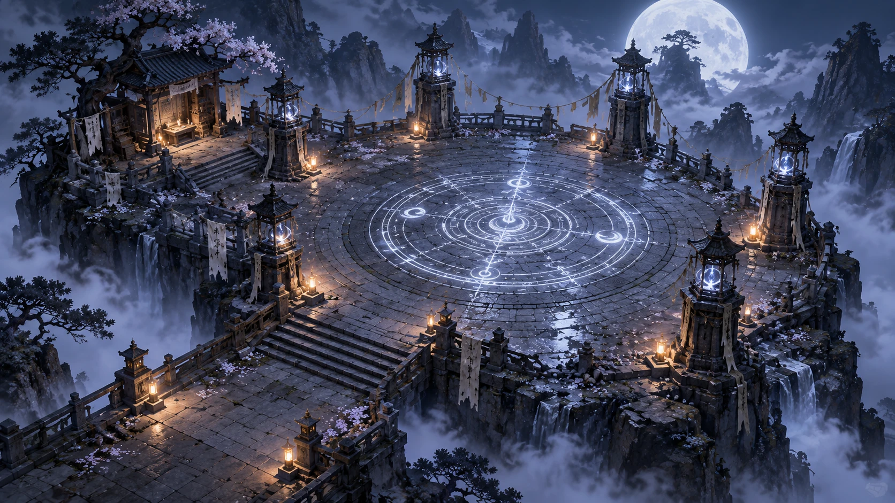
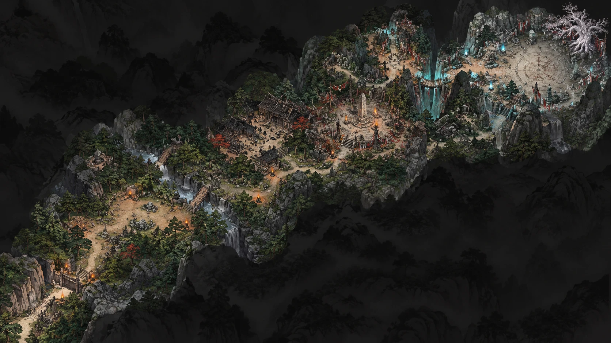
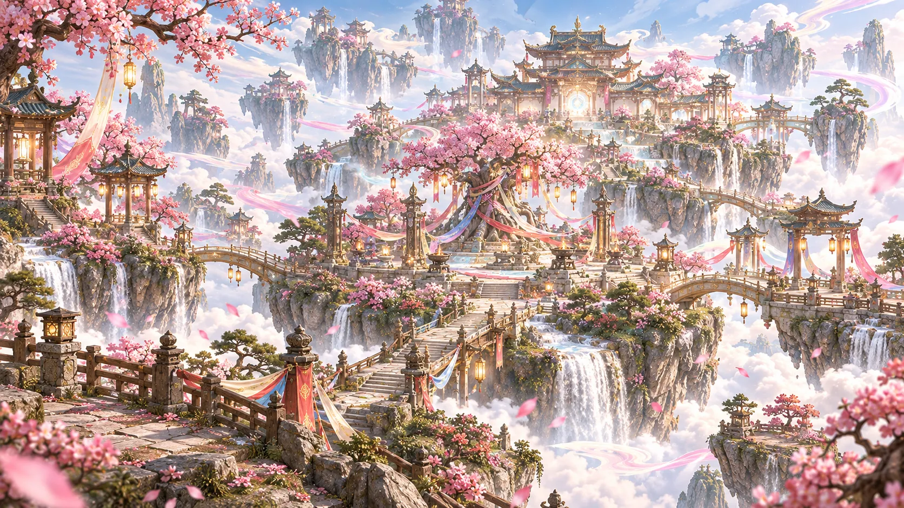
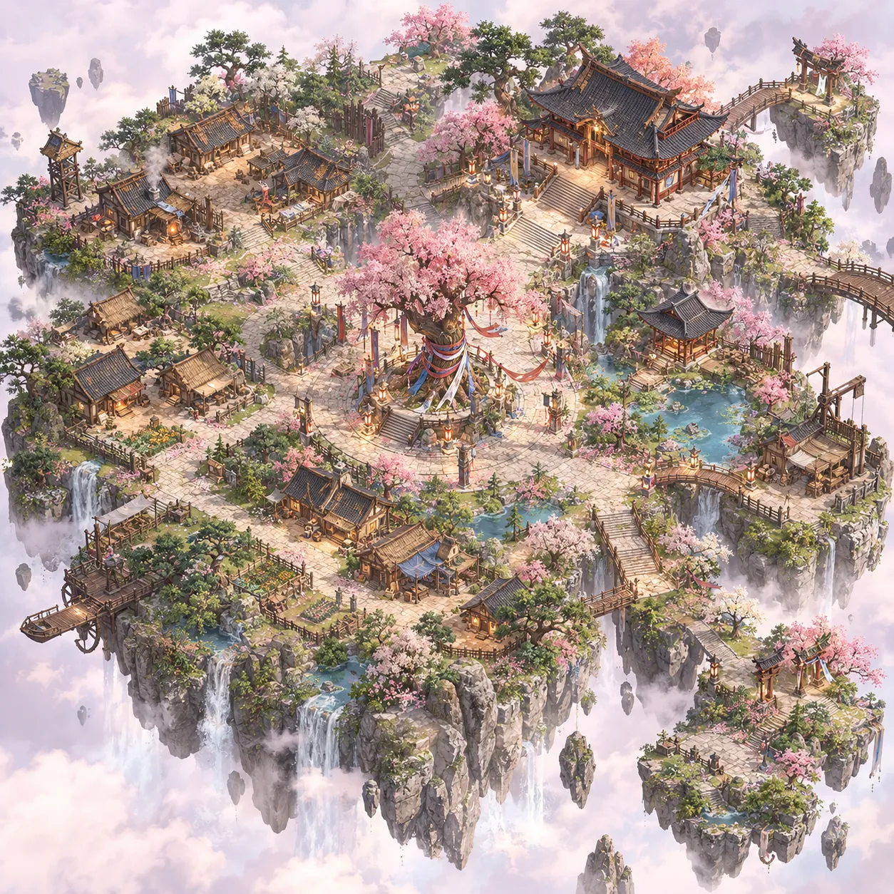
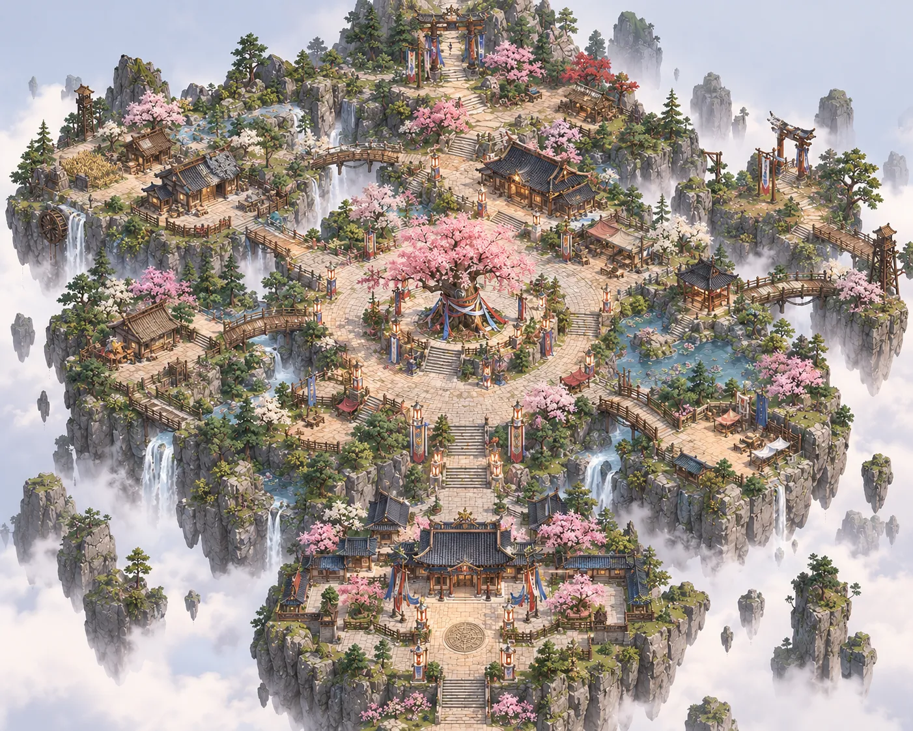

# 신시 — 컨셉아트 기록

> 기준일 2026-10-01 · 사용자 제공 공유 원화의 파일, 대상, 보이는 요소, 기획과의 대조를 기록한다.
> 컨셉아트는 분위기·구성 참고 자료다. 전장 크기·규칙·수치는 [전투·전장 기준안](combat-design.md)이 기준이며, 그림과 다르면 기획 본문을 조용히 바꾸지 않고 아래 대조 절에 적는다.

## 1. 기록 규칙

- 원본 이미지는 `docs/design/references/concept-art/`에 `{대상}-{번호}.{확장자}`로 둔다. 새 버전은 기존 파일을 덮지 않고 번호를 올린다.
- 항목마다 파일, 대상, 받은 날, 출처, 해시, 보이는 요소, 기획 대조, 확인할 질문을 적는다.
- 보이는 요소는 그림에서 실제로 보이는 것만 적는다. 그림에서 새 규칙·패턴·설정을 만들어 확정하지 않는다.
- 작가·제작 도구·라이선스를 모르면 `미확인`으로 적는다. 외부 체험판이나 게임 빌드에 그림 자체를 넣을 때는 [에셋 대장](../licenses/ASSET_REGISTRY.md)의 확인을 먼저 거친다.

## 2. 목록

이 그림을 기반으로 제작할 공용 원본·지역 조립물·캐릭터 후보와 Meshy CLI → Blender 작업 흐름은 [3D 모델 제작 목록](model-production-list.md)에서 확인한다. 제작 수량은 제안이며 아래 기획 대조의 미정 사항을 확정하지 않는다.

CA-05·CA-06을 참고한 배치용 에셋은 [돌바닥 프리팹](../../Assets/02.Prefab/Environment/StoneCourtyard/PF_StoneCourtyardTile.prefab)과 [부유석 프리팹](../../Assets/02.Prefab/Environment/FloatingRock/PF_FloatingRock.prefab)이다. 에디터 프리뷰를 확인했으며 게임플레이·성능·빌드는 미검증이다. 참고 시트로 게임 규칙을 확정하지 않는다.

| ID | 대상 | 파일 | 받은 날 | 상태 |
|---|---|---|---|---|
| CA-01 | 월백 전장 (보스) | [wolbaek-arena-01.webp](references/concept-art/wolbaek-arena-01.webp) | 2026-10-01 | 참고용·출처 미확인 |
| CA-02 | 숲 맵 | [forest-map-01.webp](references/concept-art/forest-map-01.webp) | 2026-10-01 | 참고용·출처 미확인 |
| CA-03 | 신시 마을 (분위기) | [village-01.webp](references/concept-art/village-01.webp) | 2026-10-01 | 참고용·출처 미확인 |
| CA-04 | 신시 마을 (대략적인 배치도) | [village-layout-01.webp](references/concept-art/village-layout-01.webp) | 2026-10-01 | 참고용·출처 미확인 |
| CA-05 | 공용 돌바닥 타일 | [stone-courtyard-tile-01.png](references/concept-art/stone-courtyard-tile-01.png) | 2026-10-01 | 구조 참고·사용자 제공 |
| CA-06 | 부유석 | [floating-rock-01.png](references/concept-art/floating-rock-01.png) | 2026-10-01 | 구조 참고·사용자 제공 |
| CA-07 | 신시 마을 (배치도 2) | [village-layout-02.webp](references/concept-art/village-layout-02.webp) | 2026-10-03 | 참고용·출처 미확인 |

## 3. CA-01 월백 전장

| 항목 | 내용 |
|---|---|
| 파일 | `references/concept-art/wolbaek-arena-01.webp`, 1672×941, WebP |
| SHA-256 | `16dd9590d5b5a529c6d21a56992b6777c8f23156dbadeee5bc4121411fa43d6e` |
| 출처 | 사용자 제공. 작가·제작 도구·라이선스 미확인 |
| 관련 기획 | [월백 1페이즈 실행 보완](combat-design.md#월백-1페이즈-실행-보완), [세계관 8장](world-and-narrative.md#8-월백의-죽음과-남는-갈등), [미술·음향·화면 기본안](experience-service.md#8-미술음향화면-기본안) |

### 보이는 요소

- **시점·시간대:** 높은 곳에서 내려다본 사선 시점. 보름달이 뜬 밤이며 달빛의 차가운 푸른빛과 등불의 따뜻한 주황빛이 대비된다.
- **입지:** 구름 바다 위로 솟은 절벽 꼭대기. 뒤로 뾰족한 바위 봉우리와 소나무가 보이고 절벽 여러 곳에서 폭포가 떨어진다.
- **중앙 광장:** 돌판을 깐 원형 광장. 바닥에 빛나는 동심원 법진이 있고 원 둘레에 초승달·작은 원 문양이 배치되어 있으며 중심을 가로지르는 빛의 선이 있다.
- **외곽:** 기와 지붕을 얹은 돌 기둥 6개가 광장을 둘러싸고 각 기둥 안에 푸른 빛 구슬이 있다. 기둥 사이로 줄에 매단 천 조각이 걸려 있고, 글씨가 적힌 흰 깃발이 기둥과 난간에 늘어져 있다.
- **경계:** 광장 둘레에 돌 난간과 작은 석등. 앞쪽 왼편으로 넓은 계단과 아래 단 평지가 이어진다.
- **부속 공간:** 왼쪽 위에 꽃이 핀 고목 아래 작은 목조 사당이 있고 제단·촛불·깃발이 보인다. 꽃잎이 바닥 곳곳에 흩어져 있다.

### 기획 대조

| 기획 기준 | 그림 | 판단 |
|---|---|---|
| 월백 전장은 지름 36m 원형 | 원형 광장과 둘레 난간 | 형태 일치. 실제 크기는 그림으로 확인할 수 없다 |
| 월백은 스스로 달빛 아래서 이름을 정한 달빛 흰색 여우 영물 | 보름달·푸른 달빛이 주조색 | 분위기 일치 |
| 여우의 흔적으로 찾아 여는 월백 결계 | 법진·깃발·사당이 있는 제의 공간 | 분위기 일치. 결계 입장 연출은 그림에 없다 |
| P03 반경 5m, P05 반경 3m 장판, P06 길이 14m 예고 | 바닥 법진이 이미 빛나고 있음 | 바닥 장식이 공격 예고 표시와 겹쳐 읽힐 수 있다. 가독성 확인 필요 |

### 확인할 질문

- 외곽 돌 기둥 6개가 이동을 막는 장애물인가, 난간 밖 장식인가? 기둥이 전장 안에 있으면 P01 돌진의 "벽 앞 정지"와 P04 투사체 판정에 영향을 준다.
- 앞쪽 계단과 아래 단 평지, 왼쪽 사당이 전투 영역에 포함되는가, 입장 동선·배경인가?
- 바닥 법진이 2페이즈 전환 연출에 쓰이는가? 2페이즈는 담당자 입력 대기이므로 이 문서에서 정하지 않는다.

## 4. CA-02 숲 맵

| 항목 | 내용 |
|---|---|
| 파일 | `references/concept-art/forest-map-01.webp`, 1672×941, WebP |
| SHA-256 | `c0ef6980b6cf3a2f1056d281622eb7106918895439b780a4fe9a9388cc90b606` |
| 출처 | 사용자 제공. 작가·제작 도구·라이선스 미확인 |
| 관련 기획 | [숲 일반전](combat-design.md#숲-일반전), [세계관 7장 지역 추적](world-and-narrative.md#7-토벌대와-지역-추적), [최종 지역 해금 기본안](experience-service.md#최종-지역-해금-기본안) |

### 보이는 요소

- **시점·배경:** 사선 시점의 지도형 그림. 배경은 어두운 수묵풍 산세이고 밝게 칠한 산등성이 하나가 왼쪽 아래에서 오른쪽 위로 길게 이어진다.
- **왼쪽 아래 (입구):** 절벽 사이의 나무 문과 횃불, 문 앞으로 내려가는 돌계단.
- **왼쪽~가운데 (숲길):** 소나무 숲 사이 흙길. 작은 석상·돌무더기·모닥불이 있고 붉은 단풍나무가 섞여 있다. 계류와 폭포가 흐르고 나무다리 두 개가 계류를 건넌다.
- **가운데 위 (건물 군):** 지붕이 낡은 목조 건물 여러 채와 돌담.
- **가운데 (비석 광장):** 높은 돌 비석을 중심으로 한 광장. 붉은 기둥 문, 붉은 깃발, 화로가 둘러싸고 계단이 이어진다.
- **오른쪽 위 (끝 광장):** 푸르게 빛나는 폭포와 다리를 지나면 바닥에 원형 문양을 새긴 밝은 원형 광장이 있다. 오른쪽 끝에 붉은 천을 감은 거대한 흰 고목, 주변에 청록색 불꽃이 켜진 돌 기둥이 있다.

### 기획 대조

| 기획 기준 | 그림 | 판단 |
|---|---|---|
| 숲 일반전은 전멸 후 다음 지점으로 이동하는 진행형 전장(2026-10-08) | 입구에서 끝 광장까지 이어지는 긴 동선과 여러 구역 | 동선형 기획과 방향은 맞지만 구역별 크기·웨이브 지점·출현 위치는 별도 배치 검증 필요. 일반전은 사망 위치 그대로 부활하므로 고정 부활 지점을 배치하지 않음 |
| 별도 방어 대상·마지막 웨이브 보스 없음 | 끝 광장이 보스 전장처럼 연출됨 | 확인 필요. 끝 광장이 일반전 영역인지 연출용인지 정해야 한다 |
| 지역 순서 숲 → 인간 마을 폐허 → 오래된 제단 → 월백 결계 | 목조 건물 군(폐허로 보임), 비석·붉은 문 광장(제단으로 보임), 끝 원형 광장 | 한 그림에 여러 지역이 이어져 보인다. 체험판은 숲 1개만 넣고 폐허·제단은 후속 범위다 |
| 숲 적은 짐승 특징이 강한 산귀, 부적의 흔적을 처음 확인 | 산귀·부적 흔적은 그림에 없음 | 해당 없음 |
| 비적대 NPC 산길지기가 숲의 안전한 길 안내 | 입구의 문과 길 | 배치 위치로 쓸 수 있으나 정하지 않았다 |

### 확인할 질문

- 이 그림은 숲 지역 전체의 지도인가, 숲·폐허·제단·결계를 잇는 월드맵인가?
- [숲 일반전](combat-design.md#숲-일반전)은 2026-10-08 지점 진행형으로 변경됐다. 이 그림에서 각 전투 구역·다음 웨이브 지점·합류 경로의 배치는 미정이며 기존 32m×32m를 전체 맵 크기로 강제하지 않는다.
- 오른쪽 위 원형 광장과 흰 고목은 월백 전장(CA-01)과 같은 장소인가, 다른 장소인가? CA-01은 절벽 위 돌 광장이고 CA-02의 끝 광장은 숲 끝의 흙바닥 광장이라 서로 다르게 보인다.

## 5. CA-03·CA-04 신시 마을

CA-03은 마을의 분위기, CA-04는 대략적인 배치를 보여 준다. 사용자가 두 그림을 같은 마을로 제공했으므로 한 절에 함께 기록한다.

| 항목 | CA-03 분위기 | CA-04 배치도 |
|---|---|---|
| 파일 | `references/concept-art/village-01.webp`, 1672×941, WebP | `references/concept-art/village-layout-01.webp`, 1254×1254, WebP |
| SHA-256 | `3cc26a5aafd83d45e21cfc974287bdfbc2bba0805bef3d2e60554aa15535006c` | `5746c573171db8c3c60923d6f9cb3da31992a0654b79b74931fddefb434eee23` |
| 출처 | 사용자 제공. 작가·제작 도구·라이선스 미확인 | 사용자 제공. 작가·제작 도구·라이선스 미확인 |

관련 기획: [지역·해금·이야기 경험](../02-game-design.md#8-지역해금이야기-경험), [NPC 기능](experience-service.md#7-이야기-진행과-npc-기능), [생활 구역과 행동력](experience-service.md#1-생활-구역과-행동력), [세계관 1장 시대와 공동체](world-and-narrative.md#1-시대와-공동체), 마을 서버 규모는 [기술설계서](../03-technical-design.md).

### CA-03 분위기

- **시간대·색:** 맑은 낮. 분홍 꽃나무, 흰 구름, 금빛 등불이 주조색이고 하늘에 분홍·무지개빛 비단 띠가 흐른다.
- **입지:** 구름 위에 떠 있는 여러 바위섬. 섬마다 폭포가 떨어지고 아치형 다리와 돌계단이 섬들을 잇는다.
- **중심:** 가운데에 비단 띠와 등을 매단 거대한 꽃나무가 있고 둘레에 석등·화로·돌 기둥이 선다.
- **뒤쪽:** 여러 층의 기와 지붕을 얹은 큰 궁궐형 건물군이 있고, 정문 안쪽에 둥글게 빛나는 문이 보인다.
- **앞쪽:** 돌판 길, 나무 난간, 붉은·푸른 깃발, 석등. 여기저기 정자와 문이 흩어져 있다.

### CA-04 배치도

그림 위쪽을 북쪽으로 보고 위치를 적는다.

| 위치 | 보이는 것 |
|---|---|
| 중앙 | 돌판을 깐 원형 광장. 가운데에 비단 띠를 감은 거대한 꽃나무와 네 방향 계단, 둘레에 등과 깃발 기둥. 광장에서 길이 사방으로 뻗는다 |
| 북동 | 높은 단 위의 2층 기와 건물. 계단과 난간이 앞에 있고 마을에서 가장 크다 |
| 북서 | 굴뚝에서 연기가 나고 안쪽이 붉게 빛나는 작업장, 나무 망루, 담장으로 둘린 집들 |
| 서 | 초가·기와 집 여러 채와 꽃밭 |
| 남서 | 물레방아가 달린 나무 선착장과 배, 밭 구획 |
| 남 | 푸른 차양을 친 가게형 건물과 집들, 작은 연못 |
| 동 | 연못과 정자, 우물 도르래 또는 기중기처럼 보이는 나무 틀 구조물 |
| 동쪽 끝·북동쪽 끝 | 섬 밖으로 나가는 나무 다리. 북동쪽 끝 작은 섬에는 붉은 기둥 문이 있다 |
| 남동 | 계단으로 이어진 별도 작은 섬. 붉은 기둥 문 두 개와 꽃나무가 있다 |
| 가장자리 | 섬 둘레로 폭포가 떨어지고 주변에 작은 바위섬들이 떠 있다 |

### 기획 대조

| 기획 기준 | 그림 | 판단 |
|---|---|---|
| 신시는 안전한 서비스 거점, 공유 마을 목표 10~100명 | 넓은 중앙 광장과 사방으로 뻗은 길 | 모이는 장소로는 맞다. 100명이 모였을 때의 넓이·성능은 그림으로 판단할 수 없다 |
| 서비스 NPC: 단군, 정제관 서린, 장인 담우, 의술사 여온, 토벌대 길잡이 가람 | 큰 기와 건물, 연기 나는 작업장, 가게형 건물, 문이 있는 작은 섬 | NPC별 위치는 정하지 않았다. 아래 질문 참고 |
| 생활 채집은 신시 인근 약초밭, 마을 서버가 관리하는 별도 공간/영역, 방 정원 8명·약초 노드 12개 | 마을 안에 밭 구획과 꽃밭 | 마을 안 밭이 채집 구역인지 장식인지 확인 필요 |
| 토벌·보스는 신시에서 출정하는 별도 전장 | 섬 밖으로 나가는 다리와 문 있는 작은 섬들 | 출정 지점으로 쓸 수 있으나 정하지 않았다 |
| 기본 색은 먹색·짙은 녹색 지형 | 분홍 꽃과 밝은 파스텔 하늘이 주조색 | **불일치.** 안전한 마을만 밝게 두는 대비인지, 전체 색 기준을 바꾸는지 정해야 한다 |
| 고조선 건국 신화 초창기, 인간의 나라 완성 전 | 여러 층의 기와 궁궐, 정교한 목조 건물 | 확인 필요. 시대감 기준(건축 양식의 수준)을 문서로 정한 적이 없다 |
| 단군이 풍백·우사·운사와 내려와 세운 공동체 | 중앙의 거대한 꽃나무에 제물 띠를 감음 | 분위기 일치. 이 나무를 신단수 같은 설정물로 삼을지는 정하지 않았다 |

### 확인할 질문

- 북동쪽 큰 기와 건물이 단군의 거처인가? 서린(정제), 담우(제작·강화), 여온(의술·물약), 가람(출정)은 각각 어느 건물을 쓰는가? 북서쪽 붉게 빛나는 작업장은 담우의 대장간 후보로 보인다.
- 출정 지점과 생활 구역 입구는 어느 다리·섬인가? 남동쪽 작은 섬과 북동쪽 끝 섬의 붉은 기둥 문은 각각 무엇인가?
- 중앙 꽃나무는 신단수로 둘 것인가? 세계관 문서에 넣으려면 [세계관·서사](world-and-narrative.md)의 설정 원본과 맞춰야 한다.
- 떠 있는 섬 설정은 세계관에 없는 요소다. 신시가 실제로 하늘에 떠 있는 것인지, 연출상 과장인지 정해야 한다.

## 6. CA-05 공용 돌바닥 타일

| 항목 | 내용 |
|---|---|
| 파일 | `references/concept-art/stone-courtyard-tile-01.png`, 1536×1024, PNG |
| SHA-256 | `c5f2d5a6263be1a32c4db00650e953543050e8032ad419601a3d71b2a1eead87` |
| 출처 | 사용자 제공. 작가·제작 도구·라이선스 미확인 |
| 중복 확인 | 함께 받은 바닥 시트 두 장의 SHA-256이 같아 한 파일로 기록 |
| 관련 제작 | [공용 건축 원본과 Blender 부품](model-production-list.md#3-공용-건축-원본과-blender-부품)의 MOD-04 |

### 보이는 요소와 제작 방향

- 정사각 타일 안에 원형 중심석과 동심원 돌판, 십자 방향 돌길, 네 방향의 마름모 문양석이 있다. 따뜻한 미색 돌과 회색 돌이 섞이고 돌판 틈·균열·모서리 마모가 보인다.
- 정면·사선·근접 컷, 가로 3개와 2×2 반복 배치 예시가 있다. 타일 외곽에도 돌판이 이어지고 사선 컷에는 측면 두께가 보인다.
- 제작 목표는 반복 경계·크기·피벗을 맞춘 바닥 메시와 공용 석재 PBR 재질이다. 표면의 작은 균열·노화·이끼는 실제 크기와 게임 카메라에서 확인한다.
- 시트의 반복 예시는 참고다. 실제 메시·UV·재질의 반복 경계는 제작 후 별도 검증하며, 그림만으로 연결 품질을 검증했다고 하지 않는다.
- 타일의 실제 크기·두께와 전장 배치 수는 그림으로 정하지 않는다. 월백 전장의 이동 영역과 공격 예고 기준은 [전투·전장 기준안](combat-design.md)을 따른다.

## 7. CA-06 부유석

| 항목 | 내용 |
|---|---|
| 파일 | `references/concept-art/floating-rock-01.png`, 1536×1024, PNG |
| SHA-256 | `9a83e82dfcf02d5328d2758c9967dcb7f41d87b90f96fff317ec8f67e76cee52` |
| 출처 | 사용자 제공. 작가·제작 도구·라이선스 미확인 |
| 관련 제작 | [공용 자연물](model-production-list.md#2-공용-자연물)의 NAT-02 절벽 바위 덩어리 파생 후보 |

### 보이는 요소와 제작 방향

- 정면·뒷면·좌우·윗면을 보여 주는 다면 시트다. 넓은 윗면 아래로 암석 기둥이 길게 이어지며 끝으로 갈수록 좁아진다. 바위의 큰 수직 균열·층별 돌출과 주변의 작은 부유 암석이 보인다.
- 상부와 중간 선반에 이끼·풀·작은 돌이 있고 일부 식생이 가장자리 아래로 늘어진다. 석재는 회색과 따뜻한 미색이 섞여 있다.
- 생성 원본의 주 암석과 주변 작은 암석을 재사용할 수 있는지 확인하고, 실루엣·균열·표면 거칠기·이끼 배치와 재질을 다듬는다.
- 이 참고 모델의 제작 요청은 신시 전체의 부유섬 설정이나 플레이어가 밟는 영역을 확정하지 않는다. 실제 크기·배치·충돌 사용 여부는 해당 지역 제작에서 확인한다.

## 8. CA-07 신시 마을 배치도 2

| 항목 | 내용 |
|---|---|
| 파일 | `references/concept-art/village-layout-02.webp`, 1402×1122, WebP |
| SHA-256 | `50b0928cafde4db7b54cea8d68a22dab9e4dd2c81454bd76ede0518946195c2e` |
| 출처 | 사용자 제공. 작가·제작 도구·라이선스 미확인 |
| 배치 씬 | [Dev_ShinshiVillageCA07](../../Assets/00.Scenes/Dev_ShinshiVillageCA07.unity) (CA-04 기반 [Dev_ShinshiVillageQuarterView](../../Assets/00.Scenes/Dev_ShinshiVillageQuarterView.unity)는 보존) |

### 보이는 요소

그림 위쪽을 북쪽으로 보고 적는다. 남쪽에서 비스듬히 내려다본 시점이다.

| 위치 | 보이는 것 |
|---|---|
| 중앙 | 돌판을 깐 원형 광장과 비단 띠를 감은 거대한 꽃나무. 광장 둘레에 깃발과 등 기둥 |
| 남 | 2층 기와 전각과 좌우 부속 건물·모서리 정자로 둘러싼 궁궐 마당. 마당 가운데 원형 문양, 광장에서 내려오는 넓은 계단과 남쪽 끝으로 나가는 계단 |
| 북 | 광장보다 높은 단. 계단으로 올라가 꽃나무·소나무 사이를 지나 가장 높은 언덕의 붉은 기둥 문에 닿는다. 뒤로 바위 봉우리 |
| 북동 | 높은 단 위 큰 기와 건물, 단풍나무 옆 작은 건물, 붉은 차양 가게 |
| 북서 | 초가·목조 농가, 밀밭, 망루, 작은 연못. 서쪽 절벽 끝 물레방아와 폭포 |
| 서·남서 | 개울 협곡 건너 집 한 채와 가게. 개울은 남서쪽 절벽으로 폭포가 되어 떨어진다 |
| 동 | 연꽃과 징검돌이 있는 연못, 육각 정자. 다리로 이어진 바깥 섬에 망루 |
| 동북 바깥 섬 | 붉은 기둥 문과 깃발. 나무 데크 길이 망루 섬으로 이어진다 |
| 남동 | 붉은 차양·흰 천막 가게가 모인 시장, 연못에서 나온 물이 절벽으로 떨어진다 |
| 가장자리 | 섬 전체가 구름 위에 떠 있고 사방에 소나무를 얹은 바위 기둥이 떠 있다 |

### 기획 대조

| 기획 기준 | 그림 | 판단 |
|---|---|---|
| CA-04 배치(큰 건물 북동, 출정 섬 남동) | 큰 전각이 남쪽, 붉은 문 언덕이 북쪽 | **다르다.** CA-04를 대체하는 배치인지 함께 쓰는지 정해야 한다 |
| 서비스 NPC 위치 미정 | 궁궐·북동 건물·농가·시장이 구역으로 나뉨 | NPC별 건물은 정하지 않았다 |
| 떠 있는 섬 설정 미정 | 구름 위 섬과 폭포 | CA-03·CA-04와 같은 질문이 남는다 |

### 확인할 질문

- CA-07이 CA-04를 대체하는가? 대체하면 위 CA-04 절의 NPC 위치 질문을 CA-07 기준으로 다시 정한다.
- 북쪽 붉은 기둥 문과 동북 바깥 섬의 붉은 문은 각각 무엇(출정 지점, 생활 구역 입구)인가?

## 9. 공통 미술 방향과 확인할 것

- **현재 기준 — 2026-10-01 최신 사용자 설명:** 게임의 아트 방향은 **실사에 가까운 3D 스타일화 판타지**다. 원화의 큰 형태·비례·실루엣과 판타지 색감을 따르며, 실제 석재의 균열·마모·이끼 분포, 재료별 노멀·거칠기·PBR 반응과 자연광에서 읽히는 디테일을 유지한다. 메시 밀도와 LOD 예산은 화면 크기·성능 검증을 기준으로 정한다.
- **이전 요청 이력 — 2026-10-01:** 실사 판타지 느낌을 목표로 한다는 요청과 이후 3D 스타일화 확인이 있었다. 바닥·부유석 시트는 구조와 배치 참고로 사용하고, 결과물의 재질·조명은 석재의 자연스러운 마모·균열·거칠기, 이끼의 분포와 PBR 표면 반응을 기준으로 다듬는 방향이었다. 시트의 채색 느낌을 최종 재질 목표로 그대로 확정하지 않는다는 당시 기준과 생성·제작 기록은 이력으로 보존한다. 두 설명은 위 최신 통합 기준으로 읽는다.
- 부적·수묵 표현과 전투 가독성 기준은 [미술·음향·화면 기본안](experience-service.md#8-미술음향화면-기본안)에서 유지한다. 아트 방향 정정만으로 캐릭터 비례·전투 판정·건축 시대감 같은 별도 기준을 자동 변경하지 않는다.

- 밝은 마을(CA-03·CA-04)과 어두운 전장(CA-01·CA-02)의 대비를 의도한 것이라면 미술 기본안의 기본 색 문장에 지역별 구분을 적어야 한다.
- 맵 담당은 진욱, 보스 담당은 기웅이다([게임 기획서](../02-game-design.md) 범위 표 기준). 위 질문은 각 담당자가 답한 뒤 이 문서와 관련 기획 본문을 함께 고친다.
