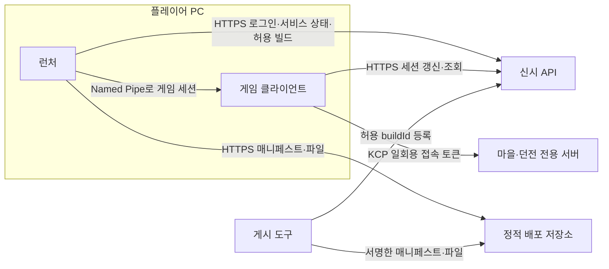

# 런처·패치 설계

> 기준일: 2026-10-02 · 상태: 설계 / 구현 중(Patch.Core, 게시 도구, 업데이트 엔진) · 담당: 민성(런처·패치·게임 세션 연결), 런처 화면 디자인은 착수 때 확정
> 신시 전용 Windows 런처와 게임 패치 배포의 설계다. 그믐 저장소의 런처(WPF, 서명 매니페스트, Named Pipe 세션 전달)를 참고했으며 신시의 전용 서버·공유 마을 구조에 맞게 바꿨다. 코드는 `Launcher/`에 있으며 배포 저장소·서명 키는 아직 없다.

## 1. 목적과 범위

런처는 플레이어 PC에서 **로그인, 게임 설치·업데이트·검증, 공지·점검 안내, 게임 실행**을 맡는다. 게임은 런처가 넘겨준 세션으로만 정식 서버에 접속한다.

| 런처가 한다 | 런처가 하지 않는다 |
|---|---|
| 계정 로그인·자동 로그인·로그아웃 | 파티 구성·방 목록. 신시는 게임 안 공유 마을에서 파티를 만든다 |
| 게임 설치·업데이트·파일 검증·복구 | 게임 규칙·보상 처리 |
| 서버 허용 버전과 설치 버전 비교, 불일치 시 실행 차단 | 게임 서버 주소 선택. 배정은 API가 한다 |
| 공지·점검·서비스 상태 표시 | 결제·상점 |
| 게임 실행과 게임 세션 전달 | 게임 설정(그래픽·키)은 게임 안에서 |
| 런처 자체 업데이트, 문제 보고용 로그 묶기 | |

그믐과 다른 점.

| 항목 | 그믐 | 신시 |
|---|---|---|
| 게임 서버 | 방장 PC 리슨 서버 + 릴레이 | AWS 전용 서버(마을·던전 인스턴스) |
| 파티·방 | 런처와 게임 로비 | 게임 안 공유 마을 |
| 계정 가입 | Discord 봇 링크 | 홈페이지 공개 가입, 아이디·비밀번호 로그인([계정·홈페이지](account-and-website.md)) |
| API | Python | ASP.NET Core(.NET 10). 런처와 DTO 계약 공유 가능 |
| 공지·점검 | 해당 없음 | 어드민에서 설정([운영 도구](operations-admin.md) 3.3) |

## 2. 구성



| 구성 요소 | 책임 | 위치(예정) |
|---|---|---|
| `Launcher.UI` | WPF 화면, 설정, 실행 | `Launcher/src/Shinshi.Launcher.UI/` (예정) |
| `Launcher.Account` | 로그인·토큰 보관·게임 세션 발급·전달 | `Launcher/src/Shinshi.Launcher.Account/` (예정) |
| `Patch.Core` | 매니페스트 형식·해시·서명 검증·경로 검사 | `Launcher/src/Shinshi.Patch.Core/` (게시 도구와 공유) |
| `Patch.Client` | 다운로드·설치 배치·활성 버전 전환·복구 | `Launcher/src/Shinshi.Patch.Client/` |
| `Release.Packager` | Unity 빌드 → 매니페스트·서명 → 게시 폴더·채널 갱신(업로드는 저장소 결정 뒤) | `Launcher/src/Shinshi.Release.Packager/` |
| 빌드 신원 DTO | `build-identity.json` 형식, 게임·런처·게시 도구 공용 | `Assets/01.Scripts/00.Common/Contracts/Common/BuildIdentity.cs` |
| 게임 쪽 수신기 | 파이프에서 세션을 받아 API·서버 인증에 사용 | `Assets/01.Scripts/01.Network/Session/` (민성, 예정) |
| 테스트 | 매니페스트·서명·경로·세션 전달 단위 시험 | `Launcher/tests/Shinshi.Launcher.Tests/` |

솔루션은 `Launcher/Shinshi.Launcher.slnx`이고 백엔드와 같은 .NET 10 설정을 쓴다. 서명은 Ed25519(BouncyCastle.Cryptography)이며, JSON 정규화 없이 payload 원본 바이트에 `shinshi.patch.{kind}.v1` 접두를 붙여 서명한다. 게시 폴더는 콘텐츠 주소 배치(`{product}/blobs/{sha 앞 2자}/{sha}`, `{product}/releases/{releaseId}/manifest.json`, `{product}/channels/{채널}.json`)다.

기술 초기안은 **.NET 10 WPF, Windows x64**다. 백엔드와 같은 .NET이라 요청·응답 DTO를 공유 프로젝트로 둘 수 있다. Unity 게임과는 DTO를 DLL로 공유하지 않고 계약 테스트로 맞춘다([아키텍처](../04-architecture.md) 8장).

## 3. 로그인과 게임 세션 전달

1. **첫 로그인**: 아이디·비밀번호 → `POST /v1/auth/exchange`(설치 빌드 포함) → 접근 토큰(15분)·회전 갱신 토큰(24시간). 계정은 홈페이지에서 만든다([계정·홈페이지](account-and-website.md)). 운영자 복구 코드는 런처가 아니라 홈페이지 복구 화면에서 쓴다.
2. **자동 로그인**: 사용자가 선택하면 갱신 토큰만 `%LOCALAPPDATA%\Shinshi\Account`에 Windows DPAPI(CurrentUser)로 암호화해 저장한다. 접근 토큰·초대 코드는 파일에 쓰지 않는다. 갱신은 직렬화하고, 응답을 잃으면 이전 토큰을 재전송하지 않고 재로그인을 요구한다.
3. **게임 시작**: 런처가 API에서 **게임 세션**(게임 전용, 짧은 수명, 런처 세션의 하위)을 발급받는다. 로그인하지 않았거나 버전 검사(5장)를 통과하지 못하면 시작 버튼을 막는다.
4. **전달**: 런처가 무작위 이름의 Named Pipe를 열고 게임을 `-launcher-pipe <이름> -launcher-pid <PID>` 인자로 실행한다. 게임은 파이프에 연결하고 양쪽이 서로의 프로세스 ID를 확인한 뒤 세션을 한 번 받고 수신 확인을 보낸다. 같은 Windows 사용자 제한, 1회 전달, 120초 제한을 적용한다. **토큰은 실행 인자·환경 변수·로그에 넣지 않는다.**
5. **게임 안**: 게임은 받은 세션을 메모리에만 두고 만료 전에 갱신한다. 서버 접속은 기존 계약대로 API에서 일회용 접속 토큰(60초)을 받아 `NetworkAuthenticator`로 교환한다. 장기 토큰을 Mirror 메시지에 넣지 않는다.
6. **갱신 시점**: 서버는 갱신 토큰을 회전할 때 그 아래 게임 세션을 모두 폐기한다. 그래서 런처는 백그라운드로 갱신하지 않고 게임 시작, 자동 로그인처럼 필요할 때만 갱신하며, 게임이 실행 중이면 갱신하지 않는다. 게임은 받은 게임 세션을 `POST /v1/auth/game-session/refresh`로 15분 안에 스스로 회전한다.
7. **런처 종료**: 로그아웃이 아니다. 게임은 계속 실행된다. 런처에서 로그아웃하면 하위 게임 세션도 폐기되고 게임은 다음 갱신 때 연결을 정리하고 재로그인을 안내한다.

전달에 실패하면 런처는 자신이 실행한 게임을 종료하고 발급한 게임 세션 폐기를 시도한다. 같은 사용자 권한으로 도는 악성 프로그램이나 관리자 권한까지 막는 보안 경계는 아니며, 토큰 수명과 1회성으로 피해 범위를 줄인다.

**런처 없이 실행**: Release 빌드는 파이프 세션이 없으면 정식 서버 로그인을 막고 "런처로 실행하세요"를 표시한다. 에디터와 개발 빌드는 개발용 로그인 경로를 쓰되 외부 체험판 빌드에서 제거한다([기술설계서](../03-technical-design.md) 13장 진단 규칙과 같다).

## 4. 패치

### 4.1 빌드 신원

Unity 빌드마다 `StreamingAssets/build-identity.json`을 만든다.

| 필드 | 뜻 |
|---|---|
| `buildId` | 빌드마다 유일한 ID. 로그·거절 응답에 쓰는 값과 같다([기술설계서](../03-technical-design.md) 10장 버전 호환) |
| `protocolVersion`, `contentHash` | 서버와 **완전히 같아야** 접속되는 값 |
| `displayVersion` | 화면 표시용(`bundleVersion`) |
| `buildKind` | `Development` / `Release` |
| `createdAtUtc`, `commit` | 추적용 |

### 4.2 매니페스트와 서명

- 게시 도구가 빌드 폴더의 모든 파일에 대해 상대 경로·크기·SHA-256을 적은 **릴리스 매니페스트**를 만든다. `releaseId`, `buildId`, 채널, 최소 런처 버전을 함께 적는다.
- 매니페스트는 Ed25519로 서명한다. 공개키는 런처에 내장하고 개인키는 게시 담당자의 비밀 저장소에만 둔다(저장소·문서·로그에 넣지 않음).
- **채널 포인터**(`channels/{채널}.json`)는 현재 `releaseId`와 단조 증가하는 `sequence`를 담고 역시 서명한다. 런처는 이미 본 것보다 낮은 `sequence`를 거절한다(되돌리기 공격 방지). 의도한 롤백은 이전 릴리스를 새 `sequence`로 다시 게시한다.
- 매니페스트 경로는 상대 경로만 허용한다. `..`, 절대 경로, 드라이브 문자, 예약 이름, 설치 폴더 밖을 가리키는 경로는 매니페스트 전체를 거절한다.

### 4.3 설치 배치

```text
%LOCALAPPDATA%\Shinshi\
  launcher\                런처 본체(자체 업데이트 대상)
  game\
    versions\{releaseId}\  완성·검증된 게임 폴더
    current.json           활성 releaseId 포인터
    staging\               다운로드 중 임시 파일
  logs\                    런처 로그(토큰 제외)
  Account\                 DPAPI로 암호화한 갱신 토큰
```

관리자 권한 없이 설치한다. 게임 설정·로컬 설정 파일은 버전 폴더 밖(Unity 기본 사용자 경로)에 있어 업데이트·복구·롤백에서 지우지 않는다.

### 4.4 업데이트 절차

1. 채널 포인터와 매니페스트를 받아 서명·`sequence`를 검증한다.
2. 현재 활성 버전의 파일 해시와 비교해 **바뀐 파일만** 받는다. 바뀌지 않은 파일은 활성 폴더에서 새 버전 폴더로 복사한다. 파일 내부 바이너리 차분은 초기 범위가 아니다.
3. 필요한 디스크 공간(새 버전 크기 + 여유 10%)을 먼저 확인한다.
4. 받은 파일은 `staging`에서 해시를 확인한 뒤 새 버전 폴더로 옮긴다. 해시 실패는 파일당 3회 재시도하고 그래도 실패하면 업데이트를 중단한다.
5. 새 버전 폴더 전체를 검증한 뒤 `current.json`을 원자적으로 교체한다. **교체 전 어떤 실패에서도 기존 설치는 그대로 실행 가능해야 한다.**
6. 직전 버전 폴더 하나는 롤백용으로 남기고 그보다 오래된 것은 지운다.
7. 게임이 실행 중이면 업데이트를 시작하지 않는다.

**파일 검증·복구**: 사용자가 누르면 활성 버전 전체를 매니페스트와 비교하고 다른 파일만 다시 받는다.

### 4.5 런처 자체 업데이트

런처 매니페스트와 채널을 게임과 **따로** 둔다. 새 런처는 옆 폴더에 받아 검증한 뒤 작은 교체 단계에서 바꾸고 재시작한다. 게임 매니페스트의 `최소 런처 버전`보다 낮으면 게임 업데이트 전에 런처부터 갱신한다.

### 4.6 채널

| 채널 | 대상 | 받는 빌드 |
|---|---|---|
| `internal` | 팀원 | 개발 빌드 허용 |
| `stable` | 외부 체험자 | Release 빌드만. 게시 도구가 개발 빌드 표식(디버거 연결 설정, 개발 전용 기능)을 발견하면 게시를 거부 |

채널 선택은 팀원 설정 화면에만 보인다. 외부 빌드의 런처는 `stable`만 쓴다.

## 5. 서버 버전과의 맞춤

[기술설계서](../03-technical-design.md) 10장 규칙대로 클라이언트와 게임 서버의 `protocolVersion`·`contentHash`는 완전히 같아야 한다. 그래서 게임 파일 게시만으로는 배포가 끝나지 않는다.

1. 새 서버 빌드를 배포하되 기존 인스턴스는 드레인(신규 배정 중지 → 진행 세션 종료)한다.
2. API의 허용 `buildId` 목록에 새 빌드를 추가한다(어드민 서비스 상태, [운영 도구](operations-admin.md) 3.3).
3. 채널 포인터를 새 릴리스로 올린다. 런처는 다음 확인 때 업데이트를 받는다.
4. 이전 빌드의 진행 세션이 모두 끝나면 허용 목록에서 이전 `buildId`를 뺀다.

런처는 게임 시작 전에 `GET /v1/service-state`로 점검 여부·공지·허용 빌드를 받는다. 설치 `buildId`가 허용 목록에 없으면 업데이트를 안내하고 실행을 막는다. API가 응답하지 않으면 실행을 막고 이유를 표시한다(오프라인 플레이 없음).

## 6. 화면

| 화면 | 내용 |
|---|---|
| 메인 | 공지·점검 배너, 설치/업데이트/시작 버튼(상태에 따라 하나), 진행률·속도·남은 크기, 로그인 상태 |
| 로그인 | 아이디·비밀번호 입력, 자동 로그인 선택, 회원가입 링크(홈페이지). 계정 복구는 홈페이지 복구 화면 안내 |
| 설정 | 설치 위치 표시, 파일 검증, 로그 폴더 열기, 문제 보고용 로그 묶기, (팀원만) 채널 |
| 오류 | 원인·재시도·다음 행동. 예: 해시 실패, 디스크 부족, 버전 불일치, 점검 중, API 연결 실패 |

**문제 보고용 로그 묶기**: 런처 로그와 게임의 `Player.log`·크래시 덤프를 zip으로 묶어 폴더를 연다. 자동 업로드는 하지 않는다(개인정보 확인 전). 묶기 전에 토큰·초대 코드가 로그에 없다는 규칙을 다시 검사한다.

## 7. 배포 저장소와 첫 설치

| 항목 | 초기안 | 상태 |
|---|---|---|
| 정적 배포 저장소 | 1단계 개인 로컬 폴더(`FileSystemPatchSource`) -> 2단계 NAS. 외부 체험자가 받으려면 NAS를 HTTPS로 열어 `HttpPatchSource`로 읽는다(SMB 공유는 팀 내부용) | 방향 결정(2026-10-02), NAS 공개 방식 미정 |
| 런처 첫 배포 형태 | zip 압축 해제 실행 / 설치 프로그램 | 미정 |
| 런처 코드 서명(Authenticode) | 없으면 외부 체험자에게 Windows SmartScreen 경고가 뜬다. 인증서 비용·발급 기간 확인 필요 | 미정 |
| 서명 키 보관·교체 | 게시 담당자 비밀 저장소, 교체 시 새 공개키를 담은 런처를 먼저 배포 | 절차 초기안 |

## 8. 체험판 범위

런처 전체를 10/15 외부 체험판에 넣으면 민성의 작업량이 크게 늘어난다([로드맵](../05-implementation-roadmap.md) 6장). 2026-10-02 사용자 결정으로 **가. 최소 런처**를 체험판에 넣는다. 검토했던 선택지는 다음과 같다.

| 선택지 | 체험판에 넣을 것 | 영향 |
|---|---|---|
| 가. 최소 런처 | 로그인·자동 로그인, 설치·업데이트(전체 파일 해시 비교), 서명 검증, 버전 차단, 공지, 실행·세션 전달 | 외부 체험자가 업데이트를 자동으로 받음. 작업량 증가 |
| 나. 런처 없이 zip 배포 | 게임 안 초대 코드 로그인([기술설계서](../03-technical-design.md) 14장), 버전 불일치는 게임이 거절·안내 | 업데이트마다 체험자가 새 zip을 받아야 함. 런처는 체험판 뒤 |
| 다. 게시 도구만 먼저 | 매니페스트·서명·게시 도구와 버전 등록을 만들고 런처 화면은 뒤로 | 배포 절차는 자동화되나 체험자는 여전히 수동 설치 |

가안을 골랐으므로 게임의 정식 로그인 입력은 파이프로 받은 게임 세션 하나다. 게임 안 로그인 화면은 두지 않는다.

## 9. 미정 항목

| 항목 | 선택지 | 결정 담당 | 필요 시점 |
|---|---|---|---|
| 체험판 런처 범위 | 8장 가/나/다 → **가. 최소 런처로 결정(2026-10-02)** | 사용자 | 결정됨 |
| NAS 공개 방식 | HTTPS 웹 서버(역방향 프록시, 인증서) / 팀 내부 SMB만 | 민성 | 외부 배포 전 |
| 첫 배포 형태 | zip / 설치 프로그램 | 민성 | U26 |
| 코드 서명 인증서 | 구입 / 체험판은 미서명 + 안내 | 사용자(비용) | 외부 배포 전 |
| 같은 PC 여러 계정 동시 실행 | 허용(개발만) / 금지 | 민성 | U26 |

## 10. 검증 기준

| 수준 | 확인 |
|---|---|
| 단위 | 매니페스트 서명 위조·`sequence` 역행·경로 탈출 거절, 해시 불일치 감지, 파이프 PID 불일치·재전달 거절 |
| 설치 | 깨끗한 PC 첫 설치, 일부 파일 변경 업데이트, 다운로드 중단 후 재시작, 디스크 부족, 파일 손상 복구, 롤백 게시 |
| 연동 | 설치 `buildId`가 허용 목록에 없을 때 실행 차단, 점검 중 차단, 로그아웃 시 게임 세션 폐기 감지 |
| 실행 | 런처 → 게임 세션 전달 → 마을 입장 → 던전 출정을 서버 1 + 클라이언트 2로(M2), 외부 PC에서(M3) |
| 보안 | 실행 인자·로그·덤프 묶음에 토큰·초대 코드 없음 |

문서 작성만으로 위 항목을 검증 완료로 보지 않는다.
